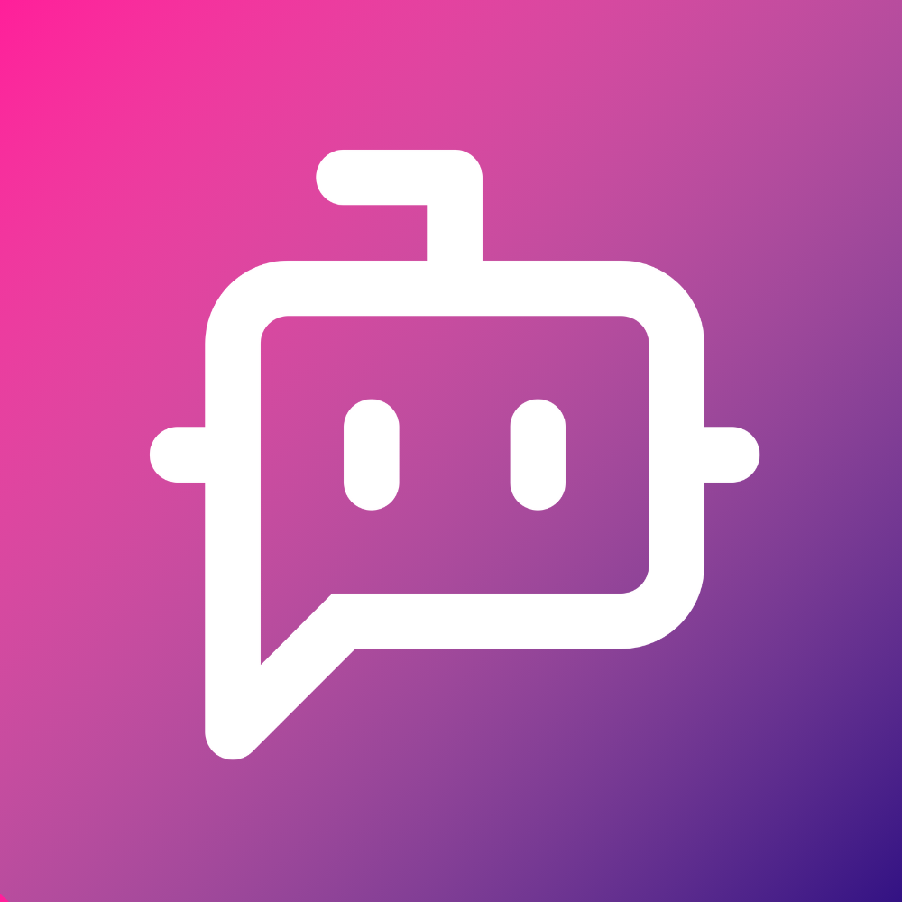

<p align="center">
  
</p>

# schorn.ai

**Your AI workspace. Your infrastructure. Your choice of models.**

schorn.ai brings AI agents, document search, and audio transcription into one
self-hosted workspace. Run models locally, connect external providers when you
need them, and give your team access through a shared web interface.

[User guide (Deutsch)](docs/de/index.md) ·
[Development](docs/development.md) ·
[Contributing](CONTRIBUTING.md) ·
[AGPL-3.0](LICENSE)

## What you can do

- **Build agents for your work.** Configure roles, instructions, models, document
  access, and tools, including approvals before tool execution.
- **Work with your documents.** Organize files in shared repositories, extract
  their content, and make it searchable for agents.
- **Transcribe and edit recordings.** Turn audio and video into editable
  transcripts with local MLX Whisper on Apple Silicon.
- **Choose your models.** Use Ollama locally or configure external providers such
  as OpenAI, Anthropic, Google, Mistral, and OpenAI-compatible endpoints.
- **Connect tools.** Give agents controlled web access and MCP integrations,
  including per-user OAuth connections where supported. Expose schorn.ai through
  [platform MCP access](docs/de/agent/edit/plattformzugriff.md) with four access levels.
- **Share a workspace.** Manage users, permissions, and SSO, with synchronized
  chats and background work across connected machines.

Local inference can keep model processing on your infrastructure. External model
providers, web tools, and connected services receive the data needed for their
configured operations. See [data and sharing](docs/de/hilfe/daten-und-freigaben.md).

## Get started

### Run your own instance

Start with the [installation guide](docs/de/cli/index.md) and
[operator handbook](docs/de/box-admin/index.md). They cover prerequisites,
credentials, TLS, models, backups, and updates.

The machine service supports **macOS on Apple Silicon** and **Linux ARM64/x64**.
MLX transcription requires Apple Silicon. Setup bundles are platform-specific;
check the CLI guide for the platform currently served by the automatic download.
Models, mail delivery, and public domain configuration are separate setup steps.

### Develop from source

You need **Node.js 24+**, npm, and Python 3 to run the tests:

```sh
git clone https://github.com/schornai/schornai.git
cd schornai
npm ci
npm test
```

For UI work, run `npm run storybook:web` and open `http://localhost:6006`.
Tests and Storybook use fixtures and need no API keys or running AI services.

To run the complete app, follow the [development guide](docs/development.md)
for Docker, Supabase, private configuration, certificates, and optional models.
Once configured, `npm run dev:service` starts the development services.

## Find your way around

| I want to…                                  | Start here                                                         |
| ------------------------------------------- | ------------------------------------------------------------------ |
| Use agents, documents, and transcription    | [User documentation (Deutsch)](docs/de/index.md)                   |
| Set up a source checkout or local demo data | [Development](docs/development.md)                                 |
| Run tests and work with UI stories          | [Testing and Storybook](docs/testing.md)                           |
| Find the code behind a feature              | [Repository map](docs/architecture.md) and [glossary](GLOSSARY.md) |
| Install, operate, or update an instance     | [Operator handbook (Deutsch)](docs/de/box-admin/index.md)          |
| Use or build the command-line tool          | [CLI](apps/cli/README.md)                                          |

The repository is an npm-workspaces monorepo: Next.js/React for the web app,
Hocuspocus/Yjs for synchronization, Supabase for authentication, data, and storage,
and separate workers for model execution, document processing, and transcription.
The [repository map](docs/architecture.md) connects each area to its entry points
and tests.

## Contribute and get help

Bug reports, documentation improvements, and focused pull requests are welcome.
Read [CONTRIBUTING.md](CONTRIBUTING.md) to get started. English and German are
both welcome in [issues](https://github.com/schornai/schornai/issues).

For suspected vulnerabilities, use the private contact in
[SECURITY.md](SECURITY.md).

## License

Copyright © schorn.ai contributors.

Original project code is licensed under the **GNU Affero General Public License,
version 3 only** ([AGPL-3.0-only](LICENSE)). You may use, modify, and redistribute
it under those terms. If you run a modified version for users over a network,
section 13 requires offering those users its corresponding source code. The
software is provided without warranty.

Third-party code and dependencies retain their respective licenses. Model weights
and external services have their own licenses and terms. See the full [license
text](LICENSE) for the terms that apply to this project.

The local development seed includes a demo agent with calculator and chat support (automatic titles, reply suggestions and current time), automatic user/editor tools, workspace-admin approval, and global-admin tools disabled
so the tool tab and read access can be tried without granting administrative tools.
See [development setup](docs/development.md) for the local-only seed reset workflow.
