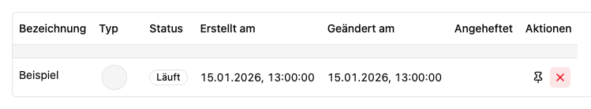

# Verlauf: Chats und Transkriptionen wiederfinden

Der **Verlauf** führt deine bisherigen Chats und Transkriptionen auf. Du erreichst ihn über die Seitenleiste; dort erscheinen ebenfalls aktuelle und angeheftete Aktivitäten.

## Aktivität öffnen und finden

1. Öffne **Verlauf**.
2. Suche nach der Bezeichnung der Aktivität.
3. Wähle den Eintrag, um den Chat oder die Dateien der Transkription wieder zu öffnen.

Über **Optionen** kannst du zwischen Liste und Tabelle wechseln, nach Bezeichnung oder Zeit sortieren und nach angeheftetem Zustand, Status, Typ oder Datum gruppieren. Mit **Ansicht speichern** merkst du dir die Auswahl.

## Status verstehen

| Anzeige     | Bedeutung                                                                     |
| ----------- | ----------------------------------------------------------------------------- |
| **Wartend** | Die Aktivität ist derzeit nicht in laufender Verarbeitung.                    |
| **Läuft**   | Eine Verarbeitung läuft.                                                      |
| **Erfolg**  | Die zuletzt gemeldete Verarbeitung war erfolgreich.                           |
| **Fehler**  | Eine Verarbeitung ist fehlgeschlagen; öffne den Eintrag für den Zusammenhang. |

## Anheften und lösen

Wähle **Anheften** am Eintrag, damit du ihn schneller wiederfindest. **Lösen** entfernt nur diese Markierung. Das Anheften einer Aktivität ist etwas anderes als ein Favorit für den zugehörigen Agenten oder Transkriptor.

## Aus dem Verlauf löschen

Mit **Löschen** entfernst du den Verlaufseintrag sofort, ohne Bestätigungsdialog. Kopiere benötigte Antworten oder lade Dateien vorher herunter.

Gesprächs- und Dateidaten bleiben gespeichert; laufende Verarbeitung wird fortgesetzt. Verwende vorher im Chat **Abbrechen**, um eine Generierung zu stoppen. Bei gemeinsam verwendeten Aktivitäten wird der Eintrag auch aus den Verläufen der anderen berechtigten Personen entfernt. Für das Bereinigen der gespeicherten Gesprächsdaten wende dich an die Betriebsadministration.

Verlaufseinträge lassen sich nur einzeln entfernen; eine automatische Löschfrist ist nicht einstellbar.

## Zugehörige MCP-Werkzeuge

- `platform_activities_list`: Eigenen Verlauf lesen. Mindeststufe: **Benutzer**.
- `platform_activity_create`: Chat- oder Transkriptionsaktivität anlegen. Mindeststufe: **Benutzer**.
- `platform_activity_update`: Aktivität umbenennen oder anheften. Mindeststufe: **Benutzer**.
- `platform_activity_delete`: Aktivität aus dem Verlauf entfernen. Mindeststufe: **Benutzer**.

Jeder Aufruf prüft zusätzlich die Berechtigung für das eigene Konto bzw. die betroffene Ressource. Die Zugriffsstufe verleiht keine Rechte. Voraussetzungen, besondere Grenzen und der vollständige Werkzeugkatalog stehen unter [Plattformzugriff](../agent/edit/plattformzugriff.md).
