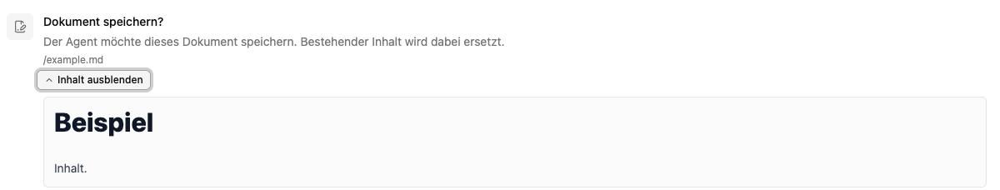
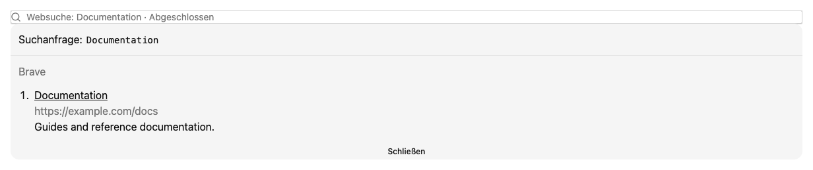

# Werkzeugaktionen prüfen und freigeben

Ein Agent kann Werkzeuge einsetzen, um Dateien zu lesen oder zu schreiben, im Web zu suchen oder eine Seite abzurufen. Wenn die Konfiguration eine Bestätigung verlangt, wartet er auf deine Entscheidung.

## Eine Rückfrage beantworten

1. Lies die angezeigte Aktion und kontrolliere Ziel, URL oder Suchanfrage.
2. Prüfe bei einer Datei den Pfad und über **Inhalt anzeigen** den vorgesehenen Text.
3. Wähle **Erlauben**, wenn genau diese Aktion ausgeführt werden soll, oder **Ablehnen**.
4. Warte, bis die Entscheidung verarbeitet wurde und der Chat weiterläuft.

## Dokument speichern

Bei **Dokument speichern?** kann ein bestehender Inhalt ersetzt werden. Prüfe deshalb nicht nur den Text, sondern auch den Zielpfad. Eine gemeinsame Dokumentenablage ist ein anderer Speicherort als die Dateien dieses Chats. Ein leerer Inhalt kann eine leere Datei erzeugen oder vorhandenen Inhalt ersetzen.

## Dateien kopieren oder verschieben

Die Freigabe zeigt Quelle und Ziel. Prüfe beide Pfade: **Verschieben** entfernt die Quelle nach erfolgreicher Übertragung, **Kopieren** behält sie. Vorhandene Zieldateien werden nicht überschrieben. Eine Verschiebung kann wegen der Schreibregel der Quelle oder des Ziels eine Freigabe verlangen.

Die Ergebniskarte unterscheidet die übertragene Datei von der noch laufenden Indexierung. Scheitert das Einreihen, ist die Datei trotzdem bereits am Ziel. Bei einem Teilfehler, etwa beim Entfernen der Quelle, prüfe beide Speicherorte und starte den Transfer nicht unbesehen erneut. Die allgemeinen [Dateiaktionen](../../app/documents/files.md) bieten eine erneute Verarbeitung am Ziel an.

## Webzugriffe

**Webseite abrufen** lädt die angegebene URL herunter, speichert sie und verarbeitet sie. **Web durchsuchen** sendet die angezeigte Suchanfrage an den konfigurierten Suchanbieter. Eine Freigabe für die Suche ist nicht automatisch eine Freigabe für einen späteren Abruf.

Werkzeugkarten können **Wird ausgeführt**, **Wartet auf Freigabe**, **Abgelehnt**, **Abgeschlossen** oder einen Fehler anzeigen. Öffne bei Bedarf die Details und Quellen. Für den vollständigen Inhalt einer Fundstelle bitte den Agenten, die verlinkte Seite abzurufen.

Bei Fetch kann der Download erfolgreich sein, während die Textverarbeitung scheitert oder kein Transkriptor für Audio/Video konfiguriert ist. **Datei gespeichert** und **Text für den Agenten verfügbar** sind daher unterschiedliche Ergebnisse.

## Wenn eine Entscheidung nicht gesendet werden konnte

Verwende **Erneut versuchen**, wenn die Oberfläche diesen Fehler anzeigt. Wiederhole nicht unbesehen die gesamte Aufgabe, wenn eine Schreibaktion möglicherweise schon ausgeführt wurde. Kontrolliere zuerst den Zielinhalt.

Die einzelne Freigabe ändert keine Arbeitsplatzrechte. Bei automatisch erlaubten Werkzeugen kann eine Rückfrage entfallen; die [Agentenkonfiguration](../edit/rollen.md) legt dies fest.
