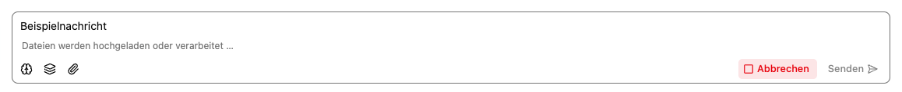

# Mit einem Agenten chatten

Starte einen Chat über **Neuer Chat** am Agenten. Vorhandene Gespräche öffnest du über den [Verlauf](../../activity/index.md).

## Nachricht senden

1. Beschreibe dein Ziel im Feld **Nachricht…**. Nenne relevante Daten und das gewünschte Format.
2. Hänge bei Bedarf [Dateien](dateien.md) an.
3. Warte, bis Uploads und Dateiverarbeitung abgeschlossen sind.
4. Wähle **Senden** oder drücke `Enter`. Mit `Shift` + `Enter` fügst du einen Zeilenumbruch ein.
5. Warte auf die Antwort. Wenn eine Werkzeugaktion freigegeben werden muss, erscheint stattdessen eine [Rückfrage](freigaben.md).

Frage konkret nach, wenn dir eine Antwort unklar ist. Beispiel: „Welche Aussagen stammen aus der Datei? Nenne die passende Fundstelle und kennzeichne Vermutungen.“

Beim Senden wartet der Server pro Synchronisationsschritt höchstens 30 Sekunden
auf den Realtime-Dienst. Eine abgelehnte Anmeldung oder eine geschlossene Verbindung
beendet das Warten früher mit einem Fehler. Prüfe bei einem Sendefehler den
Gesprächsverlauf, bevor du die Nachricht erneut sendest.

## Antwort lesen und weiterverwenden

Während der Antwort zeigt der Chat auch Nachdenkabschnitte und Werkzeugergebnisse. Warte nach einer Websuche oder einem Dateiabruf auf den abschließenden Antworttext.

Über **Nachricht kopieren** kopierst du den Text einer Antwort in die Zwischenablage. Wenn Nutzungsdaten verfügbar sind, zeigt **Statistik** Eingabe- und Ausgabe-Tokens sowie die Ausgabegeschwindigkeit. Ein Token entspricht je nach Text einem Wort, Wortteil oder Satzzeichen.

## Nachdenken und Abbrechen

Das Gehirnsymbol schaltet die gewünschte Nachdenken-Option für die Nachricht um. Ob sie wirkt, hängt von Modell und [verpflichtenden Einstellungen](../edit/einstellungen.md) ab.

Während der Generierung kannst du **Abbrechen** wählen. Bereits ausgeführte Werkzeugaktionen werden dadurch nicht rückgängig gemacht. Eine Pause des [Nachrichtenstapels](stapel.md) hält dagegen die noch wartenden Nachrichten zurück.

## Reiter im Gespräch

- **Chat:** Nachrichten und Antworten.
- **Dateien:** die Dateien dieses Gesprächs.
- **Info:** die aktuelle Agentenkonfiguration und Dokumentation.

Bei ausbleibender Antwort prüfe zuerst offene Werkzeugfreigaben und folge den [Hinweisen zur Fehlerbehebung](../../hilfe/fehlerbehebung.md).
