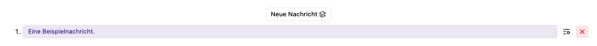

# Mehrere Nachrichten als Stapel verarbeiten

Der **Nachrichtenstapel** hilft dir, mehrere Aufgaben in einem Gespräch vorzubereiten. Die Nachrichten werden nacheinander verarbeitet. Spätere Nachrichten können sich auf frühere Antworten in diesem Chat beziehen. Starte für unabhängige Aufgaben separate Chats.

## Einen Stapel vorbereiten

1. Öffne den **Nachrichtenstapel** über das Stapelsymbol an der Eingabe.
2. Wähle **Neue Nachricht** für jeden weiteren Eintrag.
3. Wähle einen Eintrag und bearbeite seinen Text, gegebenenfalls seine Anhänge und Nachdenken-Option.
4. Prüfe die Nummerierung. Die Darstellung zeigt neue Einträge oben; die Nummer hilft dir, die vorgesehene Reihenfolge zu erkennen.
5. Warte auf die Verarbeitung aller angehängten Dateien.
6. Bei mehreren vorbereiteten Nachrichten wähle **Stapelverarbeitung starten**.

Beispiel: erst eine Zusammenfassung erstellen lassen, dann aus dem Ergebnis offene Fragen sammeln und anschließend einen Maßnahmenentwurf formulieren lassen.

## Steuern und anhalten

**Pausieren** hält die wartenden Nachrichten zurück. Während einer laufenden Verarbeitung kannst du einzelne wartende Einträge zwischen wartend und pausiert umschalten. Die bereits laufende Generierung stoppst du getrennt über **Abbrechen**.

Das X an einem Stapeleintrag entfernt diesen vorbereiteten Eintrag. Die Oberfläche bietet hier keine Drag-and-drop-Umsortierung. Kontrolliere deshalb die Reihenfolge vor dem Start.

Mit **Senden** startest du den nächsten vorgesehenen Schritt. Verwende **Stapelverarbeitung starten**, um mehrere vorbereitete Nachrichten nacheinander abzuarbeiten.

Wenn eine Nachricht eine Werkzeugfreigabe auslöst, benötigt der Chat zunächst deine [Entscheidung](freigaben.md), bevor die Verarbeitung weitergehen kann.
