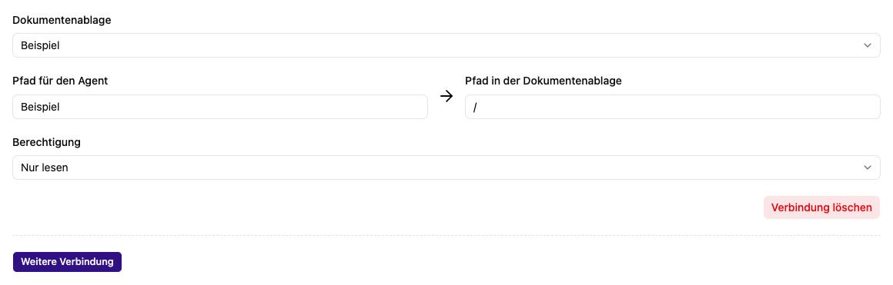

# Eine Dokumentenablage mit einem Agenten verbinden

Eine Verbindung zur Dokumentenablage macht deren Dateien für eine Agentenrolle erreichbar. Eine Ablage muss vorher [angelegt](../../app/documents/new.md) und mit geeigneten Inhalten befüllt sein.

## Verbindung einrichten

1. Öffne **Agent bearbeiten → Rollen** und die gewünschte Rolle.
2. Wähle unter **Werkzeuge** die Aktion **Dokumentenablage anbinden**.
3. Wähle im neuen Bereich **Dokumentenablage** die gewünschte Quelle.
4. Lege **Pfad in der Dokumentenablage** fest, beispielsweise `/handbuch` für einen Teilbereich oder `/` für die gesamte Ablage.
5. Lege **Pfad für den Agent** fest, zum Beispiel `/wissen`. Unter diesem Namen spricht der Agent die Verbindung an.
6. Wähle den Berechtigungsmodus und speichere den Agenten.

Beispiel: Der Ordner `/handbuch` aus einer Ablage erscheint für den Agenten unter `/wissen`. Eine dortige Datei `urlaub.md` erreicht er dann über `/wissen/urlaub.md`. Verwende bei mehreren Verbindungen unterscheidbare Agentenpfade.

## Schreibmodi

| Einstellung                           | Verhalten                                                                |
| ------------------------------------- | ------------------------------------------------------------------------ |
| **Nur lesen**                         | Der Agent kann Inhalte lesen und verfügbare Suchfunktionen nutzen.       |
| **Lesen und Schreiben (nachfragen)**  | Schreibaktionen benötigen eine [Freigabe im Chat](../chat/freigaben.md). |
| **Lesen und Schreiben (automatisch)** | Schreibaktionen können ohne diese einzelne Rückfrage ausgeführt werden.  |

Für das Lesen braucht das Konto der chattenden Person mindestens die Benutzerrolle im Arbeitsplatz der Ablage; zum Schreiben mindestens die Bearbeiterrolle. Wähle zusätzlich den passenden Schreibmodus an der Verbindung. Verwende vollständige Agentenpfade wie `/wissen/urlaub.md`; Pfadsegmente wie `..` werden bei Dateiänderungen und Transfers abgelehnt.

## Dateien durch den Agenten übertragen

Beim Schreiben von Dateiinhalten erhält der Agent nur nach erfolgreichem Speichern
eine Erfolgsmeldung. Schlägt das Speichern fehl, meldet das Werkzeug einen Fehler;
der Agent kann darauf reagieren und den Schreibvorgang erneut versuchen.

Mit eingebundenen Ablagen stehen auch die Werkzeuge **Datei kopieren** und **Datei verschieben** zur Verfügung. Der Agent verwendet seine eingebundenen Pfade; Gesprächsdateien liegen unter `this_conversation/`. Quelle und Ziel sind vollständige Dateipfade. Fehlende Zielordner werden automatisch angelegt. Die Dateiendung bleibt gleich; eine vorhandene Zieldatei wird nicht überschrieben.

Kopieren benötigt einen lesbaren Quellpfad und einen beschreibbaren Zielpfad. Beim Verschieben muss auch die Quelle beschreibbar sein. Verlangt eine betroffene Schreibverbindung eine Rückfrage, wartet das Werkzeug auf die Freigabe mit angezeigtem Quell- und Zielpfad.

Verarbeitete Inhalte bleiben erhalten; im Ziel einer Ablage wird die Indexierung eingereiht. Ordner und Stapeltransfers werden nicht unterstützt.

## Weitere Verbindungen und Entfernen

Mit **Weitere Verbindung** fügst du zusätzliche Quellen hinzu. **Verbindung löschen** entfernt nach Bestätigung die ausgewählte Zuordnung aus der Rolle; speichere anschließend den Agenten. Die zugrunde liegende Dokumentenablage wird dadurch nicht gelöscht.

Wenn der Agent nichts findet, prüfe Pfad, Berechtigungen, abgeschlossene Dateiverarbeitung und die [Suchindex-Einstellungen](../../app/documents/edit.md).
