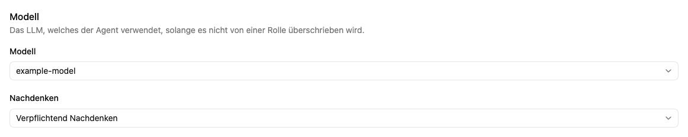

# Modelle und allgemeine Agenteneinstellungen

Im Reiter **Einstellungen** legst du die gemeinsamen Eigenschaften des Agenten fest. Speichere Änderungen anschließend mit **Agent speichern**.

## Name, Beschreibung und Arbeitsplatz

Wähle einen Namen, der die Aufgabe erkennen lässt, und eine kurze Beschreibung. Farbe und Icon helfen bei der Wiedererkennung. Der Arbeitsplatz bestimmt, für welchen Personenkreis der Agent verfügbar ist. In der Auswahl stehen Arbeitsplätze, in denen du die benötigten Verwaltungsrechte hast.

## Standardmodell und Nachdenken

Das gewählte Modell wird verwendet, solange eine Agentenrolle es nicht überschreibt. Verfügbar sind lokale Sprachmodelle und die von Administrator:innen unter [Modelle](../../settings/models.md) hinzugefügten externen Sprachmodelle. Externe Modelle übertragen Gesprächsinhalte an den konfigurierten Anbieter. Fehlt das gewünschte Modell, bitte die globale Administration, es unter **Modelle** einzurichten beziehungsweise über [XRAG](../../settings/xrag.md) bereitzustellen.

| Einstellung                        | Bedeutung                                                           |
| ---------------------------------- | ------------------------------------------------------------------- |
| **Nachdenken**                     | Standardmäßig eingeschaltet; die Nachricht kann die Auswahl ändern. |
| **Nicht nachdenken**               | Standardmäßig ausgeschaltet; die Nachricht kann die Auswahl ändern. |
| **Verpflichtend Nachdenken**       | Die Konfiguration erzwingt Nachdenken für das verwendete Modell.    |
| **Verpflichtend nicht Nachdenken** | Die Konfiguration schaltet Nachdenken verbindlich aus.              |

Eine abweichende Einstellung der gewählten Agentenrolle hat Vorrang vor der allgemeinen Einstellung. Bei einer verpflichtenden Vorgabe kannst du die Einstellung für einzelne Nachrichten nicht umschalten.

## Zusätzliche Funktionen

Der Editor zeigt Schalter für **Dateien hochladen** und **Stapelverarbeitung** sowie die Auswahl eines **Transcribers**. Ein zugeordneter Transkriptor ermöglicht die automatische Verarbeitung hochgeladener Audio- und Videodateien und die Aufnahmefunktion im Chat.

Die Schalter für Dateiupload und Stapelverarbeitung wirken derzeit nicht auf die Chat-Eingabe: Beide Funktionen bleiben dort auch bei ausgeschaltetem Schalter verfügbar.

**Ziel verfolgen**, **Selbstlöschende Chats** und **Nachtschicht** sind derzeit nicht verfügbar.

Weiter: [Chat bedienen](../chat/index.md) · [Transkriptor konfigurieren](../../app/transcribe/edit.md)
