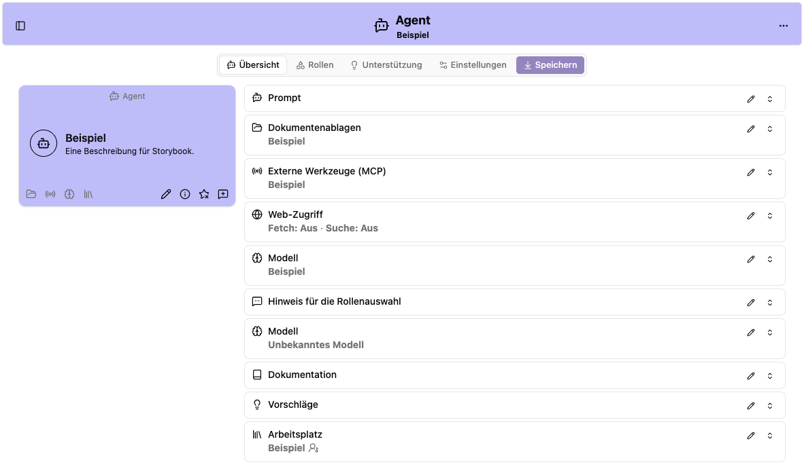

# Agenten bearbeiten, kopieren und löschen

Öffne einen Agenten über das Stiftsymbol **Bearbeiten**. Du bearbeitest damit die gemeinsame Konfiguration dieses Agenten im Arbeitsplatz.

## Bereiche des Editors

| Reiter                             | Inhalt                                                                          |
| ---------------------------------- | ------------------------------------------------------------------------------- |
| **Übersicht**                      | Zusammenfassung der Konfiguration und Verweise zu den einzelnen Einstellungen   |
| [Rollen](rollen.md)                | Prompts, Rollenauswahl, Modelle pro Rolle und Werkzeuge                         |
| [Unterstützung](unterstuetzung.md) | Dokumentation und vorgeschlagene Nachrichten                                    |
| [Einstellungen](einstellungen.md)  | Name, Beschreibung, Aussehen, Arbeitsplatz, Standardmodell und Zusatzfunktionen |

## Speichern und Verwerfen

Bearbeite die gewünschten Felder und wähle **Speichern** beziehungsweise **Agent speichern**. Der Editor speichert nicht automatisch. Eine Markierung **Bearbeitet** beziehungsweise **Geändert** zeigt Unterschiede zum geladenen Stand.

Rücksetzsymbole an Feldern verwerfen die jeweilige Änderung. **Änderungen verwerfen** setzt nach Bestätigung alle noch nicht gespeicherten Änderungen am Agenten zurück. Prüfe vor dem Verlassen des Editors, ob du speichern oder verwerfen möchtest.

## Als neuen Agenten speichern

Im Agentenmenü kannst du **Als neuen Agenten speichern** verwenden. So entsteht eine eigenständige Kopie der Konfiguration. Gespeicherte [MCP-Header](mcp.md) werden dabei übernommen, ohne ihre Werte anzuzeigen. Für das Kopieren oder Verschieben in einen anderen Arbeitsplatz benötigst du Administrationsrechte für Quell- und Ziel-Arbeitsplatz. Vergib einen unterscheidbaren Namen und prüfe Arbeitsplatz, Rollen und Datenzugriffe. Verknüpfte Dokumentenablagen und Dienste werden dadurch nicht als eigene Ressourcen dupliziert; die Konfiguration kann weiterhin auf dieselben Quellen verweisen.

## Löschen

Wähle im Menü **Agent löschen** und bestätige den Dialog. Das Löschen des Agenten lässt sich in der Oberfläche nicht rückgängig machen. Informiere Personen, die den Agenten verwenden, vor dem Löschen. Soll auch der gespeicherte Gesprächs- und Dateibestand entfernt werden, beauftrage die Betriebsadministration mit dessen Bereinigung.

Teste nach dem Speichern einen neuen Chat mit einer typischen Frage und den benötigten Werkzeugen.
