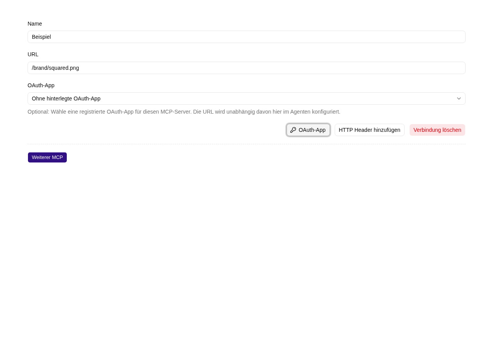

# Externe Werkzeuge über MCP anbinden

**MCP** ist eine Schnittstelle, über die ein externer Dienst Werkzeuge für den Agenten bereitstellt. Welche Daten gelesen oder Aktionen ausgeführt werden können, bestimmt der angebundene Dienst.

## Verbindung hinzufügen

1. Lass dir von der zuständigen Administration die MCP-URL und gegebenenfalls benötigte HTTP-Header geben.
2. Öffne **Agent bearbeiten → Rollen** und die gewünschte Rolle.
3. Wähle **Werkzeuge → Externes Werkzeug (MCP) anbinden**.
4. Trage einen verständlichen **Namen** und die vollständige **URL** ein.
5. Ergänze benötigte Header über **HTTP Header hinzufügen** mit **Name** und **Wert**.
6. Speichere den Agenten und prüfe die Verbindung in einem neuen Chat mit einer geeigneten Aufgabe.

Schlägt der Testaufruf fehl, prüfe die MCP-URL und Authentifizierungsheader. Lass die Betriebsadministration außerdem prüfen, ob der Realtime-Dienst die MCP-Adresse aus dem Netzwerk der Box erreichen kann.

## Persönliche Anmeldung, zum Beispiel bei Trello

Für Trello trägst du `https://mcp.trello.com/v1` ein und lässt die HTTP-Header leer.
Erst wenn der Agent ein MCP-Werkzeug aufruft und der Dienst OAuth verlangt,
zeigt der Chat eine Werkzeugfreigabe mit **Mein Konto verbinden** an.
Das gilt auch für Dienste wie Gmail, deren Werkzeugliste öffentlich ist und die
erst beim eigentlichen Werkzeugaufruf eine Anmeldung verlangen.
Auch Benutzer:innen ohne Bearbeitungsrechte können ihr eigenes Konto verbinden,
sofern sie Zugriff auf den Agenten haben.

1. Sende eine Aufgabe an den Agenten. Wenn eine Verbindung erforderlich ist, wähle in der Werkzeugfreigabe **Mein Konto verbinden**.
2. Melde dich beim Anbieter an und bestätige die gewünschten Berechtigungen.
3. Nach der Rückkehr wird genau der wartende Werkzeugaufruf automatisch fortgesetzt. Du musst die Nachricht nicht erneut senden.

Mit **Ablehnen** kannst du den Aufruf ohne Anmeldung ablehnen.

Die Verbindung wird pro Box-Benutzer:in und vollständiger MCP-URL gespeichert.
Andere Benutzer:innen müssen sich selbst anmelden. Weitere Chats und Agenten
mit derselben MCP-URL und derselben OAuth-App-Konfiguration können deine bestehende Verbindung verwenden. Tokens
werden ausschließlich serverseitig gespeichert und stehen nicht in der
Agentenkonfiguration. Abgelaufene Tokens werden erneuert, sofern der Anbieter
einen gültigen Refresh-Token bereitstellt. Bei widerrufener Anmeldung verbindest
du dein Konto erneut. Unter [Profil → Verbindungen](../../me/connections.md)
kannst du gespeicherte OAuth-Verbindungen ansehen und trennen.

## Registrierte OAuth-App, zum Beispiel GitHub

HTTPS-MCP-Endpunkte können automatische Client-Registrierung oder eine vorab registrierte OAuth-App verwenden. Für GitHub ist eine registrierte App erforderlich:

1. Eine globale Administrator:in legt unter [Einstellungen → Verbindungen](../../settings/connections.md) eine **OAuth-App** an: mit Name, Client-ID, Client Secret und der exakten **Issuer-URL** des OAuth-Anbieters. Die angezeigte Callback-URL muss bei der registrierten GitHub-App eingetragen sein.
2. Trage im Agenten die MCP-URL ein, für GitHub beispielsweise `https://api.githubcopilot.com/mcp/`. Klicke neben **HTTP Header hinzufügen** auf **OAuth-App**, um die Auswahl zu öffnen, und wähle die registrierte App. Die URL bleibt unabhängig editierbar. Die Auswahl ist auch bei neuen, noch nicht gespeicherten MCP-Konfigurationen möglich.
3. Speichere den Agenten, starte einen MCP-Aufruf und verbinde dein persönliches Konto.

Das Dropdown zeigt alle zentralen OAuth-Verbindungen. Bei **Ohne hinterlegte OAuth-App** wird keine zentrale App verwendet. Diese Option bleibt für Anbieter mit dynamischer Client-Registrierung verfügbar. GitHub benötigt eine registrierte App samt Secret; bei fehlenden Angaben erklärt die Anmeldung die nötige Konfiguration.

Im Agenten werden die Verbindungs-ID und die unabhängig konfigurierte MCP-Adresse gespeichert, keine Zugangsdaten. Ein Klon kann dieselbe zentrale Verbindung nutzen, ohne Secrets zu kopieren. Client-ID, Client Secret und ein bereits gesetzter Aussteller einer angelegten OAuth-App sind nicht bearbeitbar. Bei älteren Apps ohne Aussteller muss ein globaler Administrator diese Angabe unter Einstellungen → Verbindungen einmalig nachtragen; anschließend ist eine erneute persönliche Anmeldung erforderlich. Ein abweichender Aussteller in der MCP-Antwort wird abgelehnt. Für neue Zugangsdaten wird eine neue App angelegt und hier ausgewählt; dabei kann eine neue persönliche Anmeldung erforderlich werden. Gelöschte Verbindungen werden als nicht verfügbar angezeigt. Bereits ausgewählte Apps werden beim Öffnen des Editors direkt angezeigt. Der Button **OAuth-App** klappt die Auswahl ein oder aus, ohne die Auswahl zu ändern.

Der Anbieter muss die Rückrufadresse
`<Adresse deiner Box>/api/mcp/oauth/callback` akzeptieren und dein Browser muss
dorthin zurückkehren können. Eine Anmeldung läuft nach zehn Minuten ab und ist
nur einmal verwendbar. Bei Abbruch oder Fehler kehre zum Chat zurück und starte
sie erneut. Ein unterstütztes Chatmodell und Netzwerkzugriff vom Web- und
Realtime-Dienst auf den Anbieter sind erforderlich.

Im Chatverlauf erscheinen MCP-Aufrufe mit einem Stecker-Symbol, dem Werkzeugnamen und ihrem Status. Das Laden verfügbarer Werkzeuge wird gesondert benannt. Klappe einen Schritt auf, um seine Eingabe und das Ergebnis zu sehen. Die Ansicht gilt für alle MCP-Dienste.

## Was du vor der Nutzung klären solltest

Kläre mit der Administration, welche MCP-Werkzeuge Dateien lesen, Daten übertragen oder Änderungen ausführen. Beschränke diese Rechte am MCP-Dienst und seinen Zugangsdaten; Web-Fetch-Whitelist und Ablage-Schreibmodi gelten nur für die jeweiligen anderen Werkzeuge.

Trage Zugangsdaten in die vom MCP-Dienst vorgegebenen Headerfelder ein. Gespeicherte Header-Werte bleiben verborgen, auch für Administrator:innen. Nur die Namen stehen in der lesbaren Agentenkonfiguration; die Werte lädt der Realtime-Dienst beim Aufruf. Ein leeres Feld mit **Gespeichert – zum Ersetzen eingeben** behält den vorhandenen Wert. Zum Ersetzen gibst du einen neuen Wert ein, zum Entfernen löschst du den Header und speicherst den Agenten.

Bei einem geänderten Header-Namen oder einer anderen Server-Adresse musst du die Werte neu eingeben. Beim Kopieren eines Agenten werden unveränderte Zugangsdaten übernommen; dafür benötigst du Administrationsrechte für Quell- und Ziel-Arbeitsplatz. Verwende dafür Zugangsdaten mit den für diesen Agenten benötigten Rechten und schwärze die Werte in Screenshots oder Supportnachrichten.

Mit **Weiterer MCP** ergänzt du weitere Verbindungen. **MCP löschen** beziehungsweise **Verbindung löschen** entfernt nach Bestätigung die Konfiguration dieser Verbindung. Speichere anschließend den Agenten. Widerrufe nicht mehr benötigte Zugangsdaten zusätzlich beim MCP-Dienst.

Eine OAuth-App kann für mehrere MCP-Endpunkte wiederverwendet werden, sofern der Anbieter dies unterstützt. Die Server-Adresse gehört jeweils zur MCP-Konfiguration im Agenten.

## Zugehörige MCP-Werkzeuge

- `platform_connection_save`: Zentrale OAuth-App einschließlich `issuer` anlegen oder einen fehlenden Aussteller einmalig ergänzen. Mindeststufe und erforderliche Berechtigung: globaler Administrator. Bereits gesetzte OAuth-Identitäten bleiben unveränderlich.
- `platform_agent_create` und `platform_agent_update`: MCP-Endpunkte und Referenzen auf zentrale OAuth-Apps in Agentenrollen speichern. Mindeststufe: Workspace-Administrator; Administratorrechte im betroffenen Arbeitsplatz erforderlich. Die Referenz gewährt keine zusätzlichen Rechte beim Anbieter.

Die persönliche Anmeldung und Zustimmung beim OAuth-Anbieter erfordern den Browser und werden nicht durch ein MCP-Werkzeug ersetzt.
