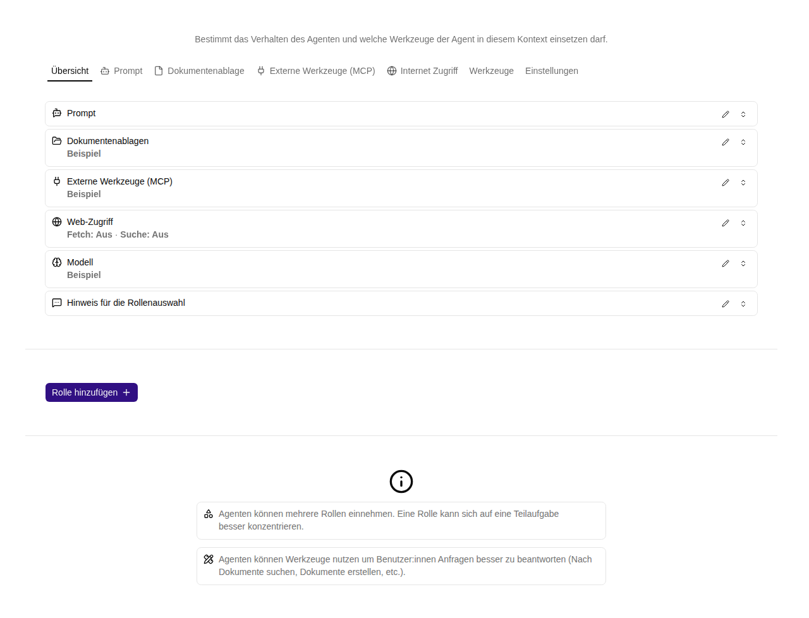

# Agentenrollen und Prompts

Eine **Agentenrolle** definiert das Verhalten der KI für einen bestimmten Aufgabentyp. Sie ist unabhängig von der Arbeitsplatzrolle einer Person. Ein Agent kann eine oder mehrere Rollen besitzen.

## Eine Rolle einrichten

1. Öffne im Agenteneditor **Rollen**.
2. Verwende eine vorhandene Rolle oder wähle **Rolle hinzufügen**.
3. Formuliere im Reiter **Prompt** Aufgabe, Antwortformat, Datenbasis und Grenzen.
4. Unter den Einstellungen der Rolle vergibst du einen **Namen** und einen **Hinweis für die Rollenauswahl**.
5. Ergänze unter **Werkzeuge** die benötigten Verbindungen.
6. Speichere den gesamten Agenten.

Bei mehreren Rollen wählt der Agent für eine neue Nachricht eine passende Rolle. Der Hinweis für die Rollenauswahl erklärt, wann diese Rolle zuständig ist. Beispiel: „Für Fragen nach internen Abläufen und Zuständigkeiten; nutze die Wissensablage.“ Der eigentliche Prompt erklärt anschließend, wie die Rolle antworten soll.

## Modelle pro Rolle

Unter **Modell überschreiben** kannst du ein anderes Modell als das Standardmodell des Agenten auswählen. **Nicht überschreiben** übernimmt die allgemeine Einstellung. Auch die Nachdenken-Einstellung lässt sich pro Rolle abweichend setzen.

## Verfügbare Werkzeuge

- [Dokumentenablage anbinden](dokumentenablagen.md): Wissen lesen, suchen und je Freigabemodus schreiben.
- [Internet-Zugriff](web.md): Webseiten abrufen oder über einen Suchanbieter suchen.
- [Externes Werkzeug (MCP) anbinden](mcp.md): Funktionen eines eingerichteten externen Dienstes bereitstellen.

**Chat Erweiterung** und **Taschenrechner** lassen sich unter **Werkzeuge** hinzufügen. Das Hinzufügen aktiviert das jeweilige Werkzeug. Seine Reiter bieten Einstellungen, Zurücksetzen und **Werkzeug entfernen** mit Bestätigung. Speichere anschließend den Agenten. **schorn.ai Plattform Zugang** öffnet einen eigenen [Plattformzugriff-Tab](plattformzugriff.md), in dem du die Freigaberegel je Zugriffsstufe einstellst.

Die Reiter und die Rollenübersicht zeigen Chat Support, Taschenrechner und Plattformzugriff in dieser Reihenfolge. Alle drei werden beim Hinzufügen aktiviert; einen separaten Aktiv-Schalter gibt es nicht. **Werkzeug entfernen** entfernt die Konfiguration und den zugehörigen Reiter. Die Änderung gilt dauerhaft nach dem Speichern des Agenten. Über **Werkzeuge** kannst du die Funktion erneut hinzufügen. Ältere deaktivierte Konfigurationen erscheinen nicht als Reiter und können dort wieder hinzugefügt werden.

## Chat Support

Im Reiter **Chat Support** schaltest du drei Funktionen einzeln ein:

- **Chat-Titel setzen**: Der Agent kann einen sprechenden Namen für den Aktivitätseintrag vergeben. Manuell gesetzte Namen bleiben erhalten.
- **Antwortvorschläge anbieten**: Der Agent kann 2–8 kurze Antworten anbieten. Ein Klick ergänzt den aktuellen Entwurf; du kannst die Antwort ändern, ergänzen oder stattdessen frei schreiben. Erst **Senden** übermittelt die Nachricht. Die neuesten Vorschläge ersetzen frühere Vorschläge desselben Antwortdurchlaufs und verschwinden nach der nächsten Nutzernachricht. Die KI kann zusätzlich eine normale Nachricht schreiben.
- **Aktuelles Datum und Uhrzeit abfragen**: Liefert die tatsächliche Uhrzeit zum Aufrufzeitpunkt. Ohne angegebene IANA-Zeitzone gilt UTC; beispielsweise liefert `Europe/Vienna` die österreichische Ortszeit einschließlich Sommerzeit. Die Zeitzone des Nutzers wird nicht automatisch ermittelt.

Die Werkzeuge sind nur für die ausgewählte, entsprechend konfigurierte Agentenrolle verfügbar. Ob und wann das Modell sie aufruft, hängt von der Anfrage und dem Rollenprompt ab.

## Taschenrechner

Der Rechner verwendet den Parser von mathjs mit einer begrenzten numerischen Auswertung. Beispiele: `3283 + 2342`, `23 * 32 + 1`, `(42 + 2) / 34`, `sqrt(5)`, `avg(2;4;5)`, `sum([1,2,3])`, `min(1;2;3)` und `max(1;2;3)`.

Unterstützt werden `+`, `-`, `*`, `/`, `^`, `%`, `mod`, Klammern, `pi`, `e`, `sqrt`, `sin`, `cos`, `tan`, `asin`, `acos`, `atan`, `ln`, `log`, `log10`, `log2`, `abs`, `floor`, `ceil`, `round`, `exp`, `pow`, `sum`, `avg`, `min` und `max`. Winkelfunktionen arbeiten im Bogenmaß; `ln` ist der natürliche Logarithmus, `log` und `log10` verwenden Basis 10. Funktionsargumente können durch Komma oder Semikolon getrennt werden; Dezimalzahlen verwenden einen Punkt.

Ergebnisse sind endliche reelle Zahlen mit JavaScript-Gleitkommapräzision, keine garantierte Dezimal- oder Finanzarithmetik. Ausdrücke sind auf 2000 Zeichen und begrenzte Verschachtelung/Komplexität beschränkt. Zuweisungen, eigene Funktionen, Einheiten, komplexe Zahlen und beliebiger Programmcode sind nicht verfügbar. Ungültige Eingaben erscheinen als Werkzeugfehler; der Agent kann den Ausdruck korrigieren.

## Rolle entfernen

Öffne die Einstellungen der Rolle, wähle **Rolle löschen** und bestätige. Speichere anschließend den Agenten. Entferne nicht alle Rollen: Ohne eine verwendbare Rolle kann der Agent keine Aufgabe bearbeiten.

Eine gute Kontrolle ist ein neuer Chat mit einer passenden und einer unpassenden Anfrage. So erkennst du, ob Rollenauswahl und Prompt die gewünschte Abgrenzung vermitteln.

## Zugehörige MCP-Werkzeuge

`platform_agent_get` liest die zugängliche Agentenkonfiguration ab Stufe **User**. `platform_agent_update` speichert Rollen einschließlich `toolCalculator` und `toolChatAwareness` ab Stufe **Workspace-Administrator**; erforderlich sind Administratorrechte im bisherigen und im Zielarbeitsplatz.

`platform_calculate` und `platform_current_date_time` sind ab Stufe **User** verfügbar und verwenden dieselbe Berechnung beziehungsweise Uhrzeitfunktion wie die Rollenwerkzeuge. `platform_activity_update` benennt eigene Aktivitäten um; solche expliziten Namen gelten als manuell gesetzt. `platform_chat_read` liest Nachrichten einschließlich Antwortvorschlägen nur für berechtigte Chats; `platform_chat_send` sendet eine ausgewählte oder frei formulierte Antwort. Vorschläge werden über `chat-response-suggestions` im laufenden Agentenantwortdurchlauf erzeugt, nicht als externer MCP-Schreibzugriff: Sie sind Teil der Modellantwort und dürfen keine Nutzernachricht oder Freigabe vortäuschen.

Die rolleninternen Tools heißen `calculator`, `chat-set-label`, `chat-response-suggestions` und `chat-current-date-time`. Sie benötigen den entsprechenden aktivierten Rollenschalter; Titeländerungen betreffen nur die aktuelle Aktivität des aufrufenden Nutzers. Das Setzen einer höheren Plattform-Werkzeugstufe erweitert keine Benutzerberechtigungen.

Verbindung und gemeinsame Berechtigungsregeln: [Plattformzugriff](../../agent/edit/plattformzugriff.md).
