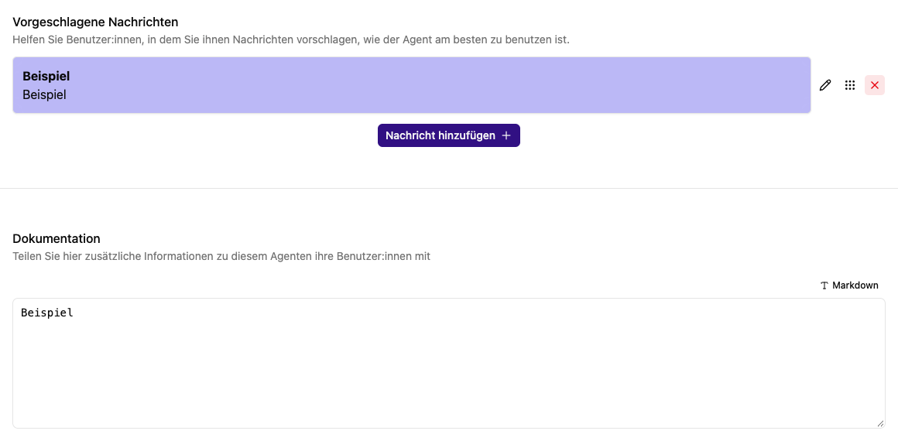

# Anleitungen und Nachrichtenvorschläge für einen Agenten

Im Reiter **Unterstützung** erklärst du anderen Personen, wofür ein Agent gedacht ist und wie sie ihn sinnvoll verwenden. Diese Inhalte sind Anwenderhinweise. Die Arbeitsanweisungen für das Modell gehören in den [Prompt der Rolle](rollen.md).

## Dokumentation schreiben

1. Öffne **Agent bearbeiten → Unterstützung**.
2. Beschreibe unter **Dokumentation** Zweck, geeignete Eingaben, Datenquellen und erwartetes Ausgabeformat.
3. Nutze bei Bedarf Markdown, etwa Überschriften, Listen, fett hervorgehobene Wörter und Beispiele.
4. Kontrolliere die Darstellung mit **Vorschau anzeigen**.
5. Speichere den Agenten.

Ein hilfreicher kurzer Text beantwortet: „Wobei hilft dieser Agent?“, „Welche Unterlagen braucht er?“ und „Was muss ich am Ergebnis selbst prüfen?“ Dokumentiere auch, ob der Agent externe Dienste aufrufen oder Dateien verändern kann.

## Vorschläge anlegen

Wähle unter **Vorgeschlagene Nachrichten** die Aktion **Nachricht hinzufügen**. Trage eine kurze **Bezeichnung** für die Karte und den vollständigen Text unter **Nachricht** ein. Schließe die Bearbeitung und speichere den Agenten.

Beispiel: Bezeichnung „Besprechung zusammenfassen“, Nachricht „Fasse die folgenden Notizen in Entscheidungen, offene Fragen und nächste Schritte zusammen. Frage nach, wenn Angaben fehlen.“

Die Vorschläge erscheinen in der Agenteninfo und im leeren Chat über der Texteingabe. Ein Klick übernimmt den vollständigen Nachrichtentext in das Eingabefeld und fokussiert es. Vorhandener Eingabetext wird ersetzt; gesendet wird erst mit **Senden** oder `Enter`.
