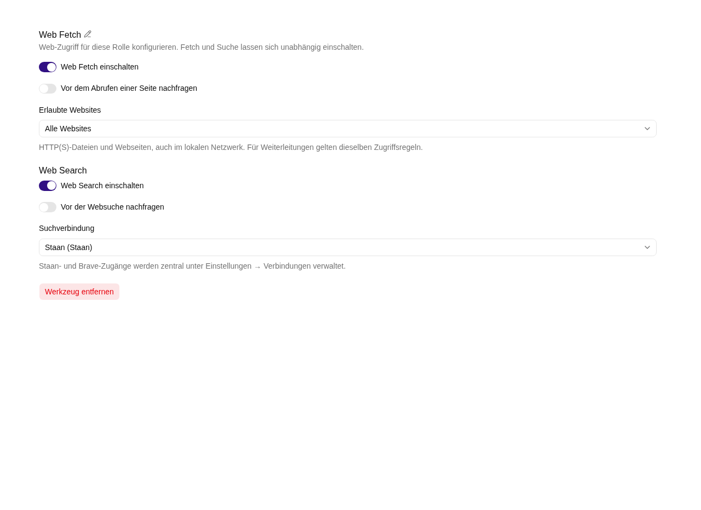

# Web-Zugriff konfigurieren

**Web Fetch** lädt eine angegebene URL herunter und verarbeitet ihren Inhalt. **Web Search** sendet eine Suchanfrage an einen konfigurierten Suchanbieter. Beide Funktionen lassen sich unabhängig einschalten.



## Web Fetch einschalten

1. Öffne **Agent bearbeiten → Rollen → Werkzeuge → Werkzeug: Internet Zugriff**.
2. Aktiviere **Web Fetch einschalten**.
3. Entscheide, ob der Agent **vor dem Abrufen einer Seite nachfragen** soll.
4. Wähle **Alle Websites** oder **Domain-Whitelist**.
5. Speichere den Agenten.

Bei einer Whitelist trägst du pro Zeile einen Hostnamen ohne Protokoll, Pfad oder Port ein:

```text
example.com
*.example.org
```

`example.com` erlaubt genau diesen Host. `*.example.org` erlaubt dessen Subdomains, aber nicht `example.org` selbst. Eine leere Whitelist erlaubt keine Abrufe. Weiterleitungen müssen die gleichen Regeln erfüllen.

**Alle Websites** und Wildcard-Einträge erlauben ausschließlich öffentliche IP-Adressen. Für einen internen HTTP(S)-Dienst muss die zuständige Administration dessen genauen Hostnamen oder IPv4-Adresse in die Domain-Whitelist aufnehmen, beispielsweise `intranet.example.com` oder `192.168.1.20`. Damit erhält der Agent bewusst Zugriff auf diesen Dienst aus dem Netzwerk der Box. Nimm nur die für die Aufgabe benötigten internen Hosts auf. Weiterleitungen auf einen anderen internen Host benötigen einen eigenen exakten Eintrag.

## Web Search einschalten

1. Aktiviere **Web Search einschalten**.
2. Wähle eine **Suchverbindung** aus dem Dropdown. Eine globale Administrator:in legt Staan-/Brave-Zugänge unter [Einstellungen → Verbindungen](../../settings/connections.md) an.
3. Sprache und Region für Staan werden ebenfalls zentral festgelegt; ohne Angabe gilt `en-us`.
4. Entscheide, ob vor jeder Websuche nachgefragt werden soll.
5. Speichere den Agenten.

Beim Wechsel wird nur die ausgewählte Verbindungs-ID geändert. Fehlt eine Verbindung oder wurde sie gelöscht, meldet die Suche die fehlende Konfiguration. **Die Fetch-Whitelist beschränkt die Websuche nicht.** Eine Suche liefert zunächst Titel, Links und kurze Auszüge; das Lesen einer vollständigen Seite benötigt einen anschließenden Abruf.

## Wo heruntergeladene Dateien liegen

Ohne abweichendes Ziel legt Fetch Dateien im Gespräch unter `/this_conversation/web/…` ab. Der Agent kann sie danach lesen. Ein beschreibbarer eingebundener Ablagepfad kann ebenfalls als Ziel dienen. Schreibschutz und Bestätigungen dieser Ablage bleiben maßgeblich.

Ein erneuter Abruf derselben Adresse kann die dort gespeicherte Datei ersetzen. Dateien mit gleicher Domain und gleichem URL-Pfad können denselben Speicherort verwenden; Query-Parameter unterscheiden diesen Standardpfad nicht. Audio und Video benötigen auch hier einen passenden Transkriptor, damit Text entsteht.

## Verbindungen und Schlüssel bewusst einsetzen

Suchanfragen werden an den gewählten Anbieter übermittelt; beim Abruf wird die Zielwebsite kontaktiert. Zugangsschlüssel gehören nur in die Konfiguration und nicht in Prompts oder Nachrichten. Schlüssel werden ausschließlich serverseitig in den zentralen Verbindungen gespeichert. Die Agentenkonfiguration enthält nur eine Referenz. Verwende Schlüssel mit den für diesen Agenten benötigten Rechten und widerrufe sie beim Anbieter, wenn du die Verbindung stilllegst.

**Werkzeug entfernen** entfernt nach Bestätigung die Web-Konfiguration der Rolle einschließlich Whitelist und Verbindungs-Auswahl; die zentrale Verbindung bleibt bestehen. Speichere danach den Agenten.

Weiter: [Freigaben und Web-Ergebnisse im Chat](../chat/freigaben.md)
