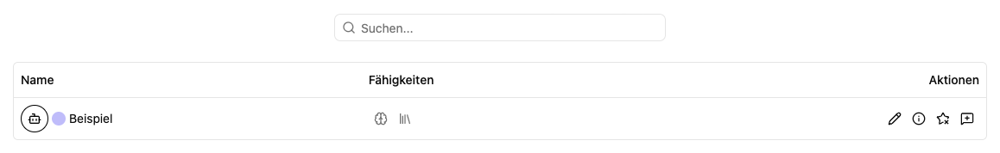

# Agenten finden und verwenden

Ein **Agent** ist ein für bestimmte Aufgaben eingerichteter KI-Assistent. Seine Beschreibung, Rollen, Modelle und angebundenen Werkzeuge bestimmen, wobei er helfen kann.

## Einen passenden Agenten auswählen

1. Öffne **Agenten** in der Seitenleiste oder **Alle Agenten** auf dem Dashboard.
2. Nutze die Suche. Sie berücksichtigt unter anderem Name, Beschreibung und Modell.
3. Öffne **Infos** am Agenten, um seine [Fähigkeiten und Dokumentation](details.md) zu lesen.
4. Wähle **Neuer Chat** am gewünschten Agenten.

Der Chat ist ein eigener Verlauf. Ein erneuter Klick auf **Neuer Chat** beginnt ein separates Gespräch; vorhandene Gespräche findest du im [Verlauf](../activity/index.md).

## Symbole an der Karte

| Aktion                                  | Wirkung                                                               |
| --------------------------------------- | --------------------------------------------------------------------- |
| **Infos**                               | Öffnet die Konfiguration als Übersicht und die Anwenderhinweise.      |
| **Als Favorit** / **Favorit entfernen** | Ändert deine persönliche Favoritenmarkierung.                         |
| **Neuer Chat**                          | Startet ein Gespräch mit diesem Agenten.                              |
| **Bearbeiten**                          | Öffnet den Editor; dafür brauchst du Arbeitsplatzadministratorrechte. |

## Ansicht anpassen

Unter **Optionen** stehen Kacheln und Tabelle sowie Sortierung nach Namen zur Verfügung. Gruppierungen helfen dir, Agenten nach Favoriten, Arbeitsplatz, Anfangsbuchstaben, Modell, Dokumentenablagen oder Rollenanzahl zu vergleichen. Speichere deine bevorzugte Ansicht mit **Ansicht speichern**.

Bei einer leeren Übersicht prüfe die Suche und deine [Berechtigungen](../me/permissions.md). Ein **Unbekanntes Modell** oder eine **Unbekannte Dokumentenablage** weist auf eine nicht verfügbare oder nicht zugängliche Zuordnung hin; die Arbeitsplatzadministration sollte sie prüfen.

Weiter: [Chat führen](chat/index.md) · [Neuen Agenten anlegen](new.md)
