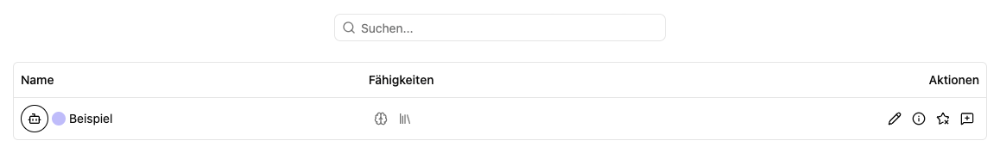

# Agenten finden und verwenden

Ein **Agent** ist ein für bestimmte Aufgaben eingerichteter KI-Assistent. Seine Beschreibung, Rollen, Modelle und angebundenen Werkzeuge bestimmen, wobei er helfen kann.

## Einen passenden Agenten auswählen

1. Öffne **Agenten** in der Seitenleiste oder **Alle Agenten** auf dem Dashboard.
2. Nutze die Suche. Sie berücksichtigt unter anderem Name, Beschreibung und Modell.
3. Öffne **Infos** am Agenten, um seine [Fähigkeiten und Dokumentation](details.md) zu lesen.
4. Wähle **Neuer Chat** am gewünschten Agenten.

Der Chat ist ein eigener Verlauf. Ein erneuter Klick auf **Neuer Chat** beginnt ein separates Gespräch; vorhandene Gespräche findest du im [Verlauf](../activity/index.md).

## Symbole an der Karte

| Aktion                                  | Wirkung                                                               |
| --------------------------------------- | --------------------------------------------------------------------- |
| **Infos**                               | Öffnet die Konfiguration als Übersicht und die Anwenderhinweise.      |
| **Als Favorit** / **Favorit entfernen** | Ändert deine persönliche Favoritenmarkierung.                         |
| **Neuer Chat**                          | Startet ein Gespräch mit diesem Agenten.                              |
| **Bearbeiten**                          | Öffnet den Editor; dafür brauchst du Arbeitsplatzadministratorrechte. |

## Ansicht anpassen

Unter **Optionen** stehen Kacheln und Tabelle sowie Sortierung nach Namen zur Verfügung. Gruppierungen helfen dir, Agenten nach Favoriten, Arbeitsplatz, Anfangsbuchstaben, Modell, Dokumentenablagen oder Rollenanzahl zu vergleichen. Speichere deine bevorzugte Ansicht mit **Ansicht speichern**.

Bei einer leeren Übersicht prüfe die Suche und deine [Berechtigungen](../me/permissions.md). Ein **Unbekanntes Modell** oder eine **Unbekannte Dokumentenablage** weist auf eine nicht verfügbare oder nicht zugängliche Zuordnung hin; die Arbeitsplatzadministration sollte sie prüfen.

Weiter: [Chat führen](chat/index.md) · [Neuen Agenten anlegen](new.md)

## Als XRAG exportieren

Workspace-Administrator:innen können das Objekt unter **Info → XRAG exportieren** einzeln herunterladen. Für einen gemeinsamen Download mit weiteren Ressourcen wählst du **Zu XRAG-Paket hinzufügen** und bestätigst die gewünschten verbundenen Objekte. Chats und deren Dateien gehören nicht zum Agentenexport. Unter **Bearbeiten → Einstellungen** kannst du den lesbaren globalen Identifier ändern. Er wird aus dem Titel in kebab-case erzeugt. Die globale ID bleibt bei Import und erneutem Export erhalten, sodass getrennt übertragene Objekte wieder verbunden werden können.

Unter [XRAG Import und Export](../settings/xrag.md) findest du die Schritte zum Importieren, zur Bestätigung vorhandener Objekte und zum Erstellen oder Entpacken von Sammelarchiven.

## Zugehörige MCP-Werkzeuge

- `platform_xrag_export`: Ein Objekt mit `kind: "agent"` exportieren, optional mit Modellarchiven. Mindeststufe: **Workspace-Administrator**; Administratorrechte im Workspace des Objekts. Downloadlink zehn Minuten gültig; Modellarchive müssen im Katalog vorhanden sein.
- `platform_xrag_related_objects` und `platform_xrag_saved_package_add` ermitteln die verbundenen Ressourcen und übernehmen die gewählte Auswahl in ein eigenes Paket. Mindeststufe **Workspace-Administrator** mit Exportrechten für jedes ausgewählte Objekt.
- `platform_xrag_identity_get` / `platform_xrag_identity_set`: Globalen Identifier lesen bzw. initialisieren oder mit Prüfung der bisherigen ID ändern. Mindeststufe: **Workspace-Administrator**; Administratorrechte im betroffenen Workspace. Bereits exportierte Archive bleiben unverändert.

Import- und Sammelwerkzeuge sowie ihre Grenzen sind unter [XRAG](../settings/xrag.md#zugehörige-mcp-werkzeuge) dokumentiert.
