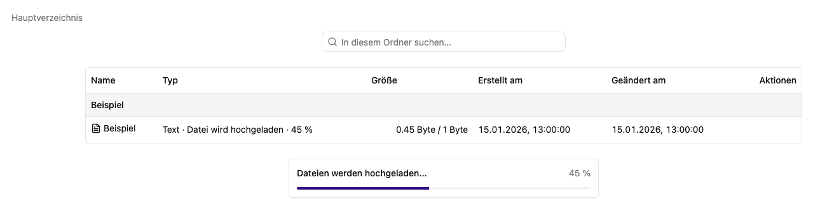
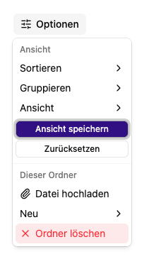

# Dateien hochladen, öffnen und organisieren

Im Reiter **Dateien** siehst du den Inhalt einer Dokumentenablage. Dieselbe Dateiansicht wird auch für [Chats](../../agent/chat/dateien.md) und [Transkriptionsaktivitäten](../transcribe/files.md) verwendet. Dort gelten die Rechte der jeweiligen Aktivität.

## Dateien hochladen

1. Öffne den Zielordner.
2. Ziehe Dateien in die Dateiansicht oder wähle **Optionen → Datei hochladen**. Ein leerer Ordner bietet **Datei hochladen** auch direkt an.
3. Wähle eine oder mehrere Dateien.
4. Warte zunächst auf den Upload und anschließend auf die Verarbeitung.
5. Öffne eine Datei und kontrolliere, ob ihr Inhalt lesbar ist.

In einer gemeinsamen Ablage benötigst du für Änderungen mindestens die Bearbeiterrolle. Das gilt auch für erneute Dateiverarbeitung und das Bearbeiten von Transkriptsegmenten.

## Status unterscheiden

| Anzeige                                    | Bedeutung und nächster Schritt                                                                              |
| ------------------------------------------ | ----------------------------------------------------------------------------------------------------------- |
| **Datei wird hochgeladen** mit Prozentwert | Die Originaldatei wird übertragen. Warte bis zum Abschluss.                                                 |
| **Datei wird verarbeitet…**                | Inhalt wird extrahiert oder ein Medium transkribiert.                                                       |
| **Noch nicht verarbeitet**                 | Wähle **Erneut verarbeiten** im Dateimenü. Bei Audio und Video zuerst den zugeordneten Transkriptor prüfen. |
| **Fehler**                                 | Upload oder Verarbeitung ist fehlgeschlagen. Siehe [Fehlerbehebung](../../hilfe/fehlerbehebung.md).         |

## Ordner und Darstellung

Über **Optionen → Neu → Neuer Ordner** legst du einen Ordner mit Namen an. Mit der Brotkrumennavigation, beginnend bei **Hauptverzeichnis**, wechselst du in übergeordnete Ordner.

**In diesem Ordner suchen…** filtert die angezeigten Einträge. Für Text _innerhalb_ der Dateien und über die gesamte Ablage hinweg verwendest du die [Volltextsuche](search.md).

Unter **Optionen** wählst du Tabelle oder kleine, mittlere beziehungsweise große Kacheln. Sortierung ist nach Name, Größe, Erstellungs- und Änderungsdatum möglich. Gruppieren kannst du unter anderem nach Anfangsbuchstaben, Dateityp oder Datum. **Ansicht speichern** merkt sich deine Auswahl für diese Ansicht.

Ein Rechtsklick auf eine freie Fläche der Dateiansicht öffnet dieselben Aktionen wie **Optionen**. Die Ordneraktionen beziehen sich auf den aktuell geöffneten Ordner, auch in der Spaltenansicht.

## Vorschau und Dateitypen

Die Vorschau zeigt extrahierten Text mit erkannten Tabellen und Listen, Markdown, Quelltext, Bilder oder ein Transkript. Bei DOCX können Aufzählungen als einzelne Absätze mit Listenzeichen erscheinen. Öffne das Original, um Seitenlayout, Hervorhebungen, Listeinrückungen und wichtige Tabellenwerte zu prüfen.

Text- und Codedateien sowie verbreitete Dokument-, Tabellen- und Präsentationsformate werden anhand ihres Typs verarbeitet. Audio und Video benötigen einen Transkriptor. Bei **Unbekanntes Dateiformat** exportiere das Original in ein unterstütztes Format, beispielsweise ein Textdokument als UTF-8-Datei, und lade die exportierte Datei hoch.

Originale mit aktiven Inhalten, etwa HTML- und SVG-Dateien, werden beim direkten Öffnen als Download ausgeliefert. Zum Lesen in der App verwende die verarbeitete Textvorschau.

## Neue Datei und Text bearbeiten

Wähle **Optionen → Neu → Neue Datei** und gib einen Dateinamen ein. Beliebige Dateiendungen sind erlaubt. Die Datei wird zunächst leer angelegt. Erkannte Text- und Codedateien öffnen direkt die Bearbeitungsansicht; bei anderen Dateitypen bleibst du im Ordner. Bestehende Dateinamen, Pfadzeichen und reservierte interne Namen werden abgewiesen.

Ohne Ansichtsparameter oder mit `?view=preview` öffnet sich die Vorschau; `?view=edit` öffnet die Bearbeitung, sofern die Datei bearbeitbar ist und du Schreibrechte hast.

In der Dateivorschau findest du **Optionen** rechts oben im Kopfbereich. **Optionen → Bearbeiten** öffnet Textdateien oder bereits verarbeitete Inhalte in einem Textfeld mit Monospace-Schrift. **Speichern** übernimmt den Text, **Abbrechen** verwirft ungespeicherte Eingaben. Speichern ist auf 1 MiB UTF-8-Text begrenzt. Wurde der Text inzwischen geändert, verhindert eine Konfliktmeldung das Überschreiben.

Bei Text- und Codedateien wird auch die Originaldatei aktualisiert. Bei PDF-, Office- und Mediendateien bleibt das Original unverändert. Eine Bearbeitung des gesamten Transkripts wird als Textkorrektur gespeichert; die ursprünglichen Zeitmarken bleiben intern erhalten. Die Vorschau zeigt dann den korrigierten Gesamttext anstelle der Segmentbearbeitung und bietet keinen SRT-Export dieser Korrektur an.

Anlegen und Speichern starten keine Textextraktion oder Transkription. Nach dem Speichern wird der Suchindex einer gemeinsamen Ablage aus dem gespeicherten Text aktualisiert. Falls das Einreihen zur Indexierung scheitert, bleibt der Text gespeichert und eine Meldung fordert zum erneuten Speichern auf.

## Einzelne Dateien verwalten

Das Aktionsmenü einer Datei steht in Tabelle, Kachel- und Spaltenansicht sowie in der Vorschau zur Verfügung. In Kacheln sitzt der **…**-Knopf innerhalb des Attachments, in Tabellen am rechten Zeilenrand. Ein Rechtsklick auf eine Dateikachel, eine Dateizeile der Tabelle oder einen Dateieintrag der Spaltenansicht öffnet dieselben Dateiaktionen. In gemeinsamen Ablagen erfordern Änderungen mindestens `editor`; für Chat- und Transkriptionsdateien brauchst du Zugriff auf die jeweilige Aktivität. Lesende Konten sehen die Downloadaktionen und können eine Datei in eine Ablage mit eigenen Schreibrechten kopieren.

- **Original herunterladen** liefert die gespeicherte Originaldatei. **Verarbeiteten Text herunterladen** liefert, falls verfügbar, den extrahierten Text als Markdown oder das Transkript einschließlich manueller Textkorrekturen als Textdatei.
- **Umbenennen** ändert den Namen innerhalb desselben Ordners. Die Dateiendung bleibt erhalten; Original, verarbeitete Begleitdaten und vorhandene Suchindexeinträge werden gemeinsam angepasst. Namenskollisionen werden abgewiesen. Falls das abschließende Entfernen des alten Namens scheitert, bleibt die vollständige neue Kopie erhalten; kontrolliere beide Einträge vor einem erneuten Versuch.
- **Datei löschen** fragt nach Bestätigung und entfernt nur diese Datei einschließlich ihrer verarbeiteten Inhalte und Suchindexeinträge. Der Ordner und andere Dateien bleiben bestehen. Die Aktion kann nicht rückgängig gemacht werden.
- **Erneut verarbeiten** fragt nach Bestätigung, behält das Original und erstellt die abgeleiteten Inhalte erneut. Manuelle Änderungen an verarbeiteten Texten und Transkripten werden dadurch überschrieben. Für Audio und Video muss ein Transkriptor konfiguriert sein. Der Status erscheint in der Liste; laufende Verarbeitung wird nicht doppelt gestartet. Währenddessen sind Umbenennen und Löschen gesperrt.

## Kopieren und Verschieben

1. Öffne das Aktionsmenü einer einzelnen Datei und wähle **Kopieren** oder **Verschieben**.
2. Wähle den aktuellen Speicherort oder eine beschreibbare Dokumentenablage. Bei Ablagen zeigt die Auswahl auch den Arbeitsplatz an.
3. Öffne einen vorhandenen Zielordner und bestätige die Auswahl.

Zum Kopieren genügen Leserechte an der Quelle und Schreibrechte am Ziel. Verschieben verlangt zusätzlich Schreibrechte an der Quelle. Das gilt auch für Transfers aus Chat- und Transkriptionsdateien oder zwischen verschiedenen Ablagen. Ein vorhandener Dateiname wird nicht überschrieben; derselbe Quell- und Zielpfad ist nicht zulässig.

Original und verarbeitete Inhalte werden zusammen übertragen. Manuelle Transkriptkorrekturen bleiben erhalten. Im Ziel einer Dokumentenablage wird der Suchindex aus dem vorhandenen Text neu aufgebaut; vorhandene Transkripte werden dabei nicht erneut transkribiert. Fehlen verarbeitete Inhalte, versucht die normale Verarbeitung sie zu erzeugen. Während einer laufenden Dateiverarbeitung ist der Transfer gesperrt.

**Verschieben** entfernt die Quelle erst nach erfolgreichem Kopieren. Scheitert das Entfernen, bleibt die vollständige Zielkopie erhalten: Prüfe beide Speicherorte vor einem weiteren Versuch. Wird ein Fehler beim Einreihen der Verarbeitung angezeigt, liegt die Datei bereits am Ziel; verwende dort bei Bedarf **Erneut verarbeiten**.

## Ordner löschen und aktuelle Grenzen

Bei Schreibrechten besitzen löschbare Ordner ein eigenes **…**-Menü und ein Rechtsklick-Menü mit **Ordner löschen**. Ein normaler Klick öffnet den Ordner. Gelöscht wird der ausgewählte Ordner einschließlich seiner Unterordner und Dateien. Das Hauptverzeichnis, der aktuell geöffnete Ordner und dessen übergeordnete Ordner können dort nicht gelöscht werden. Die Optionen und das Kontextmenü auf freien Flächen bieten keine Löschaktion für den aktuellen Ordner. Prüfe den Ordnernamen im Bestätigungsdialog und lade benötigte Dateien vorher herunter; die Löschung lässt sich nicht rückgängig machen.

Auch beim Löschen eines Ordners werden die Suchindexeinträge jeder enthaltenen Datei entfernt. Eine Datei mit wartender oder laufender Verarbeitung wird nicht gelöscht. Bei einem Fehler stoppt der Vorgang; bereits gelöschte Dateien bleiben gelöscht. Lade die Ansicht neu und wiederhole die Löschung für die verbliebenen Dateien, sobald die Verarbeitung abgeschlossen oder der Fehler behoben ist. Scheitert nur das Entfernen einer Datei nach der Indexbereinigung, bleibt sie bis zur erneuten Indexierung aus der Suche ausgeschlossen.

Die hier beschriebenen Dateiaktionen beziehen sich jeweils auf eine einzelne Datei. Ganze Ordner oder mehrere Dateien gleichzeitig lassen sich nicht kopieren oder verschieben. Bei Copy-/Move-Aufrufen durch den Agenten werden fehlende Zielordner einschließlich verschachtelter Unterordner automatisch angelegt. Belegt eine Datei einen Teil des Ordnerpfads, wird der Transfer abgewiesen. Die Dateiansicht bietet weiterhin die Auswahl eines vorhandenen Zielordners.
