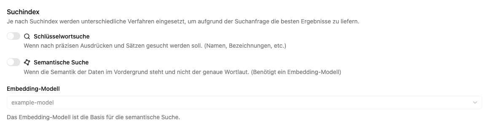

# Eine Dokumentenablage erstellen

Eine neue Ablage braucht einen Namen und einen Arbeitsplatz. Suchverfahren und ein optionaler Transkriptor bestimmen, wie ihre Inhalte später genutzt werden können.

## Ablage anlegen

1. Öffne **Apps → Dokumentenablagen → Neue Dokumentenablage**.
2. Wähle unter **Einstellungen** den Arbeitsplatz und trage **Name** und **Beschreibung** ein.
3. Wähle bei Bedarf Farbe und Icon.
4. Öffne **Funktionen**. Die **Schlüsselwortsuche** ist bei einer neuen Ablage vorbereitet.
5. Aktiviere bei Bedarf **Semantische Suche** und wähle ein verfügbares **Embedding-Modell**.
6. Wähle einen **Transkriptor**, wenn hochgeladene Audio- und Videodateien automatisch verschriftlicht werden sollen.
7. Prüfe die Übersicht und wähle **Erstellen** beziehungsweise **Dokumentenablage erstellen**.
8. Öffne **Dateien**, lade eine Beispielunterlage hoch und prüfe nach der Verarbeitung die Vorschau und Suche.

## Welche Suchfunktion passt?

**Schlüsselwortsuche** eignet sich für Namen, Bezeichnungen und konkrete Wörter. **Semantische Suche** sucht nach inhaltlicher Ähnlichkeit und benötigt ein Embedding-Modell. Du kannst beide Verfahren aktivieren; die [Volltextsuche](search.md) verwendet dann die eingeschalteten Verfahren.

Wenn kein passendes Modell oder kein Transkriptor auswählbar ist, muss die zuständige Administration diese Ressource zuerst bereitstellen.

Für die Nutzung durch einen Agenten richte anschließend eine [Verbindung in dessen Rolle](../../agent/edit/dokumentenablagen.md) ein.
