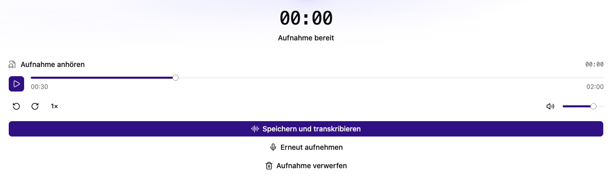

# Audio direkt im Browser aufnehmen

Für die Mikrofonaufnahme brauchst du einen Browser mit freigegebenem Mikrofonzugriff und eine Verbindung über **HTTPS**; für lokale Entwicklung ist auch `localhost` möglich. Kläre vor einer Gesprächsaufnahme die Zustimmung der Beteiligten und wähle einen Speicherort, auf den nur der vorgesehene Personenkreis Zugriff hat.

## Aufnahme öffnen

- Am Transkriptor: **Audio aufnehmen** startet eine neue Aktivität und öffnet den Recorder.
- In einer Transkriptionsaktivität: Verwende das Mikrofon oder **Optionen → Neu → Neue Aufnahme**.
- In einem Chat oder einer Dokumentenablage: Die Aufnahme wird angeboten, wenn ein Transkriptor zugeordnet ist.

## Aufnehmen und speichern

1. Wähle **Aufnahme starten**.
2. Erlaube den Mikrofonzugriff im Browser und gegebenenfalls im Betriebssystem.
3. Kontrolliere **Aufnahme läuft**, Pegel und Dauer.
4. Wähle **Aufnahme stoppen**.
5. Höre die fertige Aufnahme über **Aufnahme anhören** an.
6. Wähle **Speichern und transkribieren**.
7. Warte auf **Gespeichert**. Die Transkription startet danach automatisch.

## Neu aufnehmen oder verwerfen

Mit **Erneut aufnehmen** beginnst du eine neue Aufnahme. **Aufnahme verwerfen** entfernt die noch nicht gespeicherte Aufnahme. Schließe den Recorder erst, nachdem du die Aufnahme gespeichert oder verworfen hast. Ein laufender Upload muss zunächst abgeschlossen werden.

Während der Aufnahme versucht die App, den Bildschirm wach zu halten. Wenn das nicht möglich ist, zeigt sie einen Hinweis. Lass die Seite geöffnet und verhindere die automatische Bildschirmsperre. Warte vor dem Schließen der Seite auf **Gespeichert**.

## Probleme beheben

Bei verweigertem Mikrofonzugriff passe die Website- und Betriebssystemberechtigung an und versuche es erneut. Eine leere Aufnahme musst du wiederholen. Schlägt nur der Upload fehl, bleibt die Vorschau verfügbar und du kannst den Upload erneut versuchen. Verlasse die Seite vorher nicht.

Der Speicherort entspricht dem geöffneten Chat, der Transkriptionsaktivität oder dem aktuellen Ablageordner. Achte darauf, bevor du eine Aufnahme speicherst.
