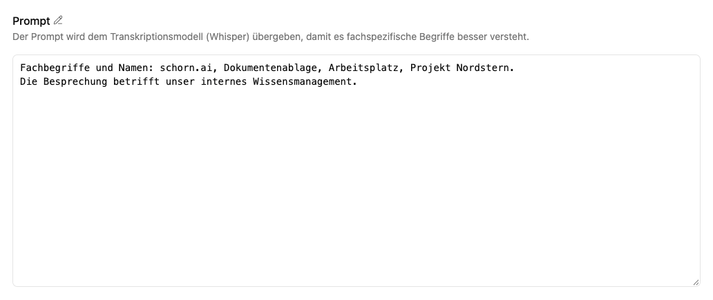

# Transkriptoren bearbeiten, kopieren und löschen

Wähle **Bearbeiten** am Transkriptor. Im Editor findest du **Übersicht**, **Prompt** und **Einstellungen**.

## Konfiguration anpassen

Unter **Prompt** hinterlegst du Hinweise für die Spracherkennung, besonders Namen und Fachwörter. Unter **Einstellungen** wählst du Modell, Arbeitsplatz, Name, Beschreibung, Farbe und Icon.

Wähle anschließend **Speichern** beziehungsweise **Transkriptor speichern**. Rücksetzsymbole verwerfen einzelne Änderungen. Über **Änderungen verwerfen** kannst du nach Bestätigung alle noch nicht gespeicherten Änderungen zurücksetzen.

Unter **Einstellungen → Automatische Wiederholungsversuche** gibt es einen Regler mit drei Stufen:

- **Schnell:** ein Versuch pro Audioabschnitt, ohne automatische Wiederholung.
- **Ausgewogen:** bis zu drei Versuche pro Audioabschnitt.
- **Gründlich:** bis zu sechs Versuche pro Audioabschnitt; entspricht dem bisherigen Standard.

Wiederholungen erfolgen nur bei unsicheren oder stark wiederholten Erkennungsergebnissen. Mehr Versuche können die Erkennung verbessern, benötigen aber zusätzliche Zeit. Ein problemloser Abschnitt wird auch bei **Gründlich** nur einmal erkannt. Bestehende Transkriptoren ohne gespeicherte Stufe verwenden weiterhin **Gründlich**.

Prüfe neue Einstellungen mit einer kurzen Aufnahme. Für bestehende Transkripte kannst du einzelne Fehler in der [Abschnittsbearbeitung](transkription.md) korrigieren oder über **Erneut verarbeiten** die gesamte Datei mit der aktuellen Konfiguration neu transkribieren. Sichere zuvor manuelle Korrekturen; sie werden dabei ersetzt.

## Kopie erstellen

**Als neuen Transkriptor speichern** erzeugt eine eigenständige Konfiguration. Gib ihr einen passenden Namen, beispielsweise für einen anderen Fachbereich. Bestehende Aufnahmen und Transkriptionsaktivitäten werden dadurch nicht dupliziert.

## Transkriptor löschen

Wähle **Transkriptor löschen** und bestätige den Dialog. Die Aktion ist in der Oberfläche nicht rückgängig zu machen. Prüfe vorher, ob Agenten oder Dokumentenablagen diesen Transkriptor noch für automatische Medienverarbeitung verwenden, und passe deren Zuordnungen an.

Für die Konfiguration brauchst du Arbeitsplatzadministratorrechte oder globale Administratorrechte. Bei einem Arbeitsplatzwechsel benötigst du diese Rechte sowohl im bisherigen als auch im neuen Arbeitsplatz.

## Zugehörige MCP-Werkzeuge

**Mindeststufe:** Workspace-Administrator. `platform_transcribers_list` liest zugängliche Konfigurationen ab Benutzerstufe. `platform_transcriber_create`, `platform_transcriber_update` und `platform_transcriber_delete` verwalten Transkriptoren im berechtigten Workspace.

Verbindung und gemeinsame Berechtigungsregeln: [Plattformzugriff](../../agent/edit/plattformzugriff.md).
