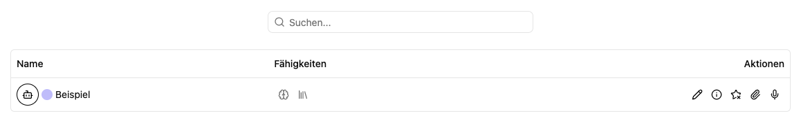

# Transkription: Sprache in Text umwandeln

Mit der Transkription wandelst du gesprochene Inhalte aus Audio- oder Videodateien in lesbaren Text um. Du kannst vorhandene Medien hochladen oder direkt im Browser aufnehmen.

Ein **Transkriptor** ist die gespeicherte Konfiguration aus Modell, Fachbegriffen und Arbeitsplatz. Eine **Transkription** ist der einzelne Arbeitsvorgang mit seinen Dateien und Ergebnissen.

## Transkriptor auswählen

1. Öffne **Apps → Transkription**.
2. Suche nach Name, Beschreibung oder Modell.
3. Öffne **Infos**, wenn du Modell und Prompt prüfen möchtest.
4. Wähle **Neue Transkription** für einen [Dateiupload](files.md) oder **Audio aufnehmen** für eine [direkte Aufnahme](aufnahme.md).

Die Karte bietet außerdem das Sternsymbol für Favoriten. **Bearbeiten** erscheint für die Verwaltung des Transkriptors. **Neuer Transkriptor** legt eine neue Konfiguration an und ist nicht die Aktion zum Hochladen einer Aufnahme.

## Übersicht anpassen

Unter **Optionen** wechselst du zwischen Kacheln und Tabelle, sortierst nach Namen und gruppierst nach Favoriten, Anfangsbuchstaben, Arbeitsplatz oder Modell. **Ansicht speichern** merkt sich die Auswahl.

## Ergebnis nutzen

Nach erfolgreicher Verarbeitung öffnest du die Datei, hörst relevante Stellen nach, korrigierst den Text und lädst bei Bedarf eine **SRT-Datei** herunter. Der gesamte Ablauf steht unter [Transkripte prüfen und exportieren](transkription.md).

Transkriptoren können zusätzlich in [Dokumentenablagen](../documents/edit.md) und [Agenten](../../agent/edit/einstellungen.md) eingebunden sein. Dort wird dieselbe Art der Verarbeitung für Medienuploads verwendet.
