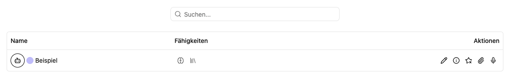

# Transkription: Sprache in Text umwandeln

Mit der Transkription wandelst du gesprochene Inhalte aus Audio- oder Videodateien in lesbaren Text um. Du kannst vorhandene Medien hochladen oder direkt im Browser aufnehmen.

Ein **Transkriptor** ist die gespeicherte Konfiguration aus Modell, Fachbegriffen und Arbeitsplatz. Eine **Transkription** ist der einzelne Arbeitsvorgang mit seinen Dateien und Ergebnissen.

## Transkriptor auswählen

1. Öffne **Apps → Transkription**.
2. Suche nach Name, Beschreibung oder Modell.
3. Öffne **Infos**, wenn du Modell und Prompt prüfen möchtest.
4. Wähle **Neue Transkription** für einen [Dateiupload](files.md) oder **Audio aufnehmen** für eine [direkte Aufnahme](aufnahme.md).

Die Karte bietet außerdem das Sternsymbol für Favoriten. **Bearbeiten** erscheint für die Verwaltung des Transkriptors. **Neuer Transkriptor** legt eine neue Konfiguration an und ist nicht die Aktion zum Hochladen einer Aufnahme.

## Übersicht anpassen

Unter **Optionen** wechselst du zwischen Kacheln und Tabelle, sortierst nach Namen und gruppierst nach Favoriten, Anfangsbuchstaben, Arbeitsplatz oder Modell. **Ansicht speichern** merkt sich die Auswahl.

## Ergebnis nutzen

Nach erfolgreicher Verarbeitung öffnest du die Datei, hörst relevante Stellen nach, korrigierst den Text und lädst bei Bedarf eine **SRT-Datei** herunter. Der gesamte Ablauf steht unter [Transkripte prüfen und exportieren](transkription.md).

Transkriptoren können zusätzlich in [Dokumentenablagen](../documents/edit.md) und [Agenten](../../agent/edit/einstellungen.md) eingebunden sein. Dort wird dieselbe Art der Verarbeitung für Medienuploads verwendet.

## Als XRAG exportieren

Arbeitsplatzadministrator:innen können das Objekt unter **Info → XRAG exportieren** einzeln herunterladen. Für einen gemeinsamen Download mit weiteren Ressourcen wählst du **Zu XRAG-Paket hinzufügen** und bestätigst die gewünschten verbundenen Objekte. Transkriptionsaufträge und deren Aufnahmen gehören nicht zum Konfigurationsexport. Unter **Bearbeiten → Einstellungen** kannst du den lesbaren globalen Identifier ändern. Er wird aus dem Titel in kebab-case erzeugt. Die globale ID bleibt bei Import und erneutem Export erhalten, sodass getrennt übertragene Objekte wieder verbunden werden können.

Unter [XRAG Import und Export](../../settings/xrag.md) findest du die Schritte zum Importieren, zur Bestätigung vorhandener Objekte und zum Erstellen oder Entpacken von Sammelarchiven.

## Zugehörige MCP-Werkzeuge

- `platform_xrag_export`: Ein Objekt mit `kind: "transcriber"` exportieren, optional mit Modellarchiven. Mindeststufe: **Arbeitsplatzadministrator:in**; Administratorrechte im Arbeitsplatz des Objekts. Downloadlink zehn Minuten gültig; Die Modelldateien müssen auf dem Core-Host lesbar sein oder als veröffentlichtes Archiv vorliegen.
- `platform_xrag_related_objects` und `platform_xrag_saved_package_add` ermitteln die verbundenen Ressourcen und übernehmen die gewählte Auswahl in ein eigenes Paket. Mindeststufe **Arbeitsplatzadministrator:in** mit Exportrechten für jedes ausgewählte Objekt.
- `platform_xrag_identity_get` / `platform_xrag_identity_set`: Globalen Identifier lesen bzw. initialisieren oder mit Prüfung der bisherigen ID ändern. Mindeststufe: **Arbeitsplatzadministrator:in**; Administratorrechte im betroffenen Arbeitsplatz. Bereits exportierte Archive bleiben unverändert.

Import- und Sammelwerkzeuge sowie ihre Grenzen sind unter [XRAG](../../settings/xrag.md#zugehörige-mcp-werkzeuge) dokumentiert.
