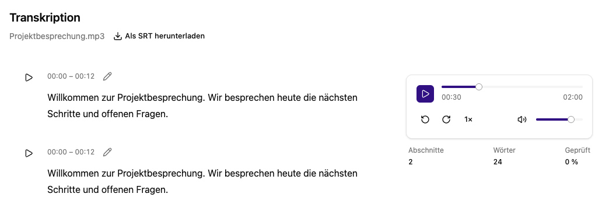
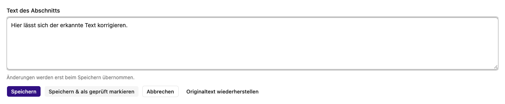

# Transkripte prüfen, bearbeiten und exportieren

Öffne eine erfolgreich transkribierte Datei. Du siehst den Text in zeitlich zugeordneten Abschnitten und einen Mediaplayer. Diese Ansicht steht auch für Medien zur Verfügung, die in einem Chat oder einer Dokumentenablage verarbeitet wurden.

## Anhören und prüfen

Starte die Wiedergabe am Player oder am gewünschten Abschnitt. Du kannst pausieren, zehn Sekunden vor- oder zurückspringen, die Position verändern und Wiedergabegeschwindigkeit sowie Lautstärke anpassen. Bei Video lässt sich das Bild ein- und ausblenden.

Die Übersicht nennt **Abschnitte**, **Wörter** und den Anteil **Geprüft**. **Geprüft** zählt die Abschnitte, die du mit **Speichern & als geprüft markieren** bestätigt hast. Höre insbesondere Namen, Zahlen und unklare Formulierungen nach, bevor du einen Abschnitt markierst.

## Einen Abschnitt korrigieren

1. Klicke am Abschnitt auf das Stiftsymbol.
2. Korrigiere den Text unter **Text des Abschnitts**.
3. Wähle **Speichern**, um die Änderung ohne Prüfmarkierung zu übernehmen, oder **Speichern & als geprüft markieren**.
4. Bearbeite anschließend den nächsten Abschnitt.

**Abbrechen** verwirft die noch nicht gespeicherte Bearbeitung. **Originaltext wiederherstellen** lädt den ursprünglichen Abschnittstext in den Editor; erst anschließendes Speichern übernimmt diese Wiederherstellung. Eine Zeitmarken- oder Sprecherbearbeitung wird hier nicht angeboten.

## Speicherfehler und gleichzeitige Bearbeitung

Bei einem Speicherfehler bleibt der Entwurf erhalten. Versuche erneut zu speichern. Meldet die App, dass der Abschnitt inzwischen geändert wurde, **kopiere zuerst deinen Entwurf**, lade dann die Ansicht neu und gleiche ihn mit dem aktuellen Text ab. So überschreibst du keine zwischenzeitliche Änderung unbesehen.

Änderungen an unterschiedlichen Abschnitten werden nacheinander in den aktuellen
Dateistand übernommen. Ist die Datei gerade durch eine andere Verarbeitung oder
einen anderen Server gesperrt, wird der Speicherversuch abgelehnt. Warte auf den
Abschluss und versuche es erneut; dein Entwurf bleibt erhalten.

## Als Untertitel exportieren

1. Speichere oder verwirf jede laufende Abschnittsbearbeitung.
2. Wähle **Als SRT herunterladen** neben dem Dateinamen.
3. Verwende die heruntergeladene `.srt`-Datei in einer Anwendung, die dieses Untertitelformat unterstützt.

Der Export enthält den gespeicherten Text einschließlich Korrekturen und die vorhandenen Zeitmarken. Er ist nicht auf als geprüft markierte Abschnitte beschränkt. Leere Abschnitte oder Abschnitte ohne gültige Zeitspanne werden ausgelassen. Für die Weiterverarbeitung als Dokument lade über **Verarbeiteten Text herunterladen** den Text herunter und öffne ihn in deinem Textverarbeitungsprogramm.

## Zugehörige MCP-Werkzeuge

- `platform_transcription_segment_update`: Transkriptsegment korrigieren oder prüfen. Mindeststufe: **Editor**.
- `platform_activity_transcription_segment_update`: Transkriptsegment korrigieren oder prüfen. Mindeststufe: **Benutzer**.
- `platform_file_read`: Extrahierten Inhalt, Textversionen und Transkript lesen. Mindeststufe: **Benutzer**.
- `platform_file_download`: Kurzlebige Downloadadresse für Originaldatei erhalten. Mindeststufe: **Benutzer**.

Jeder Aufruf prüft zusätzlich die Berechtigung für das eigene Konto bzw. die betroffene Ressource. Die Zugriffsstufe verleiht keine Rechte. Voraussetzungen, besondere Grenzen und der vollständige Werkzeugkatalog stehen unter [Plattformzugriff](../../agent/edit/plattformzugriff.md).
