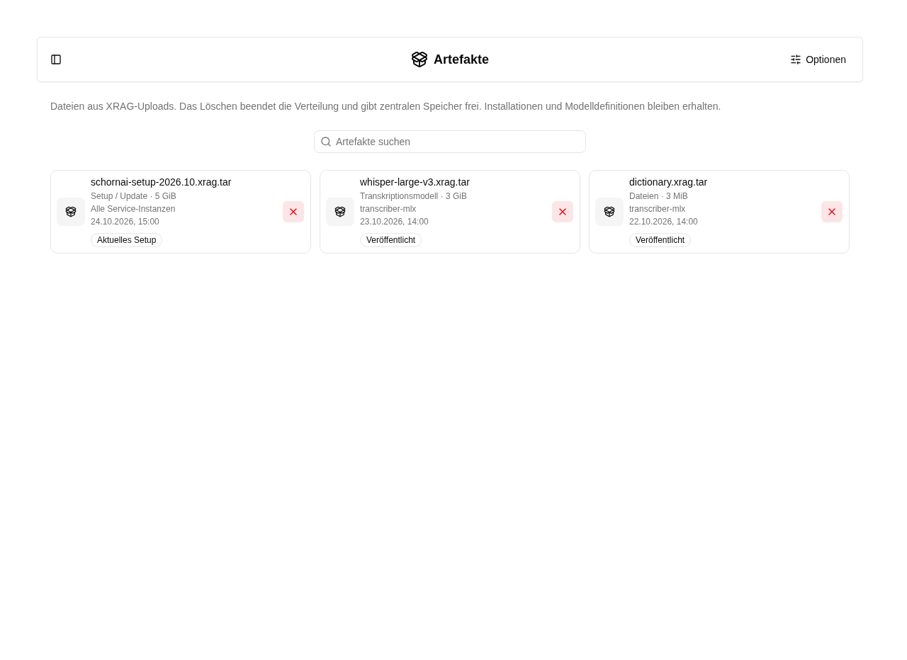

# Artefakte verwalten

Öffne **Cluster → Artefakte**. Hier siehst du die über [XRAG](../settings/xrag.md)
veröffentlichten Dateien. Unter **Cluster → Service** stehen weiterhin die Maschinen und
Dienste; der Upload bleibt unter **Einstellungen → XRAG hochladen**.

Sind noch keine Artefakte veröffentlicht, öffnet der Button **XRAG hochladen**
direkt die Upload-Seite.

## Ansicht anpassen

Unter **Optionen** wählst du **Tabelle** oder **Kacheln**. Beide Ansichten zeigen
Name, Typ, Empfänger, Größe, Veröffentlichungsdatum und Status. Die Suche filtert
nach Dateinamen, Pakettyp und expliziten Empfängerangaben.

MLX-Whisper-Modelle sind an `transcriber-mlx` adressiert.

Gruppiere nach **Typ**, **Empfänger**, **Status** oder **Anfangsbuchstabe** und sortiere
nach Name, Größe oder Veröffentlichungsdatum. Bei mehreren Empfängern erscheint eine
Datei in jeder passenden Gruppe; dadurch entstehen keine zusätzlichen Dateien.

Die aktuelle Auswahl steht wie im Docrepo in der URL. **Ansicht speichern** merkt
sie sich für dein Benutzerkonto. **Zurücksetzen** stellt die gespeicherte Auswahl
wieder her, ohne gespeicherte Auswahl die Standardtabelle. Die Einstellungen sind
unabhängig von der Service-Übersicht.

## Artefakte löschen

1. Wähle das **X** am betreffenden Artefakt.
2. Prüfe den Hinweis: Neue oder offline befindliche Maschinen können die Datei anschließend nicht mehr beziehen.
3. Bestätige **Löschen**.

Die Datei wird zuerst aus der Verteilung zurückgezogen und anschließend aus
Supabase Storage entfernt. Bereits installierte Dateien sowie Modelldefinitionen
bleiben erhalten. Eine bereits laufende Installation wird dadurch nicht zurückgerollt.
Bei **Bereinigung ausstehend** ist die Verteilung bereits beendet, aber das
Löschen noch nicht vollständig abgeschlossen. Wiederhole dann die Löschaktion.

Ein kleiner Metadateneintrag bleibt erhalten. Dadurch aktiviert das Löschen des
neuesten Setups kein älteres Setup. Nach dem Zurückziehen des aktuellen Setups
musst du ein neues Paket veröffentlichen, um wieder Updates zu verteilen.
Die Übersicht kennt keine vollständige Installationshistorie jeder Maschine;
sie bestätigt daher nicht, dass eine Datei bereits überall installiert ist.

Setup-Releases werden nach Plattform und Architektur ausgewählt. Bei mehreren
Zielplattformen können deshalb mehrere Pakete als **Aktuelles Setup** markiert
sein. Die Empfängerangabe zeigt bei solchen Paketen auch Plattform und Architektur.
Zurückgezogene Releases verhindern einen Rückfall auf ältere Pakete für
dasselbe Ziel.

## Zugehörige MCP-Werkzeuge

- `platform_artifacts_list`: Veröffentlichte Artefakte lesen. Mindeststufe: **Globaler Administrator**.
- `platform_artifact_delete`: Artefakt und Katalogeintrag entfernen. Mindeststufe: **Globaler Administrator**.

Jeder Aufruf prüft zusätzlich die Berechtigung für das eigene Konto bzw. die betroffene Ressource. Die Zugriffsstufe verleiht keine Rechte. Voraussetzungen, besondere Grenzen und der vollständige Werkzeugkatalog stehen unter [Plattformzugriff](../agent/edit/plattformzugriff.md).
