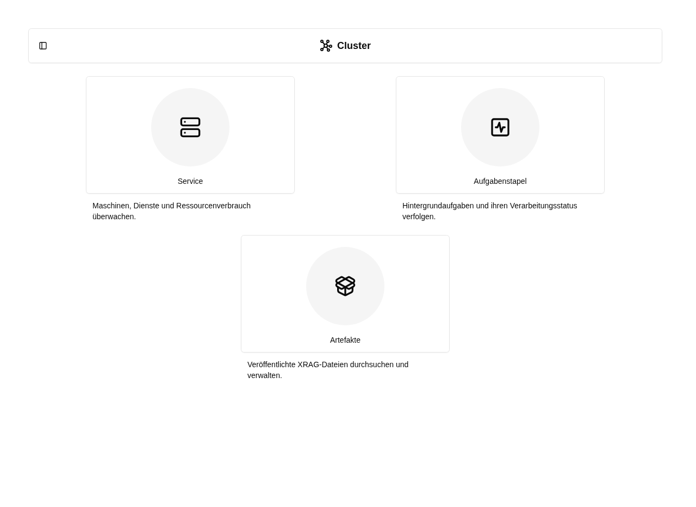

# Cluster-Übersicht

Öffne **Cluster** mit dem Graph-Star-Symbol in der Administrationsnavigation
oder im Kontomenü links unten in der Seitenleiste unter **System**.
Wie unter **Einstellungen** erscheint eine Kachelübersicht. Die drei Ziele stehen
auch direkt darunter als Unterpunkte, in dieser Reihenfolge:

1. [Service](../service/index.md): Maschinen, Dienste und Ressourcenverbrauch überwachen.
2. [Aufgabenstapel](../tasks/index.md): Hintergrundaufgaben und ihren Verarbeitungsstatus verfolgen.
3. [Artefakte](../artifacts/index.md): veröffentlichte XRAG-Dateien durchsuchen und verwalten.

Die Cluster-Navigation und ihre Kacheln sind globalen Administrator:innen vorbehalten.
XRAG-Dateien lädst du weiterhin unter [Einstellungen → XRAG hochladen](../settings/xrag.md) hoch.

## Zugehörige MCP-Werkzeuge

- `platform_services_status`: Maschinen, Dienstzustand und Auslastung lesen. Mindeststufe: **Globaler Administrator**.
- `platform_tasks_list`: Aufgabentypen und Zustände lesen. Mindeststufe: **Globaler Administrator**.
- `platform_artifacts_list`: Veröffentlichte Artefakte lesen. Mindeststufe: **Globaler Administrator**.

Jeder Aufruf prüft zusätzlich die Berechtigung für das eigene Konto bzw. die betroffene Ressource. Die Zugriffsstufe verleiht keine Rechte. Voraussetzungen, besondere Grenzen und der vollständige Werkzeugkatalog stehen unter [Plattformzugriff](../agent/edit/plattformzugriff.md).
