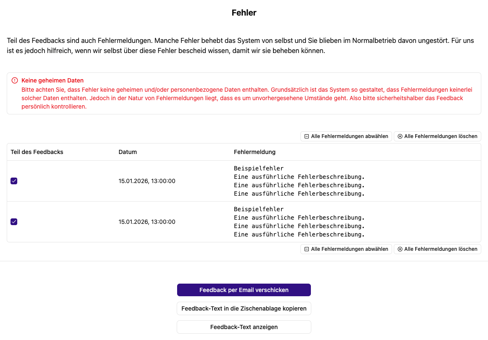

# Feedback und Fehlerberichte

Über **Feedback** im Fußbereich oder direkt unter `/feedback` kannst du eine Rückmeldung vorbereiten. Die Seite sammelt deine Bewertung, deinen Text und die von dir ausgewählten Fehlermeldungen.

## Rückmeldung erstellen

1. Wähle bei Bedarf eine Sternebewertung.
2. Beschreibe unter **Bewertung schreiben**, was passiert ist, was du erwartet hast und welche Schritte zum Problem führen.
3. Prüfe im Bereich **Fehler**, welche Meldungen Teil des Feedbacks sein sollen.
4. Kontrolliere über **Feedback-Text anzeigen** den vollständigen vorgesehenen Text.
5. Kopiere ihn in die Zwischenablage oder wähle **Feedback per Email verschicken**.

Die E-Mail-Aktion öffnet dein E-Mail-Programm mit vorbereitetem Text an `hello@schorn.ai`. Prüfe den Entwurf und sende ihn im E-Mail-Programm ab. Wenn kein Programm eingerichtet ist oder der Text zu lang für die Übergabe ist, verwende die Kopierfunktion und erstelle die Nachricht selbst.

## Fehlermeldungen auswählen und löschen

Du kannst einzelne Meldungen auswählen, alle auswählen oder alle abwählen. Nur ausgewählte Meldungen werden in den Feedbacktext aufgenommen. Manche protokollierten Fehler können sich bereits selbst behoben haben; beschreibe deshalb zusätzlich, was du tatsächlich beobachtet hast.

**Alle Fehlermeldungen löschen** entfernt nach Bestätigung die gesammelten Meldungen. Sichere zuvor die für deine Rückmeldung nötigen Informationen.

Entferne vor dem Senden Passwörter, API-Schlüssel, private Dokumentinhalte und personenbezogene Angaben, die für die Fehlerbeschreibung nicht benötigt werden. Behalte Fehlermeldung, Zeitpunkt und die Schritte zum Reproduzieren bei.

Weiter: [Fehlerbehebung](../hilfe/fehlerbehebung.md)
