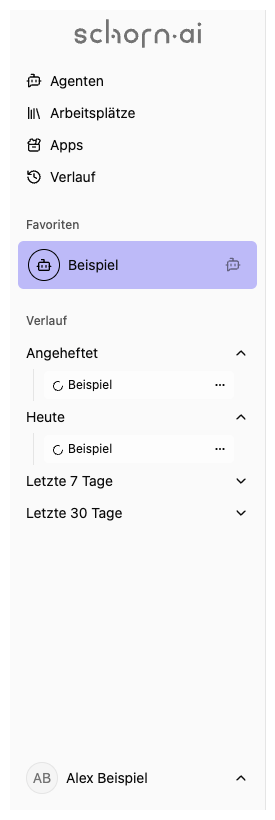

# schorn.ai – Anwenderdokumentation

Mit schorn.ai arbeitest du mit KI-Agenten, nutzt Dokumente als Wissensbasis und wandelst Audio- oder Videoaufnahmen in Text um. Welche Inhalte du siehst, hängt von deinen Arbeitsplätzen und Berechtigungen ab.

„Arbeitsplatz“ und „Workspace“ bezeichnen denselben Bereich. Frühere Versionen nannten Arbeitsplätze „Organisationen“ und Agenten „Chatbots“.

## Dein erster Ablauf

1. Öffne die Adresse deiner schorn.ai-Instanz und [melde dich an](signin/index.md).
2. Wähle **Agenten** und suche einen Agenten, dessen Beschreibung zu deiner Aufgabe passt.
3. Öffne mit **Neuer Chat** ein Gespräch und [sende deine erste Nachricht](agent/chat/index.md).
4. Lies die Antwort und prüfe wichtige Angaben anhand der angegebenen Quellen.
5. Öffne das Gespräch später wieder über den [Verlauf](activity/index.md).

Beispiel: „Fasse diesen Text in fünf Stichpunkten zusammen. Nenne anschließend die offenen Fragen.“ Ergänze den Text oder hänge eine passende Datei an.

## Dashboard und Navigation

Die Startseite `/` zeigt eine Begrüßung, gegebenenfalls einen Willkommenstext deiner Organisation und deine Favoriten. Über **Alle Agenten** und **Zu den Apps** gelangst du zu den vollständigen Übersichten. Die Seitenleiste führt außerdem zu Arbeitsplätzen und Verlauf. Über das Kontomenü erreichst du dein Profil und die Abmeldung.

Die Abbildungen verwenden Beispieldaten. Suche in deiner Instanz nach den in der Anleitung **fett hervorgehobenen Aktionen** und wähle deine eigenen Agenten, Dateien und Arbeitsplätze aus.

## Funktionen nach Bereichen

| Bereich                                     | Was du dort erledigst                                                                  |
| ------------------------------------------- | -------------------------------------------------------------------------------------- |
| [Anmeldung](signin/index.md)                | Mit Passwort oder SSO anmelden, Zugang einrichten                                      |
| [Agenten](agent/index.md)                   | Passende KI-Assistenten finden und ihre Fähigkeiten ansehen                            |
| [Chats](agent/chat/index.md)                | Nachrichten, Dateien, Nachdenken, Stapel und Werkzeugfreigaben nutzen                  |
| [Verlauf](activity/index.md)                | Chats und Transkriptionen wiederfinden und anheften                                    |
| [Apps](app/index.md)                        | Dokumentenablagen und Transkription öffnen                                             |
| [Dokumentenablagen](app/documents/index.md) | Dateien organisieren, Inhalte durchsuchen und für Agenten bereitstellen                |
| [Transkription](app/transcribe/index.md)    | Medien hochladen oder aufnehmen, Transkripte korrigieren und exportieren               |
| [Arbeitsplätze](workspace/index.md)         | Zusammengehörige Agenten und Apps samt eigener Rolle finden                            |
| [Profil](me/index.md)                       | Name, Profilbild, Sprache und persönliche Darstellung ändern                           |
| [Verbindungen](me/connections.md)           | Persönliche OAuth-Verbindungen ansehen und trennen                                     |
| [Berechtigungen](me/permissions.md)         | Eigene Rollen und die Unterschiede zwischen ihnen verstehen                            |
| [Einstellungen](settings/index.md)          | Konten, Arbeitsplätze, Verbindungen, SSO und XRAG verwalten                            |
| [Cluster](cluster/index.md)                 | Maschinen, Aufgaben und veröffentlichte Artefakte als globale Administration verwalten |
| [Aufgabenstapel](tasks/index.md)            | Hintergrundverarbeitung als Administrator:in beobachten                                |
| [Feedback](feedback/index.md)               | Rückmeldung vorbereiten und Fehlerberichte prüfen                                      |

## Inhalte bereitstellen

Arbeitsplatzadministrator:innen können [Agenten erstellen](agent/new.md), [Dokumentenablagen einrichten](app/documents/new.md) und [Transkriptoren konfigurieren](app/transcribe/new.md). Für die Verwaltung von Benutzerkonten und Arbeitsplatzzuweisungen ist die globale Rolle Administrator:in erforderlich.

## Hilfe und Nachschlagen

- [Alle Anleitungen](navigation.md): vollständiges Inhaltsverzeichnis einschließlich der Desktop-Begleitprogramme.
- [Fehlerbehebung](hilfe/fehlerbehebung.md): fehlender Zugriff, ausbleibende Antworten, Upload- und Aufnahmeprobleme.
- [Begriffe](hilfe/begriffe.md): Agent, Modell, Rolle, Suchindex und weitere Begriffe.
- [Daten und Freigaben](hilfe/daten-und-freigaben.md): Speicherorte, externe Dienste und Bedeutung des Löschens im Verlauf.
- [Dokumentationsformat](README.md): Hinweise zur Wiederverwendung als Website oder Wissensbasis.
