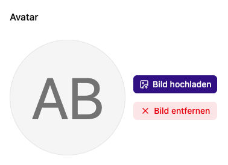
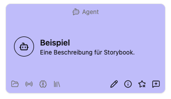

# Profil und persönliche Einstellungen

Öffne im Kontomenü **Profil**. Hier bearbeitest du deinen Namen und dein Profilbild. Darunter führen Kacheln zu **Favoriten**, **Berechtigungen** und **Verbindungen**.

## Name ändern

1. Trage **Vorname** und **Nachname** ein.
2. Wähle **Speichern**.
3. Mit **Zurücksetzen** verwirfst du die noch nicht gespeicherten Änderungen dieses Formulars.

## Profilbild ändern

Wähle **Bild hochladen** und eine passende Bilddatei. Das hochgeladene eigene Bild wird als Avatar verwendet. Über **Bild entfernen** und die anschließende Bestätigung entfernst du dieses Bild. Bei einem SSO-Konto kann anschließend wieder das vom Anbieter bereitgestellte Bild erscheinen; ohne Bild verwendet die App eine Ersatzdarstellung.

## Sprache und Hell-/Dunkelmodus

Im Fußbereich der App wählst du die Sprache über das Sprachsymbol. Zur Verfügung stehen alle 24 EU-Amtssprachen: Bulgarisch, Dänisch, Deutsch, Englisch, Estnisch, Finnisch, Französisch, Griechisch, Irisch, Italienisch, Kroatisch, Lettisch, Litauisch, Maltesisch, Niederländisch, Polnisch, Portugiesisch, Rumänisch, Schwedisch, Slowakisch, Slowenisch, Spanisch, Tschechisch und Ungarisch. Zusätzlich gibt es **Ukrainisch** und **Arabisch**. Die Auswahl zeigt die Sprachen in ihrer jeweiligen Eigenbezeichnung. Arabisch verwendet die Schreibrichtung von rechts nach links; die Seitenleiste und die mobile Navigation öffnen sich rechts. Die Auswahl wird in diesem Browser gespeichert und ist bereits auf der Anmeldeseite verfügbar.

Deutsch und Englisch sind die laufend gepflegten Hauptübersetzungen. Die weiteren Sprachen werden auf ausdrückliche Anforderung aktualisiert. Deshalb können neu hinzugekommene Texte dort zunächst auf Deutsch erscheinen. Eigene Inhalte, etwa Agentenanweisungen, Chatnachrichten und Dokumente, werden durch die Sprachwahl nicht übersetzt.

Daneben wählst du **Hell**, **Dunkel** oder die Einstellung des Betriebssystems. Diese persönliche Anzeigeauswahl ist von der administrativen [Darstellung](../settings/theme.md) getrennt.

## Favoriten und Ansichten

Markiere Agenten, Dokumentenablagen, Transkriptoren oder Arbeitsplätze über das Sternsymbol als Favorit. Die markierten Inhalte findest du auf dem Dashboard und in der Favoriten-Navigation, solange du Zugriff darauf hast.

Über den Bearbeiten-Button neben **Favoriten** in der Seitenleiste oder unter **Profil → Favoriten** (`/me/favorites`) verschiebst du Einträge am Griff per Drag-and-drop. Über das **Favorit-entfernen-Symbol** entfernst du die Markierung direkt aus dem Entwurf, nicht den Inhalt. Bis zum Speichern kannst du sie mit **Zurücksetzen** wiederherstellen. Auch nicht mehr verfügbare Einträge kannst du entfernen. Der Schalter **In der Seitenleiste anzeigen** blendet die gesamte Favoritengruppe ein oder aus; die Dashboard-Favoriten bleiben sichtbar. Mit **Speichern** übernimmst du alle Änderungen, mit **Zurücksetzen** verwirfst du den Entwurf.

In Listen passt du über **Optionen** die Sortierung, Gruppierung und Ansicht an. **Ansicht speichern** speichert die Auswahl für die jeweilige Übersicht.

Für Zugriffsfragen öffne [Berechtigungen](permissions.md). Ein Passwort änderst du über den vorgesehenen [Reset-Ablauf](../signin/reset.md), bei SSO über deinen Anmeldeanbieter.

## Zugehörige MCP-Werkzeuge

- `platform_favorites_get`: Eigene Favoriten und Sidebar-Sichtbarkeit lesen. Mindeststufe: **Benutzer**; nur eigenes Konto.
- `platform_favorites_update`: Eigene Favoritenliste einschließlich Reihenfolge und Sidebar-Sichtbarkeit ersetzen; Einträge durch Weglassen entfernen. Mindeststufe: **Benutzer**; nur eigenes Konto. Gewährt keinen Zugriff auf die referenzierten Inhalte.
- `platform_profile_get`: Eigenes Profil und Anmeldemethode lesen. Mindeststufe: **Benutzer**.
- `platform_profile_name_update`: Eigenen Profilnamen ändern. Mindeststufe: **Benutzer**.
- `platform_profile_avatar_update`: Eigenes Profilbild setzen oder zurücksetzen. Mindeststufe: **Benutzer**.
- `platform_profile_password_reset`: Eigenes Passwort mit gültigem Reset-Schlüssel setzen. Mindeststufe: **Benutzer**.
- `platform_asset_upload`: Profilbild, Logo oder XRAG-Paket bis 10 MiB hochladen. Mindeststufe: **Benutzer**.

Jeder Aufruf prüft zusätzlich die Berechtigung für das eigene Konto bzw. die betroffene Ressource. Die Zugriffsstufe verleiht keine Rechte. Voraussetzungen, besondere Grenzen und der vollständige Werkzeugkatalog stehen unter [Plattformzugriff](../agent/edit/plattformzugriff.md).
