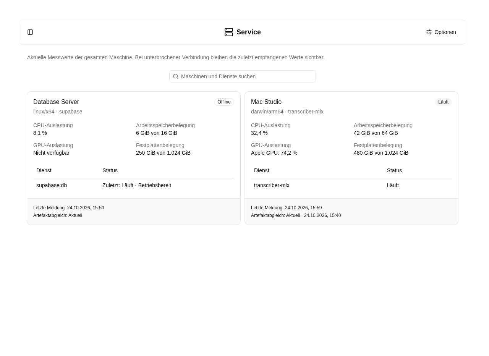

# Service: Maschinen und Dienste

Öffne **Cluster → Service** in der Administrationsnavigation. Hier siehst du die
verbundenen Maschinen. Die [Cluster-Übersicht](../cluster/index.md) verlinkt außerdem
[Aufgabenstapel](../tasks/index.md) und [Artefakte](../artifacts/index.md).
Der XRAG-Upload bleibt unter **Einstellungen → XRAG hochladen**.



## Ansicht anpassen

Über **Optionen** wählst du **Kacheln** oder **Tabelle**. Beide Ansichten zeigen
Maschinenstatus, Ressourcenverbrauch und die zugehörigen Dienste. Die Suche findet
Maschinen nach Name, Plattform, Rolle und Dienstname.

Du kannst nach **Status**, **Plattform**, **Rolle** oder **Anfangsbuchstabe** gruppieren
und nach Namen, letzter Meldung, CPU-Auslastung oder Arbeitsspeicherbelegung sortieren.
Bei Gruppierung nach Rolle erscheint eine Maschine in jeder passenden Gruppe.

Wie im Docrepo stehen die aktuelle Gruppierung, Sortierung und Ansicht in der URL.
**Ansicht speichern** merkt sich diese Auswahl für dein Benutzerkonto;
**Zurücksetzen** entfernt die aktuellen URL-Optionen und lädt deine gespeicherte
Auswahl. Ohne gespeicherte Auswahl gilt die Standardansicht. Service und Artefakte
haben voneinander unabhängige Einstellungen.

## Maschinen und Dienste

Jeder verbundene Service meldet ungefähr alle zehn Sekunden:

- **CPU-Auslastung** und **GPU-Auslastung** der Maschine.
- **Arbeitsspeicherbelegung** und **Festplattenbelegung**, jeweils belegt und gesamt.
- Seine ausgewählten Rollen, den Status nativer Prozesse und Docker-Container sowie verfügbare Container-Zustandsprüfungen.
- Zeitpunkt der letzten Meldung und Zustand des Artefaktabgleichs.

Die Rollen sind `core`, `supabase`, `document-extractor`, `transcriber-mlx` und
`ollama`. Core bündelt Web-App, Realtime und Proxy; Supabase kann auch extern
liegen. [Einrichtung und Verbindungen](../box-admin/supabase.md).

Der native MLX-Transcriber erscheint als Rolle und Dienst `transcriber-mlx`.
Damit ist er von späteren anderen Transcriber-Implementierungen unterscheidbar.

Die Werte beziehen sich auf den gesamten Rechner. Die Festplattenbelegung betrifft
das Dateisystem des Service-Verzeichnisses, nicht nur dessen eigene Dateien.
Arbeitsspeicher umfasst auch vom Betriebssystem belegten Speicher. Es werden die
letzten Werte gespeichert, keine historischen Zeitreihen.

GPU-Auslastung wird über Apple-AGX-Zähler, `nvidia-smi` oder verfügbare
Linux-DRM-Zähler gelesen. Fehlen Treiber, Berechtigungen oder passende Zähler,
steht dort **Nicht verfügbar**. Ein laufender nativer Prozess bestätigt noch
keine fachliche Betriebsbereitschaft; Docker-Zustandsprüfungen werden separat angezeigt.

Nach 35 Sekunden ohne Meldung gilt eine Maschine als **Offline**. Zuletzt gemeldete
Werte bleiben sichtbar und sind dann keine aktuellen Messungen. Auch eine
unterbrochene Browser-Live-Verbindung wird kenntlich gemacht.

## Sofort abgleichen

```sh
npx schornai service sync
npx schornai service logs --follow
```

`sync` setzt einen Auftrag beim laufenden Service ab. Die Rückmeldung bestätigt
die Annahme, nicht die abgeschlossene Installation. Bei einer anderen Konfiguration
verwende `--config /pfad/config.json`. Automatisch erfolgt derselbe Abgleich beim
Start, nach einer Wiederverbindung und bei Yjs-Änderungen. Es gibt kein Katalog-Polling.

## Zugehörige MCP-Werkzeuge

- `platform_services_status`: Maschinen, Dienstzustand und Auslastung lesen. Mindeststufe: **Globaler Administrator**.

Jeder Aufruf prüft zusätzlich die Berechtigung für das eigene Konto bzw. die betroffene Ressource. Die Zugriffsstufe verleiht keine Rechte. Voraussetzungen, besondere Grenzen und der vollständige Werkzeugkatalog stehen unter [Plattformzugriff](../agent/edit/plattformzugriff.md).
