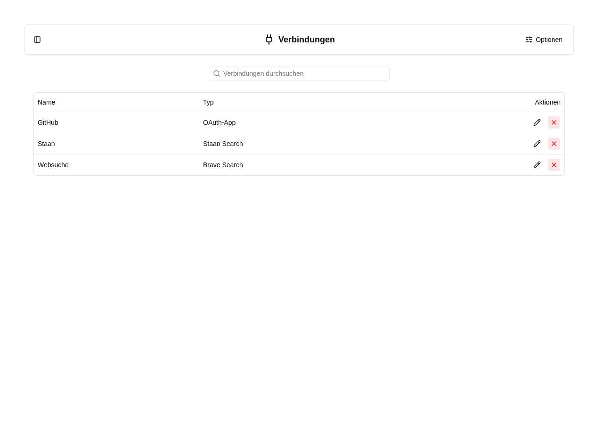
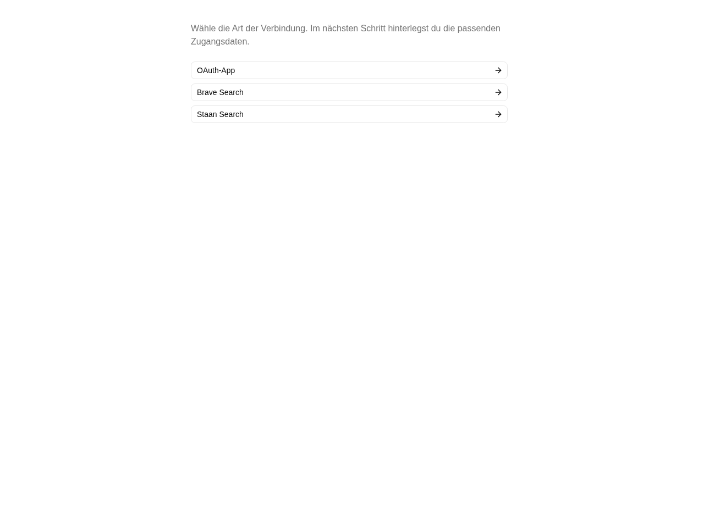

# OAuth-Apps und Suchverbindungen

Unter **Einstellungen → Verbindungen** verwaltest du wiederverwendbare Anbieter-Zugänge für die gesamte Instanz. Arbeitsplatzadministrator:innen können diese anschließend in Agenten auswählen; sie erhalten dabei keine Secrets. Persönliche OAuth-Anmeldungen werden weiterhin separat unter **Profil → Verbindungen** verwaltet.

## Übersicht und Ansichten

Die Übersicht zeigt alle Verbindungen als Tabelle mit Name, Typ und Icon-Aktionen zum Bearbeiten und Löschen. Über **Optionen** im Header sortierst du Namen auf- oder absteigend und gruppierst nach **Typ** oder **Anfangsbuchstabe**. Bei Gruppierung nach Typ gibt es **OAuth** und **Websuche**; Staan und Brave stehen gemeinsam unter Websuche. **Ansicht speichern** speichert deine persönlichen Einstellungen; die Suche filtert die Liste. Eine erfolglose Suche bietet **Suche zurücksetzen**.

## Verbindung anlegen

Wähle **Neue Verbindung** im leeren Zustand oder unter **Optionen → Neue Verbindung**. Unter `/settings/connections/new` wählst du zuerst die Art der Verbindung. Anschließend öffnet sich das passende Formular unter `/new/oauth`, `/new/brave` oder `/new/staan`. Dort vergibst du einen Namen und die jeweiligen Zugangsdaten:

- **OAuth-App:** registrierte Client-ID, verpflichtendes Client Secret und **OAuth-Aussteller (Issuer)**. Trage die exakte Issuer-URL des Anbieters ein, bei dem die Client-ID registriert ist, einschließlich eines gegebenenfalls vorhandenen Pfads. Sie muss zur OAuth-Metadaten-Antwort passen; die MCP-URL oder Callback-URL ist kein Ersatz. Zulässig sind HTTPS-URLs sowie HTTP für lokale Loopback-Anbieter. Registriere die angezeigte Callback-URL beim Anbieter. Über das Kopieren-Symbol daneben kopierst du die vollständige URL in die Zwischenablage. Im Agenten wählst du die Verbindung über **OAuth-App** neben **HTTP Header hinzufügen** aus. Die MCP-URL wird dort unabhängig eingetragen. Dieselbe App kann für mehrere passende MCP-Endpunkte verwendet werden, sofern der Anbieter diese Nutzung unterstützt.
- **Brave Search:** API-Schlüssel für Brave.
- **Staan Search:** API-Schlüssel für Staan sowie optional einen Markt wie `de-de`. Ohne Angabe gilt `en-us`.

Nach **Speichern** ist die Verbindung in den passenden Agenten-Dropdowns verfügbar. Auch neue Agenten und neue MCP-Einträge können sofort eine Verbindung auswählen; sie müssen dafür nicht vorab gespeichert werden. Im Agenten wird nur die Referenz gespeichert.

## Bearbeiten und löschen

Ein Klick auf den Namen oder **Bearbeiten** öffnet die eigene Bearbeitungsseite. **Speichern** führt zurück zur aktualisierten Übersicht. **Abbrechen** verwirft die Eingaben. Bei OAuth-Apps ist die Client-ID deaktiviert; das Client-Secret-Feld wird nicht angezeigt. Beide Zugangsdaten können nach dem Anlegen nicht geändert werden, auch nicht durch direkte Server-Aufrufe. Für andere Zugangsdaten legst du eine neue OAuth-App an und wählst sie in den betroffenen Agenten aus. Auch der einmal gesetzte Aussteller ist unveränderlich. Bei bestehenden OAuth-Apps ohne Aussteller ergänzt ein globaler Administrator diese Angabe einmalig. Bis dahin können diese Apps nicht für MCP OAuth verwendet werden. Nach dem Speichern ist eine erneute persönliche Anmeldung erforderlich. Der Name bleibt bearbeitbar. Bei Suchverbindungen behält ein leeres API-Schlüssel-Feld den vorhandenen Schlüssel. Der Typ einer bestehenden Verbindung kann nicht geändert werden.

**Löschen** verlangt eine Bestätigung. Agenten mit einer Referenz auf die gelöschte Verbindung müssen eine neue Verbindung auswählen. Die Löschung widerruft keine Berechtigungen beim externen Anbieter. Bereits laufende Aufrufe können noch abschließen.

Vorhandene direkt im Agenten gespeicherte Suchschlüssel werden bei der Datenbankmigration in zentrale Verbindungen übernommen und im Agenten durch Referenzen ersetzt. Lokale Seed-Daten enthalten keine echten Anbieter-Secrets.

Die OAuth-App hat keine eigene MCP-URL. Die Callback-URL bleibt für die Rückkehr nach der Anmeldung erforderlich. Die verfügbaren Verbindungen werden beim Öffnen des Agenten-Editors serverseitig geladen.

## Zugehörige MCP-Werkzeuge

**Mindeststufe:** Globaler Administrator. `platform_connections_list` zeigt Metadaten ohne Geheimnisse. `platform_connection_save` erstellt oder ändert Verbindungen mit denselben Regeln wie die Oberfläche; bestehende OAuth-Identitäten sind unveränderlich. Das Feld `issuer` ist für neue OAuth-Apps erforderlich und kann bei alten Apps ohne Aussteller einmalig ergänzt werden. Ein abweichender, vom MCP-Server gemeldeter Aussteller wird abgelehnt, bevor Zugangsdaten an dessen Token-Endpunkt gesendet werden. `platform_connection_delete` entfernt eine Verbindung.

Verbindung und gemeinsame Berechtigungsregeln: [Plattformzugriff](../agent/edit/plattformzugriff.md).
