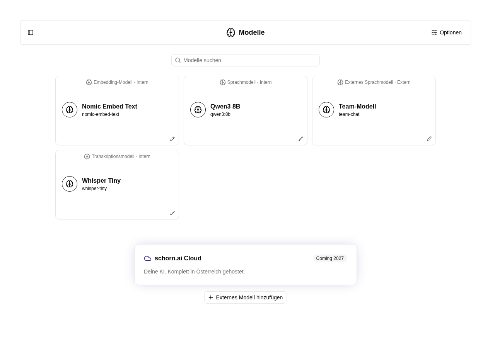
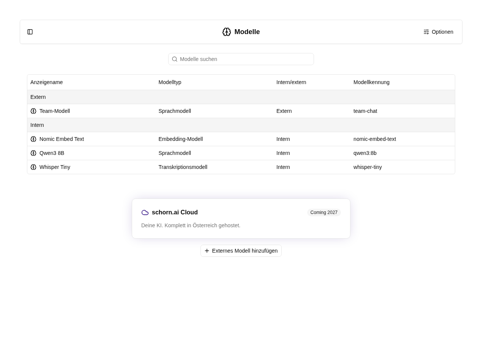

# Modelle verwalten

Öffne **Modelle** in der Verwaltungsnavigation unter **Cluster** und seinen Unterpunkten oder im Kontomenü links unten. Die Verwaltung ist nur für globale Administrator:innen zugänglich.

## Gemeinsame Übersicht

Die Übersicht zeigt lokale und externe Modelle gemeinsam. Unter **Optionen** wechselst du zwischen Karten- und Tabellenansicht, sortierst nach Name und gruppierst nach Modelltyp, intern/extern oder Anfangsbuchstabe. Die Gruppierung nach Modelltyp fasst lokale und externe Sprachmodelle zusammen. Ohne Gruppierung erscheinen alle Modelle in einer Liste. Mit der Suche findest du Modelle anhand von Name, Beschreibung oder Kennung. Eine angepasste Ansicht lässt sich über **Ansicht speichern** als persönliche Voreinstellung sichern. Ein Klick auf die Modellkarte öffnet eine eigene Modellseite mit Kennung und den hinterlegten Eigenschaften, beispielsweise Kontextgröße, Werkzeugunterstützung oder Vektordimensionen.

Die Liste enthält die registrierten Modelle. Wenn ein gelistetes lokales Modell im Chat nicht antwortet, lass die Betriebsadministration den Modelldienst und die installierten Modelldateien prüfen. Installation und Aktualisierung erfolgen über [XRAG](xrag.md).

## Externe Modelle

Bei einem Speicherfehler bleiben die bisherige Verbindung und ihr Schlüssel erhalten. Korrigiere die gemeldeten Eingaben und speichere erneut; nach einem fehlgeschlagenen Anlegen musst du keinen unvollständigen Modelleintrag löschen.

**schorn.ai Cloud** ist mit **Coming 2027** angekündigt und lässt sich derzeit nicht hinzufügen oder buchen.

Darunter sowie im **Optionen**-Menü öffnet **Externes Modell hinzufügen** die Anbieterauswahl. Verfügbar sind Mistral, Hugging Face, OpenAI, Azure OpenAI, Anthropic, Anthropic über Amazon Bedrock, Google und OpenAI-kompatible Endpunkte. Jeder Anbieter hat eine eigene Einrichtungsseite.

Gib auf der Einrichtungsseite einen Anzeigenamen und die Zugangsdaten ein. Unter dem API-Schlüssel steht die Modellkennung. Nach Eingabe des Schlüssels wird die Modellliste automatisch geladen; **Modelle laden** startet einen erneuten Abruf. Im Suchfeld kannst du die geladenen Modelle filtern und auswählen. Für eine eigene Kennung wählst du den Eintrag **„… verwenden“**. Du kannst jederzeit eine Kennung manuell eingeben, auch wenn der Anbieter keinen Katalog bereitstellt oder der Abruf fehlschlägt.

- **OpenAI-kompatibel:** HTTPS-Basis-URL inklusive Versionspfad, zum Beispiel `https://api.example.com/v1`. Ein API-Schlüssel ist optional, wenn der Endpunkt keine Authentifizierung verlangt.
- **Azure OpenAI:** Basis-URL `https://RESOURCE.openai.azure.com/openai/v1`, API-Schlüssel und der Name deiner Bereitstellung. Der allgemeine Modellkatalog liefert keine Liste der eigenen Bereitstellungen; deshalb wird der Name manuell eingegeben.
- **Anthropic über Amazon Bedrock:** AWS-Region und Bedrock-API-Schlüssel. Für den Katalogabruf benötigt der Schlüssel Berechtigungen für `ListFoundationModels` und `ListInferenceProfiles`. Alternativ gibst du die Modellkennung oder Inference-Profile-ID manuell ein. IAM-Zugangsdaten werden in dieser Oberfläche nicht verwendet.
- **Andere native Anbieter:** API-Schlüssel beziehungsweise Hugging-Face-Token und Modellkennung; die API-Adresse ist bereits hinterlegt.

Zugangsdaten in URLs, Query-Parameter und Fragmente sind nicht erlaubt. Schlüssel werden ausschließlich serverseitig gespeichert und nie erneut angezeigt. Auf der Detailseite eines gespeicherten externen Modells kannst du Anzeigename, Modellkennung, Verbindungseinstellungen und Schlüssel ändern. Ein leeres Schlüsselfeld behält den bisherigen Schlüssel. Die Modellliste verwendet die gespeicherten Zugangsdaten serverseitig; du musst den Schlüssel nicht erneut eingeben. Bei einer noch nicht gespeicherten Änderung der Adresse oder Region speicherst du zuerst oder gibst einen neuen Schlüssel ein.

Nach dem Speichern erscheint das Modell in der gemeinsamen Übersicht. Es kann als [Agentenmodell](../agent/edit/einstellungen.md) oder als Modell einer Rolle ausgewählt werden. Bei Verwendung werden Gesprächsinhalte und gegebenenfalls Anhänge an den konfigurierten Anbieter übertragen. Dessen Unterstützung für Bilder, Werkzeuge und andere Funktionen ist Voraussetzung für den jeweiligen Einsatz.

Teste das gespeicherte Modell in einem neuen Chat. Wird der Aufruf abgelehnt, prüfe beim Anbieter, ob der Schlüssel für die gewählte Modellkennung freigeschaltet ist. Trage bei einer Weiterleitungsantwort die endgültige HTTPS-API-Adresse ein; die App folgt keinen HTTP-Weiterleitungen. Diese Verwaltung unterstützt externe Sprachmodelle; Embedding- und Transkriptionsmodelle werden lokal bereitgestellt.

## Modelldetails

Die Modelldetailseite verwendet die Reiter **Übersicht**, **Verbindung** (bei externen Modellen) und **Name und Dokumentation**. Die Übersicht zeigt wie der Agenten-Editor links die Modellkarte und rechts aufklappbare Infobereiche für Eigenschaften, Verbindung und Dokumentation. Die Stift-Schaltflächen öffnen den passenden Bearbeitungsreiter. Die Modellkarte ist in Übersicht und Detailansicht identisch; ihr Stift öffnet direkt Name und Dokumentation. Unter Verbindung aktualisierst du den Modellkatalog und bearbeitest die Anbindung. Name und Dokumentation enthält den Editor und die Löschfunktion. Die Markdown-Vorschau lässt sich wie im Agenten-Editor neben dem Eingabefeld aufklappen; auf kleinen Bildschirmen erscheint sie darunter.

## Namen und Dokumentation bearbeiten

Auf der Detailseite jedes Modells — lokal oder extern — kannst du den **Anzeigenamen** und die **Dokumentation** bearbeiten. Die Dokumentation unterstützt Markdown; **Markdown-Vorschau** zeigt die formatierte Fassung. **Speichern** übernimmt beide Felder. Die Dokumentation verwendet das vorhandene Beschreibungsfeld des Modells und erscheint im aufgeklappten Modell-Infobereich, zum Beispiel beim Agenten. Die technische Modellkennung bleibt durch eine Namensänderung unverändert.

## Modelle löschen

**Modell löschen** öffnet eine Bestätigung. Nach dem Löschen verschwinden der Datenbankeintrag und gegebenenfalls der zugehörige gespeicherte API-Schlüssel. Lokale Dateien werden nicht deinstalliert und laufende Dienste nicht beendet. Eine erneute Registrierung durch die Bereitstellung kann ein lokales Modell wieder hinzufügen. Agenten und Rollen, die das gelöschte Modell verwenden, bleiben erhalten, funktionieren aber erst wieder, wenn ihnen ein anderes verfügbares Modell zugewiesen wurde. Tipp: Gruppiere die Agentenübersicht unter **Optionen** nach **Modell**. Betroffene Agenten erscheinen in den Gruppen **Unbekanntes Modell**.
