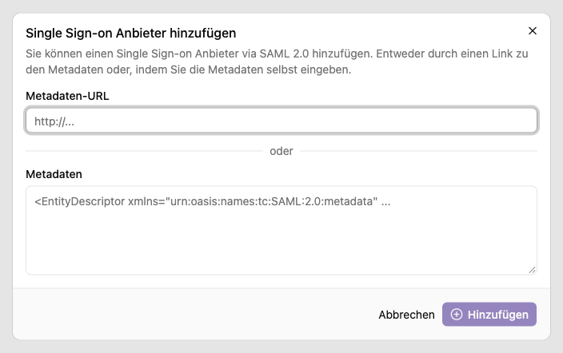
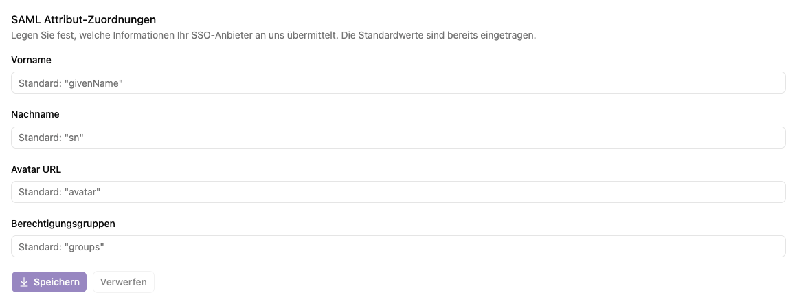

# Single Sign-on einrichten

Single Sign-on ermöglicht die Anmeldung mit einem bestehenden Organisationskonto. Die Oberfläche verwaltet einen SSO-Anbieter über **SAML 2.0**. Für die Einrichtung benötigst du die Angaben der zuständigen Identitätsadministration.

## Anbieter hinzufügen

1. Öffne **Einstellungen → SSO Anbieter**.
2. Wenn noch kein Anbieter eingerichtet ist, wähle **Hinzufügen**.
3. Trage entweder die **Metadaten-URL** ein oder füge die **Metadaten** direkt ein.
4. Bestätige das Hinzufügen.
5. Prüfe, ob die Seite den Anbieter als aktiv anzeigt.

Wähle **XML-Metadaten herunterladen** und übergib die Datei `saml-sp-metadata.xml` an die Administration deines Identitätsanbieters. Sie verwendet diese Daten, um die schorn.ai-Instanz als SAML-Anwendung einzurichten. Der Download steht globalen Administrator:innen vor und nach dem Hinzufügen eines Anbieters zur Verfügung. Er lädt die aktuellen Metadaten des konfigurierten Auth-Dienstes dieser Instanz.

Ist SAML im Auth-Dienst noch deaktiviert, zeigt die Oberfläche einen entsprechenden Hinweis. Aktiviere SAML zuerst in der Instanzkonfiguration. Bei Abruf- oder XML-Fehlern erscheint eine Fehlermeldung; prüfe die Konfiguration und versuche den Download erneut. Während des Abrufs ist die Schaltfläche gesperrt.

## Attribute zuordnen

Im Bereich **SAML Attribut-Zuordnungen** legst du fest, welche Attributnamen der Anbieter für Profil und Gruppen sendet:

| Information          | Vorgesehener Standardname |
| -------------------- | ------------------------- |
| Vorname              | `givenName`               |
| Nachname             | `sn`                      |
| Avatar URL           | `avatar`                  |
| Berechtigungsgruppen | `groups`                  |

Passe abweichende Namen an und wähle **Speichern**. **Verwerfen** setzt ungespeicherte Änderungen zurück. Die Gruppenzuordnung zu Rollen erfolgt separat unter [Arbeitsplatz → SSO Zuweisungen](workspace/details.md); dort ist auch die Zuordnung der Arbeitsplatzadministratorgruppe beschrieben.

Nach Änderungen an Gruppen beim Identitätsanbieter melde dich erneut über SSO an. Lokal zugewiesene Rollen und der automatische Beitritt zu Arbeitsplätzen werden bei der Rollenermittlung zusätzlich berücksichtigt.

## Anmeldung testen

Melde dich mit einem vorgesehenen SSO-Konto an und kontrolliere unter **Profil → Berechtigungen** die erwarteten Arbeitsplätze und Rollen. Fehlt eine Rolle, vergleiche den vom Anbieter gelieferten Gruppennamen mit dem Eintrag unter **Arbeitsplatz → SSO Zuweisungen**. Ist der SSO-Bereich ausgeblendet, öffne `/signin?method=sso` für den Test.

## Anbieter entfernen

**SSO Anbieter entfernen** öffnet einen Bestätigungsdialog. **SSO Anbieter löschen** entfernt die Konfiguration und lässt sich hier nicht rückgängig machen. Stelle vor einer geplanten Umstellung sicher, dass ein funktionierender administrativer Zugang zur Instanz erhalten bleibt.

Passwortprobleme eines SSO-Kontos werden beim Anmeldeanbieter gelöst, nicht über den lokalen Reset-Schlüssel.
