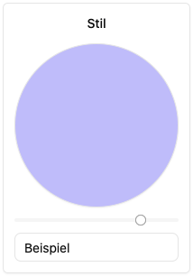

# Darstellung und Farbvorlagen

Unter **Einstellungen → Darstellung** verwalten globale Administrator:innen das Logo, den Begrüßungstext und die Farbvorlagen der Instanz. Die Übersicht zeigt die aktuelle Vorschau. Die Reiter sind direkt verlinkbar: `?view=logos` öffnet **Logo**, `?view=texts` **Text** und `?view=colors` den Farbbereich. Ohne `view` erscheint die Übersicht. Die Browsernavigation **Zurück/Vorwärts** stellt den zuvor gewählten Reiter wieder her. Bei ungespeicherten Änderungen an Logo, Farben oder Texten erscheint neben dem Seitentitel ein Stiftsymbol. Darüber kannst du diese Änderungen nach Bestätigung verwerfen. Während eines Uploads oder Speichervorgangs ist das Verwerfen gesperrt.

## Logo ändern

Wähle im Reiter **Logo** eine Sprache über **Sprache hinzufügen**. Lade mit **Logo hochladen** eine PNG-, JPEG-, WebP-, GIF- oder SVG-Datei mit maximal 5 MB hoch oder ziehe die Datei auf die Karte der gewünschten Sprache. Ergänze bei Bedarf einen Alternativtext. Klicke anschließend auf **Speichern** in der oben haftenden Reiterleiste. Der Upload allein übernimmt das Logo noch nicht dauerhaft.

Das gespeicherte Logo erscheint oben in der Sidebar. Die erste gespeicherte Variante gilt für alle Sprachen; weitere Sprachvarianten ersetzen sie nur in der jeweiligen Sprache. Ohne eigenes Logo erscheint das Systemlogo. Entferne zum Zurücksetzen die Varianten und speichere erneut.

Logo-Dateien und die Darstellungskonfiguration sind ohne Anmeldung lesbar. Verwende dafür keine vertraulichen Inhalte. Änderungen bleiben globalen Administrator:innen vorbehalten.

## Begrüßungstext und Farbvorlagen

Im Reiter **Text** kannst du den Begrüßungstext mit Vorschau und Sprachvarianten bearbeiten. Im Fußbereich jeder Sprachkarte findest du **Vorschau** zum Ein- und Ausklappen der formatierten Ansicht und **Entfernen** zum Entfernen der Variante. Alle Bereiche verwenden gemeinsam **Speichern** in der Reiterleiste und das Stiftsymbol zum Verwerfen neben dem Seitentitel. Ein Speichervorgang übernimmt Logo, Farben, Begrüßungstext und E-Mail-Vorlagen zusammen.

Im Farbbereich kannst du Vorlagen bearbeiten, hinzufügen, entfernen und umsortieren. Über **Speichern** in der Reiterleiste werden die Änderungen dauerhaft übernommen; du kannst auch die Standardvorlagen wiederherstellen.

Die konkrete Farbe eines Agenten, einer Dokumentenablage oder eines Transkriptors wählst du weiterhin in den Aussehenseinstellungen des jeweiligen Editors und speicherst die Ressource dort.

Den persönlichen **Hell-/Dunkelmodus**, die Übernahme der Betriebssystemeinstellung und die Sprache stellst du im Fußbereich der App um. Dazu brauchst du keine globalen Administratorrechte. Siehe [Profil und persönliche Einstellungen](../me/index.md).

## E-Mail-Vorlage für neue Zugänge

Unter **Text**, direkt nach dem Begrüßungstext, bearbeiten globale Administrator:innen die **E-Mail-Vorlage für neue Zugänge**. Füge eine Sprache hinzu, passe Betreff und Nachricht an und wähle **Speichern** in der Reiterleiste. Die Vorlage wird beim Erstellen einer Zugangsnachricht für ein neues Konto verwendet. Sie versendet keine E-Mail. Jede Sprachvariante erscheint wie der Begrüßungstext in einer Karte mit **Vorschau** und **Entfernen**. Die aufklappbare Vorschau ersetzt Platzhalter durch Beispieldaten.

Ohne eigene Vorlage wird ein deutscher oder englischer Standardtext verwendet. Die aktuelle Sprache bestimmt die Vorlage; fehlt eine passende Variante, gilt die erste gespeicherte Variante. Entferne alle Varianten und speichere, um die Standardtexte wiederherzustellen.

| Platzhalter     | Inhalt                                           |
| --------------- | ------------------------------------------------ |
| `{{firstName}}` | Vorname, sonst leer                              |
| `{{lastName}}`  | Nachname, sonst leer                             |
| `{{fullName}}`  | Vor- und Nachname, sonst leer                    |
| `{{email}}`     | E-Mail-Adresse des neuen Kontos                  |
| `{{resetUrl}}`  | Passwort-Seite der aktuellen Instanz             |
| `{{resetKey}}`  | Einmaliger Passwortschlüssel                     |
| `{{expires}}`   | Ablaufdatum mit Uhrzeit in der aktuellen Sprache |

Die Vorlage ist reiner Text. Bedingungen, Schleifen und HTML werden nicht ausgewertet. Unbekannte Platzhalter verhindern das Speichern. Der Betreff darf höchstens 300 Zeichen ohne Zeilenumbruch enthalten, die Nachricht höchstens 10.000 Zeichen. Verwende eine allgemeine Anrede, wenn Namen nicht immer vorliegen.
