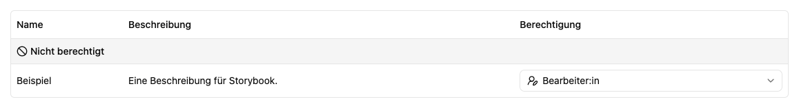

# Benutzerprofil und Rechte verwalten

Öffne eine Person über **Einstellungen → Benutzer:innen**. Die Detailseite zeigt das Konto und die Reiter **Bearbeiten** und **Berechtigungen**.

## Profil bearbeiten

Unter **Bearbeiten** kannst du ein Profilbild hochladen oder entfernen und Vor- und Nachnamen ändern. Speichere die Namensänderung im zugehörigen Formular. Ein eigenes Avatarbild kann ein vom SSO-Anbieter geliefertes Bild überlagern; nach Entfernen des eigenen Bilds kann wieder das Anbieterbild verwendet werden.

## Reset-Schlüssel neu ausstellen

Globale Administrator:innen können unter **Bearbeiten → Passwort zurücksetzen** für ein bestehendes lokales Konto **Neuen Reset-Schlüssel ausstellen** wählen. Nach der Bestätigung werden frühere, noch unbenutzte Schlüssel ungültig. Der neue Schlüssel ist sieben Tage lang gültig und wird nur in diesem Ergebnis angezeigt. Kopiere ihn und übermittle ihn der Person sicher. Nach dem Schließen oder Verlassen der Seite kann er nicht erneut abgerufen werden; stelle bei Verlust einen weiteren Schlüssel aus.

Es wird **keine E-Mail versendet**. Das bestehende Passwort bleibt bis zur erfolgreichen Einlösung unverändert. Die Person verwendet E-Mail-Adresse, Schlüssel und neues Passwort auf der [Passwort-Reset-Seite](../../signin/reset.md). Ein erfolgreich verwendeter Schlüssel ist nicht erneut verwendbar. Bei SSO-Konten erscheint stattdessen ein Hinweis auf die Passwortverwaltung beim Anmeldeanbieter.

## Arbeitsplatzrollen für lokale Konten

1. Öffne **Berechtigungen**.
2. Suche den gewünschten Arbeitsplatz.
3. Wähle in der Spalte **Berechtigung** die passende Rolle: **Nicht berechtigt**, **Benutzer:in**, **Bearbeiter:in** oder **Arbeitsplatzadministrator:in**.
4. Warte auf die Rückmeldung der Auswahl. Diese Änderung wird direkt gespeichert; dafür gibt es keinen zusätzlichen Gesamt-Speichern-Schritt.
5. Lass die Person ihre Sitzung erneuern oder sich erneut anmelden und unter **Profil → Berechtigungen** kontrollieren.

Die Bedeutung der Rollen steht unter [Rollen und Berechtigungen](../../me/permissions.md). **Nicht berechtigt** entfernt die direkte Zuweisung; ein automatischer Beitritt oder eine andere wirksame Zuweisung kann trotzdem Zugriff gewähren.

## Globale Administratorrechte

Im Bereich **Administratorrechte** kannst du **Administratorrechte gewähren** oder **Administratorrechte entziehen**. Globale Administrator:innen haben Zugriff auf alle Arbeitsplätze und Einstellungen. Bei solchen Konten wird die einzelne Arbeitsplatzliste zugunsten des globalen Status ausgeblendet.

Änderungen werden bei der nächsten Anmeldung oder Sitzungserneuerung wirksam. Prüfe vor dem Entziehen, dass die Instanz weiterhin von einer zuständigen Person administriert werden kann.

## SSO-Konten

Bei SSO zeigt der Berechtigungsreiter den Hinweis **Die Rechte werden vom SSO Anbieter verwaltet**. Verwende dafür [SSO](../sso.md) und die [Zuweisungen des Arbeitsplatzes](../workspace/details.md). Die Seite bietet für SSO-Konten nicht dieselbe manuelle Rechteverwaltung wie für lokale Konten.
