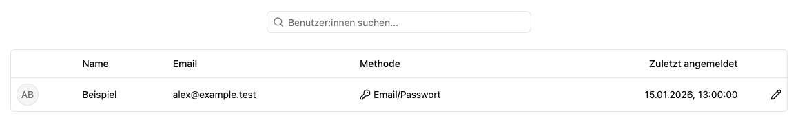

# Benutzer:innen verwalten

Unter **Einstellungen → Benutzer:innen** findest du die Konten der Instanz. Die Tabelle zeigt Namen, E-Mail-Adressen, Anmeldeverfahren und die letzte Anmeldung.

## Konto finden

1. Öffne die Benutzerliste.
2. Suche nach der gewünschten Person.
3. Öffne über das Stiftsymbol die [Detailseite](details.md).

Unter **Optionen** kannst du nach Name, E-Mail oder letzter Anmeldung sortieren und nach Anfangsbuchstaben, Methode oder letzter Anmeldung gruppieren. Speichere eine häufig genutzte Ansicht mit **Ansicht speichern**.

## Lokales Konto oder SSO

**Email/Passwort** kennzeichnet ein lokales Konto. Dessen Arbeitsplatzrollen und globale Administratorrechte verwaltest du auf der Detailseite.

**Single Sign-on** kennzeichnet die Anmeldung über den eingerichteten Anbieter. Die Detailseite verweist für diese Berechtigungen auf SSO. Verwende die passenden Gruppen- und Arbeitsplatzzuweisungen, anstatt ein weiteres lokales Konto für dieselbe Person anzulegen.

## Neue Person hinzufügen

Wähle unter **Optionen → Benutzer:in erstellen** den [Ablauf zur Kontoanlage](new.md). Dabei entsteht ein einmaliger Reset-Schlüssel, den du der Person selbst weitergibst. Es wird keine E-Mail verschickt.

Für bestehende lokale Konten kannst du auf der [Detailseite unter Passwort zurücksetzen](details.md#reset-schlüssel-neu-ausstellen) einen neuen Reset-Schlüssel ausstellen. Zum Löschen eines Kontos wende dich an die Betriebsadministration; dafür bietet diese Oberfläche keine Aktion.

## Zugehörige MCP-Werkzeuge

- `platform_users_list`: Benutzerverzeichnis lesen. Mindeststufe: **Globaler Administrator**.
- `platform_user_create`: E-Mail-Konto mit einmaligem Einrichtungsschlüssel anlegen. Mindeststufe: **Globaler Administrator**.

Jeder Aufruf prüft zusätzlich die Berechtigung für das eigene Konto bzw. die betroffene Ressource. Die Zugriffsstufe verleiht keine Rechte. Voraussetzungen, besondere Grenzen und der vollständige Werkzeugkatalog stehen unter [Plattformzugriff](../../agent/edit/plattformzugriff.md).
