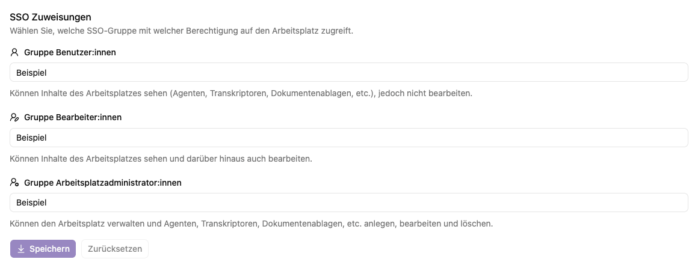

# Arbeitsplatzbeschreibung und Mitgliedschaften verwalten

Arbeitsplatzadministrator:innen können im eigenen Arbeitsplatz die Reiter **Bearbeiten** und **Dokumentation** öffnen. Nur globale Administrator:innen sehen zusätzlich **Berechtigungen**, **SSO Zuweisungen** und den Schalter für den automatischen Beitritt. Speichere Änderungen jeweils im betroffenen Formular.

## Beschreibung und automatischer Beitritt

Unter **Bearbeiten** änderst du Name und Beschreibung und wählst **Speichern**. **Zurücksetzen** verwirft die noch nicht gespeicherten Änderungen.

Nur globale Administrator:innen können **Automatisch Benutzer:in** ändern. Diese Einstellung gewährt allen Konten, die sich an dieser Instanz anmelden können, die Benutzerrolle in diesem Arbeitsplatz. Der Schalter speichert seine Änderung unmittelbar. Aktiviere ihn nur für Inhalte, die diesem gesamten Personenkreis zugänglich sein sollen. Bestehende höhere Zuweisungen werden dadurch nicht zu niedrigeren Rollen.

## Dokumentation

Unter **Dokumentation** hinterlegst du eine ausführlichere Beschreibung in Markdown und speicherst sie. Sie erscheint auf der [Arbeitsplatzseite](../../workspace/details.md) für Anwender:innen. Nenne dort beispielsweise Zuständigkeiten, geeignete Anwendungen und Regeln zur Verwendung der bereitgestellten Unterlagen.

## Lokale Berechtigungen

Nur globale Administrator:innen können lokale Mitgliedschaften hinzufügen, ändern oder entfernen. Unter **Berechtigungen** sehen sie die lokalen Konten, auch wenn diese dem Arbeitsplatz noch nicht zugeordnet sind. Wähle die gewünschte Arbeitsplatzrolle in der Tabelle; die Auswahl wird direkt gespeichert. Mit **Nicht berechtigt** entfernst du die direkte Rollenzuweisung. Über den Kontonamen öffnest du die [Benutzer-Detailseite](../user/details.md).

Arbeitsplatzadministrator:innen haben keinen Zugriff auf diese Mitgliederverwaltung. Für Änderungen wenden sie sich an die globale Administration. Das gilt auch beim direkten Aufruf einer Verwaltungsaktion.

Die Rollen von SSO-Konten verwaltest du über die Gruppenzuweisungen im nächsten Abschnitt.

## SSO-Gruppen zuweisen

Nur globale Administrator:innen können SSO-Gruppen zuweisen. Unter **SSO Zuweisungen** stehen Felder für Gruppen der Benutzer:innen, Bearbeiter:innen und Arbeitsplatzadministrator:innen. Verwende die exakten vom Anbieter gelieferten Gruppennamen. Speichere die Zuordnung und prüfe die wirksame Rolle nach einer erneuten Anmeldung.

Alle drei Gruppenfelder werden beim Aufbau der Sitzung ausgewertet. Treffen mehrere Gruppen, direkte Rollenzuweisungen oder SSO-Overrides zusammen, gilt je Arbeitsplatz die höchste Rolle: **Arbeitsplatzadministrator:in > Bearbeiter:in > Benutzer:in**. Die Reihenfolge der Gruppen verändert das Ergebnis nicht. Eine Arbeitsplatzadministratorgruppe gilt nur für die zugeordneten Arbeitsplätze und verleiht keine globalen Administratorrechte.

Lass betroffene Personen nach Änderungen an Gruppen oder Zuordnungen erneut anmelden und ihre Rolle unter **Profil → Berechtigungen** prüfen. Bis zur Anmeldung oder Sitzungserneuerung kann die bisherige Rolle weiter gelten.

Auch nach dem Entfernen einer direkten lokalen Rolle kann über **Automatisch Benutzer:in** oder SSO weiter Zugriff bestehen. Prüfe deshalb die tatsächlich angezeigten [Berechtigungen](../../me/permissions.md) mit dem betroffenen Konto.
