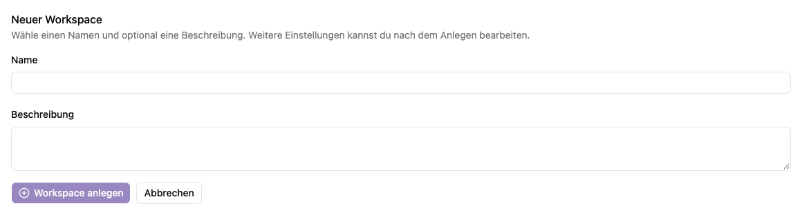

# Einen Arbeitsplatz anlegen

Ein Arbeitsplatz bildet den Rahmen für zusammengehörige Agenten, Dokumentenablagen, Transkriptoren und ihre Zugriffsrechte.

## Arbeitsplatz erstellen

1. Öffne **Einstellungen → Arbeitsplätze** und wähle **Arbeitsplatz erstellen**.
2. Trage einen **Namen** ein, zum Beispiel „Personalabteilung“.
3. Ergänze optional eine **Beschreibung**, zum Beispiel Zweck und zuständiges Team.
4. Wähle **Workspace anlegen**.
5. Nach erfolgreicher Anlage öffnet sich die Verwaltungsseite des neuen Arbeitsplatzes.

Mit **Abbrechen** kehrst du zur Übersicht zurück.

## Danach

Richte in der [Detailansicht](details.md) die Dokumentation und Berechtigungen ein. Entscheide ausdrücklich, ob alle angemeldeten Konten automatisch als Benutzer:innen beitreten sollen. Lege anschließend die benötigten Agenten oder Apps in diesem Arbeitsplatz an.

Prüfe mit einem vorgesehenen Mitglied unter **Profil → Berechtigungen** die Rolle und öffne anschließend den Arbeitsplatz, um die bereitgestellten Agenten und Apps zu testen.

## Zugehörige MCP-Werkzeuge

**Mindeststufe:** Globaler Administrator. `platform_workspace_create` legt einen Workspace mit Name und Beschreibung an. Die neue Kennung wird zurückgegeben.

Verbindung und gemeinsame Berechtigungsregeln: [Plattformzugriff](../../agent/edit/plattformzugriff.md).
