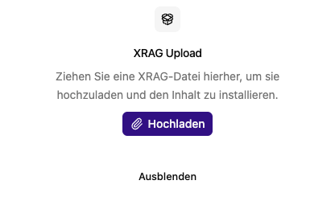

# XRAG-Pakete bereitstellen

Die Web-App stellt XRAG-Dateien in einem gemeinsamen, privaten Dateikatalog
bereit. Jeder [Service](../box-admin/index.md) prüft selbst, welche Dateien zu
seinen ausgewählten Diensten passen. Auch später eingerichtete oder vorübergehend
offline befindliche Rechner können veröffentlichte Dateien beziehen.

## Paket veröffentlichen

1. Prüfe Quelle, Zielversion und benötigte Dienste des Pakets. Setup-Pakete können Programme auf den Rechnern ausführen.
2. Öffne **Einstellungen → XRAG hochladen** als globale Administratorin oder globaler Administrator.
3. Ziehe die XRAG-Datei in den Bereich oder wähle **Hochladen**.
4. Warte, bis Übertragung und Veröffentlichung abgeschlossen sind. Die Web-App prüft Archivpfade, Metadaten und erforderliche Dateien und berechnet die SHA-256-Prüfsumme.
5. Prüfe die Installation auf den betreffenden Maschinen mit `npx schornai service logs --follow` oder in der Mac-App.

Die Upload-Rückmeldung bestätigt keine abgeschlossene Installation auf den
Maschinen. XRAG-Installationen sind im Service-Log sichtbar, nicht im
Aufgabenstapel der Web-App. Der lokale Status steht außerdem in
`~/.aibox/service-artifacts.json`. Erfolgreich installierte Prüfsummen werden
nicht erneut installiert. Änderungen werden über Yjs angekündigt. Der Service
gleicht beim Start, nach Wiederverbindungen und bei solchen Änderungen ab.
Fehlgeschlagene Vorgänge werden mit wachsendem Abstand bis maximal 60 Sekunden
erneut versucht. Es gibt keine regelmäßigen Katalogabfragen. Mit
`npx schornai service sync` stößt du einen Abgleich manuell an.

| Pakettyp                     | Empfänger                                                         |
| ---------------------------- | ----------------------------------------------------------------- |
| Setup/Update                 | Alle passenden Service-Instanzen mit konfiguriertem Dateikatalog. |
| MLX-Whisper-Modell           | Maschinen mit `transcriber-mlx`.                                  |
| Ollama-Modell                | Maschinen mit `ollama`.                                           |
| Zertifikat oder Site-URL     | Maschinen mit `supabase` oder `core`.                             |
| Allgemeine Dateien (`files`) | Maschinen mit einem in `targets` genannten Dienst.                |

Allgemeine Dateien werden unter `~/.aibox/assets/<name>/<Prüfsumme>/` abgelegt und
nicht ausgeführt. Dieses Paketformat kann später zusätzliche Diensttypen
versorgen. Unbekannte Dienstnamen in `config.json` werden derzeit abgelehnt, bis
der Service eine entsprechende Implementierung erhält.

Modellmetadaten werden einmal zentral registriert. Alle Transcriber verwenden
für dasselbe Modell denselben Dateisystembezeichner. Ein Transcriber erhält neue
Aufträge erst, wenn die benötigten Gewichte und die Konfiguration lokal vorhanden
sind. Wähle das Modell anschließend im Agenten, Transkriptor oder Suchindex aus.
Ein entfernter Ollama-Dienst kann über `endpoints.ollama` angebunden werden; nach
Änderungen an seinen Modellen muss der Realtime-Dienst seine Fähigkeiten neu
ermitteln, gegebenenfalls durch einen Neustart.

## Freigabe konfigurieren

In der privaten Umgebung der Web-App, des Realtime-Dienstes und jeder beziehenden Maschine muss derselbe
`SERVICE_API_TOKEN` mit mindestens 32 Zeichen stehen. Die `sharing.url` in der
Maschinenkonfiguration zeigt auf die Web-App. Der Token erlaubt das Lesen des Katalogs und der veröffentlichten Dateien sowie
validierte Statusmeldungen des Services. Er erlaubt keine direkten Änderungen
an Yjs-Dokumenten oder administrativen Datenbankdaten. Ein Transcriber benötigt daneben seine gesonderten
Betriebszugangsdaten. Verwende TLS und vertraute Zertifikate für entfernte Rechner.

Die Dateien verbleiben im vorhandenen privaten Storage-Bucket `box-action-files`.
Der Katalog wird erst nach erfolgreicher Prüfung veröffentlicht. Es gibt keine
automatische Löschung nach der ersten Installation. Unter [Cluster → Artefakte](../artifacts/index.md)
kannst du veröffentlichte Dateien prüfen und löschen. Der Uploadbereich bleibt
für neue Pakete zuständig. Temporäre Originaluploads werden nach erfolgreicher
Veröffentlichung entfernt; identischer Inhalt erzeugt keine zweite Version.
Ein bereits gelöschter Inhalt kann nicht erneut veröffentlicht werden; erstelle
ein neues Paket. Unbekannte Pakettypen oder Formatversionen im Katalog werden von
älteren Service übersprungen. Agenten- und Docrepo-Importe sind noch nicht
implementiert, können später aber denselben Katalog verwenden.

## Updates und Fehler

Neue Setup-Bundles funktionieren sowohl mit der bisherigen Admin-App als auch mit
einem laufenden Service. Auf einer alten Box erzeugt das Bundle die fehlende
Maschinenkonfiguration automatisch, übernimmt bestehende Daten und Zugangsdaten
und startet den Service. Ein manueller Zwischenschritt ist nicht erforderlich.
Für die Umstellung wird das neue Bundle über die bisherige Web-App der alten
Box hochgeladen; die Kompatibilität übernimmt das Bundle selbst.
Historische Setup-Archive ohne Service-Payload werden vom neuen
Service nicht ausgeführt. Bei mehreren veröffentlichten Setup-Paketen verwendet
er das zuletzt veröffentlichte passende Paket für seine Plattform und Architektur.

Setup-Updates pausieren die ausgewählten Dienste und installieren nur deren
Komponenten. Der Updater startet keinen Rechner neu und benötigt kein `sudo`.
Bei der Umstellung einer alten Box wird die Mac-App unter `~/Applications`
installiert. Auf Service-Systemen wird sie nur aktualisiert, wenn sie dort
bereits vorhanden ist. Details stehen in der
[Betriebsanleitung](../box-admin/index.md).

Notiere bei Fehlern Paketname, Zeitpunkt und Meldung. Prüfe
`~/.aibox/logs/service.log` und für Setup-Ausgaben
`~/.aibox/logs/update/log_<Zeitstempel>.txt`. Eine Prüfsumme belegt die
Unverändertheit, nicht die Vertrauenswürdigkeit des Herausgebers. Die
Uploadseite bietet keine Rückgängig-Aktion; sichere Daten und Konfiguration vor
Updates. Siehe [Sicherheit und Betrieb](../hilfe/sicherheit-und-betrieb.md).

Neue Setup-Bundles enthalten Plattform und Architektur. Mac und Linux erhalten
so jeweils das neueste passende Paket, auch bei einem gemeinsamen Dateikatalog.
