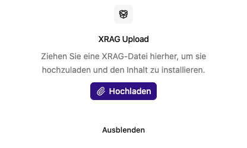

# XRAG-Pakete bereitstellen

Über den privaten Dateikatalog verteilst du XRAG-Pakete an deine
[Services](../box-admin/index.md). Jeder Service bezieht die Pakete, die zu seiner
Plattform, Architektur und den ausgewählten Diensten passen. Vorübergehend offline
befindliche Maschinen können die Dateien nach ihrer Wiederverbindung beziehen.

## Einzelnes Objekt herunterladen

Öffne **Info** am Agenten, Transkriptor, an der Dokumentenablage oder an deiner
Automation. Speichere einen neuen oder geänderten Entwurf, bevor du die Infoansicht für den Export oder zum Hinzufügen zu einem Paket öffnest. Für ein lokales Modell öffnest du in den Einstellungen **Modelle** und wählst die Modellkarte.
**XRAG exportieren** lädt das gewählte Objekt als eine `.xrag.tar` herunter.
Bei einer Dokumentenablage enthält die Datei die Konfiguration und alle Dateien,
einschließlich vorhandener Text- und Transkriptdateien. Bei einem Modell erhältst
du das ursprüngliche Ollama- oder MLX-Whisper-Archiv. Es muss im Dateikatalog
der Instanz verfügbar sein.

Externe Modelle werden über **Anbieter und Modellkennung** mit bereits
eingerichteten Modellen auf der Zielinstanz verbunden. Ein eindeutiger Treffer
wird automatisch verwendet. Bei mehreren Treffern wählst du in der Importvorschau
die gewünschte Verbindung aus. Ohne Treffer kannst du trotzdem importieren;
der Agent zeigt **Unbekanntes Modell**, bis du eines auswählst. Das gilt auch für
Modellüberschreibungen einzelner Rollen.

Verwendet werden die vorhandenen Zugangsdaten der Zielinstanz. API-Schlüssel,
Header, Endpunkte und andere Verbindungsdaten werden nicht übertragen oder
überschrieben. Die Zuordnung wird beim Import erneut geprüft. Ältere Archive
ohne Anbieter und Modellkennung können nur eine noch vorhandene identische
Modellreferenz nutzen; für automatische Zuordnung zwischen Instanzen ist ein
neuer Export erforderlich.

Beim Anlegen eines Agenten schlägt der Editor die globale ID aus dem Namen vor. Du kannst sie unter **Einstellungen** anpassen. **Erstellen** speichert sie zusammen mit dem Agenten.

Bei Agenten, Transkriptoren und Dokumentenablagen kannst du unter
**Bearbeiten → Einstellungen** ganz unten die **globale ID** bearbeiten.
Die Vorgabe entsteht aus dem Titel in kebab-case. Erlaubt sind Kleinbuchstaben
`a–z`, Ziffern, Bindestriche, `/` und `_`. Der Identifier bleibt bei späteren
Titeländerungen stabil. Zukünftige Exporte und Verweise verwenden die gespeicherte
ID.

## Mehrere Objekte als ein Paket herunterladen

1. Öffne die Infoansicht des ersten Objekts und wähle **Zu XRAG-Paket hinzufügen**.
   Wähle ein vorhandenes persönliches Paket aus. Wenn du noch kein Paket hast, führt **XRAG-Paket erstellen** zur Exportseite. Dort gibst du den Paketnamen ein. Kehre nach dem Erstellen zur Infoansicht zurück und wähle dort das Paket aus.
2. Wähle bei Bedarf verbundene Objekte aus, etwa die Dokumentenablage eines Agenten
   und das lokale Modell des zugehörigen Transkriptors. Bestätige mit **Zu XRAG-Paket hinzufügen**.
   Jede gewählte Ressource erhält einen eigenen Eintrag. Weitere Ressourcen und
   lokale Modelle kannst du von ihrer jeweiligen Infoansicht aus ergänzen.
3. Wähle **Paket öffnen** oder gehe zu **Apps → XRAG Import und Export → Export**. Unter **Meine XRAG-Pakete** kannst du die
   Auswahl prüfen und einzelne Einträge entfernen. **Export starten** speichert
   die aktuelle Auswahl als Auftrag. Der Realtime-Dienst erstellt das Archiv
   im Hintergrund, auch wenn du die Seite schließt.
4. Unter **Exporte** siehst du den Status und den Upload-Fortschritt. **Paketerstellung vorgemerkt** kennzeichnet einen neuen Auftrag. Sobald seine Verarbeitung beginnt, erscheint **Paket wird erstellt**. Sobald das Archiv bereitsteht,
   lädt **Herunterladen** alle ausgewählten Ressourcen und Modelldateien als
   **eine `.xrag.tar`-Datei** herunter. Das Ergebnis ist 72 Stunden verfügbar. Über **Export löschen** entfernst du fertige, fehlgeschlagene oder abgebrochene Exporte sofort. Dabei wird auch die zugehörige Archivdatei gelöscht. Dein gespeichertes Paket bleibt erhalten.

Der Export verwendet den aktuellen Stand der Objekte und prüft die Zugriffsrechte
beim Erstellen und beim Abrufen des Downloadlinks. Fehlt eine referenzierte Ressource wie ein Transkriptor, bleibt ihr Verweis im Archiv erhalten. Ist ihre ursprüngliche globale ID unbekannt, erhält der Verweis eine aus dem vorhandenen Bezeichner abgeleitete ID. Auf der Zielinstanz kann dann eine neue Zuordnung nötig sein. Wartende und laufende Aufträge
kannst du abbrechen. Bei einem Fehler kannst du einen neuen Export des Pakets starten.
Einträge oder ein persönliches Paket zu löschen wirkt sich nur auf die gespeicherte Auswahl aus.

Große XRAG-Pakete bis 200 GiB werden in begrenzten Speicherblöcken übertragen.
Modelle werden direkt aus dem unveränderlichen Originalarchiv gelesen; das gesamte
Paket wird weder im RAM noch als zusätzliche lokale Datei aufgebaut.
Dokumentenablagen benötigen temporären Plattenplatz für ihre Einzelarchive,
damit deren Prüfsummen vor dem Paketupload feststehen. Dieser Platz muss auf
dem Realtime-Host verfügbar sein. Nach Verbindungsabbrüchen setzt der Upload
bestätigte Blöcke fort. Nach einem Worker-Neustart wird der Auftrag neu aufgebaut;
dabei wird der dann verfügbare Stand der ausgewählten Objekte verwendet. Nach
höchstens fünf Versuchen wird ein wiederholt scheiternder Auftrag als fehlgeschlagen
angezeigt.

Automatisierungen können ihren Agenten und die zugehörigen Dokumentenablagen
mitnehmen. Beim Import gehören sie dem importierenden Benutzer; ihr Zeitplan
und Aktivierungszustand werden übernommen. Der Agent und eine verwendete
Dokumentenablage müssen mitimportiert werden oder über ihre globale ID bereits
im Zielarbeitsplatz vorhanden sein. Auslöser für Dateien einer einzelnen
Chat- oder Transkriptionssitzung sind nicht übertragbar. Abgelaufene einmalige
Zeitpläne müssen vor dem Export geändert oder deaktiviert werden.

## XRAG importieren

Öffne **Apps → XRAG Import und Export → Import**.

Im Import-Tab:

1. Ziehe eine `.xrag.tar`-Datei in den Uploadbereich oder klicke **Datei auswählen**.
   Während der Übertragung siehst du den Dateinamen und den Upload-Fortschritt. Danach bleibt der Dateiname mit **Inhalt wird geladen …** sichtbar, bis sich die Auswahl unter `/app/xrag/import/[id]` öffnet. Der Reiter **Export** führt zu `/app/xrag/export`.
2. Bei einem XRAG-Paket sind zunächst alle enthaltenen Objekte ausgewählt.
   Sobald die enthaltenen Objekte angezeigt werden, wechselst du oben rechts unter **Optionen → Ansicht** zwischen Kacheln und Tabelle. Unter jeder Karte zeigt der Auswahlbutton ihren Zustand. Die Karten übernehmen die im Paket gespeicherte Objektfarbe. In der Tabelle wählst du über die erste Spalte aus. **Keine auswählen** leert die Auswahl, **Alle auswählen** übernimmt das gesamte Paket. Die Auswahl bleibt beim Ansichtswechsel erhalten. Einzelne Modell- und Updatepakete werden
   nach erfolgreicher Prüfung direkt importiert.
3. Sind Agenten, Dokumentenablagen, Transkriptoren oder Automatisierungen ausgewählt, erscheint eine
   gemeinsame **Arbeitsplatz**-Auswahl. Sie gilt für alle ausgewählten Ressourcen.
   Globale Administrator:innen können einen neuen Arbeitsplatz anlegen.
   Reine Modell- und Plattformimporte benötigen keinen Arbeitsplatz.
4. Klicke **Importieren**. Ohne Konflikte startet der Import direkt. Falls Objekte
   bereits vorhanden sind oder mehrere externe Modelle passen, erscheinen die
   erforderlichen Entscheidungen direkt auf der Seite. Gib Ersetzungen ausdrücklich
   frei, wähle die Modellverbindung und klicke erneut **Importieren**.

Nach dem Hochladen wird die Datei geprüft und entpackt. Bei einem XRAG-Paket
bleiben die enthaltenen Einzelarchive für die Auswahl erhalten; das äußere Archiv
wird gelöscht. Einzelne Ressourcen werden bereits entpackt bereitgehalten.
Nach einem erfolgreichen Import oder einer Fehlermeldung öffnest du mit **Weiterer XRAG Upload** die Dateiauswahl.
Bei einer ungültigen Vorschauauswahl kannst du die Auswahl korrigieren und die Vorschau erneut öffnen. Offene Auswahlen sind ab Fertigstellung der Vorbereitung eine Stunde gültig und werden anschließend vom
Scheduler gelöscht. Innerhalb dieser Frist kannst du die Adresse als hochladende Person erneut öffnen. Die Objektauswahl beginnt wieder mit allen Einträgen.

Nach erfolgreichem Import werden die vorbereiteten Inhalte einschließlich aller
nicht ausgewählten Objekte sowie die Sicherungskopien sofort gelöscht. Bei einer
vorübergehenden Speicherstörung holt der Scheduler die Bereinigung nach.
Installierte Agenten, Transkriptoren, Dokumentenablagen und Automatisierungen brauchen kein
XRAG-Archiv mehr. Nur Modelle und Update-/Setup-Pakete bleiben als Artefakte
verfügbar. Bei Update-/Setup-Paketen wird nur das neueste erfolgreich veröffentlichte
Paket je Plattform und Architektur behalten; ältere Pakete entfernt die reguläre
Artefakt-Bereinigung. Modelle werden dadurch nicht gelöscht.

Nicht ausgewählte Objekte und deren Dateien werden nicht importiert. Verweise auf
nicht mitimportierte Ressourcen bleiben für einen späteren Import erhalten.
Die Berechtigungsprüfung gilt weiterhin für das gesamte Paket, auch für abgewählte Inhalte.

Workspace-Administrator:innen dürfen Modelle exportieren und zu Sammelarchiven
zusammenfügen, aber nicht importieren. Enthält ein Import auch nur ein Modell,
Update oder anderes Plattformpaket, wird ihr gesamter Import vor Änderungen
abgewiesen. Globale Administrator:innen dürfen diese Pakete importieren; ihre
Veröffentlichung und Installation laufen anschließend über die vorhandenen Dienste.

Die globale ID verbindet Ressourcen über getrennte Importe hinweg: Importierst
du zuerst die Dokumenten-Ablage und später einen darauf verweisenden Agenten in
denselben Workspace, wird die vorhandene Ablage zugeordnet. Konfigurationsänderungen seit der
Importvorschau erfordern eine erneute Prüfung und Bestätigung.

Bei bestätigter Ersetzung bleiben zusätzliche Dateien einer bestehenden Ablage
erhalten; gleichnamige Dateien werden ersetzt. Der Import stellt zuerst die
ausgewählten Inhalte bereit und sichert nur vorhandene Dateien, die ersetzt
werden. Neue Dateien gehen direkt in die Zielablage.
Konfigurationen, Modell-/Plattform-Veröffentlichungsaufträge und Aufträge zur
Dokumentverarbeitung werden erst danach gemeinsam gespeichert. Schlägt der
Import vorher fehl, werden ersetzte Dateien wiederhergestellt und neu
hinzugefügte Dateien entfernt. Konfigurationen bleiben unverändert. Die vorbereiteten
Inhalte werden nach einem fehlgeschlagenen Import ebenfalls gelöscht. Für einen
erneuten Versuch muss die Datei neu hochgeladen werden.

Die Wiederherstellung ist dauerhaft protokolliert. Nach einem Serverabsturz
setzt der Scheduler sie fort. Ist der Dateispeicher vorübergehend nicht erreichbar,
bleibt die Wiederherstellung ausstehend; betroffene Dateipfade sind bis dahin für
Schreibzugriffe gesperrt. Während der kurzen Dateiübernahme können Leser bereits
neue Dateiinhalte sehen: Dateispeicher und Datenbank bilden keine gemeinsame
Lesetransaktion. Auch Automatisierungen werden erst nach dem erfolgreichen
Import ausgelöst. Für die Vorbereitung und Sicherung ist zusätzlicher
Speicherplatz erforderlich; Zwischendateien werden automatisch bereinigt.

„Import abgeschlossen.“ bestätigt die Dateiübernahme und das Speichern der
Konfigurationen. Nur bei importierten Dokumentdateien erscheint zusätzlich der
Hinweis auf die Hintergrundverarbeitung. Vorhandene extrahierte Texte und
Transkripte werden wiederverwendet; ansonsten werden unterstützte Dateien wie
bei gewöhnlichen Uploads verarbeitet. Suchindizes werden anhand der
Ablagen-Konfiguration neu aufgebaut. Fehlende Modelle oder Fehler bei dieser
anschließenden Verarbeitung rollen den bereits abgeschlossenen Import nicht
zurück; die Datei bleibt in der Ablage und ist gegebenenfalls noch nicht durchsuchbar.

Einzelne Agenten, Transkriptoren, Dokumentenablagen und Automationen werden beim Herunterladen als Archiv erzeugt. Bricht der Download ab, starte ihn in der Infoansicht erneut. Bei lokalen Modellen liefert die App das veröffentlichte Originalarchiv. Unterstützt dein Browser Teilabrufe, kann er unterbrochene Modelldownloads fortsetzen, solange du Zugriff hast und dieselbe Modellversion verfügbar ist.

Downloadlinks für fertige Pakete und für MCP-Einzelexporte gelten zehn Minuten. Offene Importauswahlen verfallen nach einer
Stunde. Fertige Hintergrundexporte werden nach 72 Stunden bereinigt. Eine Sammeldatei enthält höchstens 1.000 Einzelarchive. Zugangsdaten
und installierungsgebundene MCP-/Websuche-Verbindungen werden nicht übertragen;
konfiguriere benötigte Verbindungen auf der Zielinstanz neu.

## Paket veröffentlichen

1. Prüfe Quelle, Zielversion und benötigte Dienste des Pakets. Setup-Pakete können Programme auf den Maschinen ausführen.
2. Öffne **Einstellungen → XRAG hochladen** als globale Administratorin oder globaler Administrator.
3. Ziehe die `.xrag.tar`-Datei in den Uploadbereich oder wähle **Hochladen**. Du kannst mehrere Dateien auswählen; sie werden nacheinander übertragen.
4. Warte auf den Veröffentlichungsstatus. Nach der Übertragung wird das Paket geprüft. Dafür muss das Browserfenster nicht geöffnet bleiben.
5. Prüfe die Installation auf den betreffenden Maschinen mit `npx schornai service logs --follow` oder in der Mac-App.

Eine abgeschlossene Übertragung bedeutet noch nicht, dass das Paket veröffentlicht
oder auf den Maschinen installiert ist. Der Uploadbereich zeigt den Status der
Veröffentlichung. Die letzten 100 Aufträge werden für bis zu 72 Stunden in diesem
Browser und Benutzerkonto gespeichert und nach einem Neuladen erneut abgefragt.
Bei deaktiviertem Browserspeicher gilt das nur für die geöffnete Seite.

Die Veröffentlichung akzeptiert Archive bis 200 GiB. Niedrigere Limits der
jeweiligen Storage-Installation gelten zusätzlich. Unter
[Cluster → Artefakte](../artifacts/index.md) kannst du veröffentlichte Dateien
prüfen und löschen. Bereits gelöschter Paketinhalt kann nicht erneut
veröffentlicht werden; erstelle bei Bedarf ein neues Paket.

### Upload fortsetzen

Wähle nach einem Abbruch dieselbe lokale Datei erneut aus. Der Browser kann die
Übertragung innerhalb von 24 Stunden fortsetzen, wenn Benutzerkonto, Dateiname,
Änderungsdatum und Dateigröße übereinstimmen. Ist die Uploadsitzung abgelaufen oder
der Browserspeicher gelöscht, beginnt die Übertragung neu.

Ein Veröffentlichungsauftrag läuft auch nach dem Schließen des Browsers oder
einem Serverneustart weiter. Vorübergehende Fehler werden bis zu fünfmal
bearbeitet. Bei einer endgültig fehlgeschlagenen Veröffentlichung prüfst du das
Paket und lädst es erneut hoch.

## Installation und Empfänger

Der Service gleicht den Katalog beim Start, nach Wiederverbindungen und bei
Änderungen ab. Mit `npx schornai service sync` kannst du den Abgleich manuell
anstoßen. Fehlgeschlagene Installationen werden mit wachsendem Abstand bis maximal
60 Sekunden erneut versucht. Bereits erfolgreich installierte Pakete werden nicht
erneut installiert.

| Pakettyp                     | Empfänger                                                  |
| ---------------------------- | ---------------------------------------------------------- |
| Setup/Update                 | Service-Instanzen mit passender Plattform und Architektur. |
| MLX-Whisper-Modell           | Maschinen mit `transcriber-mlx`.                           |
| Ollama-Modell                | Maschinen mit `ollama`.                                    |
| Allgemeine Dateien (`files`) | Maschinen mit einem in `targets` genannten Dienst.         |

XRAG-Pakete für Zertifikate (`certificate`) und Site-URLs (`site_url`) werden
nicht mehr akzeptiert. Bereits veröffentlichte Pakete dieser Typen werden von
Services ignoriert.

Allgemeine Dateien werden unter `~/.aibox/assets/<name>/<Prüfsumme>/` abgelegt und
nicht ausgeführt. Die in `config.json` ausgewählten Dienste müssen vom Service
unterstützt werden.

Wähle ein veröffentlichtes Modell anschließend im Agenten, Transkriptor oder
Suchindex aus. Transcriber erhalten Aufträge erst, wenn die benötigten Gewichte
und die Konfiguration lokal vorhanden sind. Ein entfernter Ollama-Dienst kann
über `endpoints.ollama` angebunden werden. Nach Änderungen an seinen Modellen muss
der Realtime-Dienst seine Fähigkeiten neu ermitteln, gegebenenfalls durch einen
Neustart.

### Setup-Updates

Ein Setup-Paket ist eine `.xrag.tar`-Datei. Der Service installiert das zuletzt
veröffentlichte passende Setup für seine Plattform und Architektur. Dabei werden
die ausgewählten Dienste vorübergehend pausiert. Ein Rechnerneustart oder `sudo`
ist nicht erforderlich.

Setup-Updates laufen ausschließlich vorwärts. Nach einem Abbruch kann derselbe
Release erneut versucht werden; eine ältere Veröffentlichung wird nicht als
Ersatz installiert. Überholte Setup-Archive werden auf dem Server automatisch
entfernt. Pro Plattform und Architektur bleibt der aktuelle Release erhalten.
Modelle und andere Datenpakete werden dadurch nicht gelöscht.

Bei einer manuellen Installation werden die entpackten Laufzeitverzeichnisse
verbraucht. Entpacke das Archiv für einen erneuten Installationsversuch nochmals.
Eine unter `~/Applications` vorhandene optionale Mac-App wird ebenfalls
aktualisiert. Weitere Hinweise findest du in der
[Betriebsanleitung](../box-admin/index.md).

## Freigabe konfigurieren

In der privaten Umgebung der Web-App, des Realtime-Dienstes und jeder beziehenden
Maschine muss derselbe `SERVICE_API_TOKEN` mit mindestens 32 Zeichen stehen.
`sharing.url` in der Maschinenkonfiguration zeigt auf die Web-App. Verwende TLS
und vertraute Zertifikate für entfernte Rechner.

Der Token erlaubt das Lesen des Katalogs und der veröffentlichten Dateien sowie
Statusmeldungen des Services. Er erlaubt keine administrativen Änderungen. Ein
Transcriber benötigt daneben seine gesonderten Betriebszugangsdaten.

## Speicher und Wiederaufnahme auf Maschinen

Unterbrochene Downloads werden fortgesetzt und nach Abschluss anhand ihrer
Prüfsumme kontrolliert. Beschädigte Dateien werden verworfen. Zwei Minuten ohne
Datenfortschritt brechen einen Transfer ab; für einen laufenden Download gibt es
kein festes Stundenlimit.

Der mitgelieferte Web-Proxy und das Storage-Gateway leiten die Übertragungen
ohne temporäre Dateipuffer weiter. Ihre Inaktivitätslimits betragen zwei Minuten.
Zusätzlich vorgeschaltete Proxys müssen Streaming und ausreichend lange
Inaktivitätslimits ebenfalls unterstützen. Uploads erfolgen in 6-MiB-Abschnitten.

Der Service prüft den freien Speicher vor Download und Entpacken. Beim Start und
vor dem Abgleich entfernt er verwaiste Arbeitsverzeichnisse und abgelaufene
Teildownloads. Bei Platzbedarf werden ältere Teildownloads zuerst entfernt.
Installierte Nutzdaten und die Datenbank bleiben erhalten. Unterbrochene
Verzeichniswechsel werden vor dem Start der Dienste repariert.

Im optionalen Abschnitt `artifacts` der `config.json` kannst du die Grenzen
anpassen:

| Einstellung         | Standard               | Bedeutung                                                |
| ------------------- | ---------------------- | -------------------------------------------------------- |
| `maxCacheBytes`     | 536870912000 (500 GiB) | Obergrenze für Downloads und reservierten Arbeitsbedarf. |
| `minFreeBytes`      | 5368709120 (5 GiB)     | Freie Reserve auf dem Dateisystem.                       |
| `maxExtractedBytes` | 429496729600 (400 GiB) | Maximale entpackte Nutzdaten pro Archiv.                 |
| `maxEntries`        | 1000000                | Maximale Zahl der Archiveinträge.                        |
| `retentionHours`    | 72                     | Aufbewahrung ungenutzter Teildownloads in Stunden.       |
| `idleTimeoutMs`     | 120000                 | Zeit ohne Downloadfortschritt in Millisekunden.          |

Ein neuer Upload kann eine Stunde lang zur Vorbereitung geöffnet werden. Die Vorbereitung kann bis zu 24 Stunden dauern. Fertige Auswahlen werden eine Stunde nach ihrer Erstellung bereinigt. Für verwaiste Arbeitsdateien und unverarbeitete Originale gilt eine Bereinigungsfrist von 72 Stunden.
Andere ungenutzte Artefakt-Uploads und Arbeitsdateien verfallen nach 72 Stunden. Aktive Veröffentlichungsaufträge und benötigte veröffentlichte Dateien
bleiben erhalten. Fehlgeschlagene Löschungen werden erneut versucht.

## Fehler untersuchen

Notiere Paketname, Zeitpunkt und Fehlermeldung. Prüfe
`~/.aibox/logs/service.log` und für Setup-Ausgaben
`~/.aibox/logs/update/log_<Zeitstempel>.txt`. Der lokale Installationsstatus steht
in `~/.aibox/service-artifacts.json`.

Eine Prüfsumme bestätigt die Unverändertheit einer Datei, nicht die
Vertrauenswürdigkeit ihres Herausgebers. Sichere Daten und Konfiguration vor
Updates. Siehe [Sicherheit und Betrieb](../hilfe/sicherheit-und-betrieb.md).

## Zugehörige MCP-Werkzeuge

- `platform_xrag_upload_url`: Eigene unveränderbare Uploadadresse erstellen. Mindeststufe: **Workspace-Administrator**. Die Datei per HTTP PUT an die zurückgegebene öffentliche URL senden und den zurückgegebenen Pfad verwenden.
- `platform_xrag_preview`: Gesamtes Paket und Ziel prüfen; liefert Prüfsumme und Revisionen bestehender Objekte. Mindeststufe: **Workspace-Administrator**; neue Workspaces und Plattforminhalte erfordern globale Rechte und entsprechende Zugriffsstufe.
- `platform_xrag_import`: Ressourcen in einen administrierten bestehenden Workspace importieren. Mindeststufe: **Workspace-Administrator**. Modelle und Plattforminhalte werden vollständig abgewiesen, auch bei globalen Administrator:innen.
- `platform_xrag_import_admin`: Auch Modell-/Plattforminhalte importieren und optional einen Workspace anlegen. Mindeststufe: **Globaler Administrator**. Schorn.ai-Agenten benötigen für beide Importwerkzeuge eine Bestätigung, da Pakete aktive Automationen enthalten können. Beide Importwerkzeuge benötigen die Prüfsumme der Vorschau und ausdrücklich bestätigte Revisionen für Ersetzungen; Dateien werden vor dem gemeinsamen Abschluss mit dauerhafter Wiederherstellung übernommen; die Dokumentverarbeitung bleibt asynchron. Der Rückgabewert `documentFileCount` kennzeichnet importierte Dokumentdateien. Erfolgreiche oder endgültig fehlgeschlagene Importe löschen den gesamten Upload einschließlich abgewählter Inhalte; nur Modell-/Plattformpakete bleiben als Artefakte erhalten.
- `platform_xrag_export` exportiert ein Objekt. Mit `includeModels: true` enthält der Download auch direkt verwendete lokale Modellarchive. Externe Modelle bleiben Verweise auf Anbieter und Modellkennung. Mindeststufe **Workspace-Administrator** mit Administratorrechten im Workspace des Objekts. Für lokale Modelle muss das Originalarchiv verfügbar sein.
- `platform_xrag_identity_get` / `platform_xrag_identity_set`: Globale Ressourcen-ID lesen bzw. initialisieren oder mit Prüfung der bisherigen ID ändern. Mindeststufe: **Workspace-Administrator**, Administratorrechte im Workspace des Objekts. Gilt für Agenten, Transkriptoren, Dokumentenablagen und eigene Automatisierungen, nicht für Modelle.

- `platform_asset_upload`: Profilbild, Logo oder XRAG-Paket bis 10 MiB hochladen. Mindeststufe: **Benutzer**.
- `platform_asset_upload_url`: Uploadadresse für Profilbild, Logo oder XRAG-Paket erhalten. Mindeststufe: **Benutzer**.
- `platform_artifact_publish`: Veröffentlichung eines hochgeladenen XRAG-Pakets einreihen; liefert eine Auftrags-ID. Mindeststufe: **Globaler Administrator**.
- `platform_artifact_publication_get`: Mit dieser Auftrags-ID den Status (`queued`, `processing`, `published`, `error`) und nach Veröffentlichung die Artefakt-Prüfsumme abfragen. Mindeststufe: **Globaler Administrator**. Bestätigt keine Installation auf Maschinen.

Jeder Aufruf prüft zusätzlich die Berechtigung für das eigene Konto bzw. die
betroffene Ressource. Die Zugriffsstufe verleiht keine Rechte. Voraussetzungen,
besondere Grenzen und der vollständige Werkzeugkatalog stehen unter
[Plattformzugriff](../agent/edit/plattformzugriff.md).

- `platform_xrag_saved_package_list`, `platform_xrag_saved_package_create`: Eigene gespeicherte XRAG-Pakete auflisten bzw. anlegen. Mindeststufe: **Workspace-Administrator**.
- `platform_xrag_saved_package_add`, `platform_xrag_saved_package_remove`: Ein Objekt samt ausdrücklich ausgewählten verbundenen Objekten atomar zur eigenen Auswahl hinzufügen bzw. einen Eintrag daraus entfernen. Mindeststufe: **Workspace-Administrator**; Hinzufügen erfordert Zugriff auf das Modell bzw. Administratorrechte im Objekt-Workspace.
- `platform_xrag_saved_package_delete`: Eigenes XRAG-Paket löschen, ohne Quellobjekte zu löschen. Mindeststufe: **Workspace-Administrator**.
- `platform_xrag_saved_package_export`: Eigenes XRAG-Paket als dauerhaften Hintergrundexport starten; liefert die Auftrags-ID. Mindeststufe: **Workspace-Administrator**, aktuelle Berechtigungen für jedes enthaltene Objekt erforderlich. Maximal 1000 Einträge und 200 GiB Gesamtarchiv; ursprüngliche Modellarchive müssen verfügbar sein.

- `platform_xrag_related_objects`: Verbundene Agenten, Dokumentenablagen, Transkriptoren und Modelle einschließlich weiterer Verknüpfungen auflisten. Mindeststufe: **Workspace-Administrator**; Administratorrechte im Quell-Workspace und in jedem angebotenen Ressourcen-Workspace. Externe API-Modelle werden nicht angeboten; höchstens 999 verbundene Objekte. Beim Hinzufügen werden Verbindung und Berechtigung erneut geprüft.

Die Werkzeuge `platform_xrag_preview`, `platform_xrag_import` und `platform_xrag_import_admin` verwenden dieselbe externe Modellzuordnung. Die Vorschau liefert `externalModels` mit möglichen Zielmodellen. Bei mehreren Treffern muss die Auswahl ausdrücklich erfolgen und als `modelSelections` (Quell-Identifier → Ziel-Identifier) übergeben werden. Ein fehlendes Modell blockiert den Import nicht; ungültige oder inzwischen veränderte Auswahlen werden abgewiesen. Die erforderlichen Zugriffsstufen und Workspace-Berechtigungen bleiben unverändert.

- `platform_xrag_inspect`: Paketinhalt vor Auswahl eines Arbeitsplatzes anzeigen. Mindeststufe: **Workspace-Administrator**; Zugriff auf den eigenen Upload und Berechtigung für den gesamten Paketinhalt. Liefert `isCollection`, Namen, Typen, hinterlegte Farben und Symbole, Größen, `needsWorkspace` und unveränderliche `archiveId`-Werte, keine vollständigen Konfigurationen.

`platform_xrag_preview`, `platform_xrag_import` und `platform_xrag_import_admin` akzeptieren `selectedEntries` mit diesen Archiv-IDs. Ohne Angabe wird das gesamte Paket verarbeitet. Für ausgewählte Ressourcen ist `target` erforderlich; bei reinen Modell-/Plattformimporten kann es entfallen. Die bisherigen Zugriffsstufen gelten auch für abgewählte Paketinhalte.

- `platform_xrag_transfer_list`: Eigene temporäre XRAG-Dateien aus aktuellen und früheren Besuchen mit Upload-ID und Dateigröße in Byte (oder `null`, wenn unbekannt) auflisten. Mindeststufe: **Workspace-Administrator**, nur eigene Dateien.
- `platform_xrag_transfer_delete`: Eine eigene temporäre XRAG-Datei löschen. Mindeststufe: **Workspace-Administrator**, genaue Eigentümerprüfung. Bereits importierte Objekte und veröffentlichte Pakete bleiben erhalten.

- `platform_xrag_export_jobs`: Eigene Exportaufträge und Upload-Fortschritt auflisten. Mindeststufe: **Workspace-Administrator**. Fertige Ergebnisse und Auftragsverlauf sind 72 Stunden verfügbar.
- `platform_xrag_export_delete` löscht einen eigenen fertigen, fehlgeschlagenen oder abgebrochenen Export samt vorhandener Archivdatei. Mindeststufe **Workspace-Administrator** mit aktuellen Administratorrechten in mindestens einem Arbeitsplatz.
- `platform_xrag_export_cancel`: Eigenen wartenden oder laufenden Export abbrechen. Mindeststufe: **Workspace-Administrator**. Der Worker stoppt spätestens bei der nächsten Besitzprüfung; Quellobjekte bleiben erhalten.
- `platform_xrag_export_download`: Frischen Downloadlink für einen eigenen fertigen Export abrufen. Mindeststufe: **Workspace-Administrator** und weiterhin Exportberechtigung für die Quellen. Link gilt zehn Minuten; abgelaufene oder fehlgeschlagene Exporte sind nicht verfügbar.

`platform_xrag_export`, `platform_xrag_related_objects` und
`platform_xrag_saved_package_add` unterstützen auch `kind: "automation"`. Es gelten
dieselben Workspace-Administratorrechte; exportiert werden ausschließlich eigene
Automatisierungen. Die Importwerkzeuge übernehmen sie atomar mit den übrigen
Objekten und verhindern beim Überschreiben die Übernahme fremder Automatisierungen.
