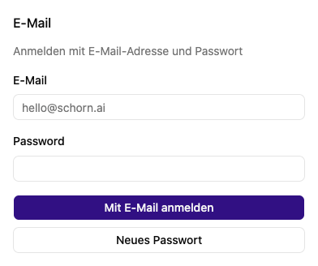

# Anmelden und abmelden

Öffne die Instanzadresse, die dir deine Organisation gegeben hat. Ohne aktive Sitzung erscheint die Anmeldung. Wenn dir die Adresse fehlt, frage die Administration deiner Organisation.

## Mit E-Mail und Passwort anmelden

1. Trage im Bereich **E-Mail** deine E-Mail-Adresse und dein Passwort ein.
2. Wähle **Mit E-Mail anmelden**.
3. Nach erfolgreicher Anmeldung öffnet sich die App beziehungsweise die zuvor aufgerufene Seite.

Neue lokale Konten werden von der Administration angelegt. Es gibt keine allgemeine Selbstregistrierung. Wenn du einen Reset-Schlüssel erhalten hast, lege zunächst unter [Passwort zurücksetzen](reset.md) dein Passwort fest.

## Mit SSO anmelden

Wenn deine Organisation Single Sign-on eingerichtet hat, erscheint **Mit … anmelden**. Klicke darauf und schließe die Anmeldung beim angezeigten Anbieter ab. Dein Organisationskonto und dessen Anmelderegeln gelten dort weiter. Ein SSO-Passwort änderst du beim Anbieter deiner Organisation.

Die Instanz kann den Passwort- oder SSO-Bereich ausblenden. Die Administration kann die alternative Ansicht über `/signin?method=password` beziehungsweise `/signin?method=sso` öffnen. Für SSO muss ein Anbieter eingerichtet sein.

## Angemeldet, aber keine Inhalte?

Prüfe [Profil → Berechtigungen](../me/permissions.md) und bitte deine Administration um die passende Zuweisung. Nach einer Rollenänderung kann eine erneute Anmeldung nötig sein.

## Abmelden

Öffne das Kontomenü im unteren Bereich der Seitenleiste und wähle **Abmelden**. Wenn du die Anmeldeseite mit einer bestehenden Sitzung öffnest, zeigt sie stattdessen dein bereits angemeldetes Konto. Auf gemeinsam genutzten Geräten solltest du dich nach der Arbeit abmelden.

Weiter: [Passwort festlegen](reset.md) · [Erste Schritte](../index.md) · [Anmeldeprobleme](../hilfe/fehlerbehebung.md)
