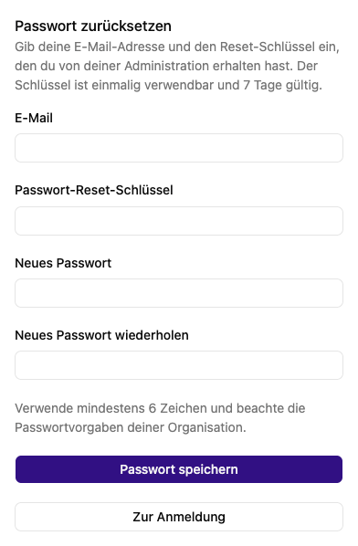

# Passwort festlegen oder zurücksetzen

Für ein lokales Konto benötigst du deine E-Mail-Adresse und einen **Passwort-Reset-Schlüssel** von der Administration. Der Schlüssel ist einmal verwendbar und **sieben Tage gültig**. Es wird bei der Kontoanlage keine automatische E-Mail verschickt.

## Passwort setzen

1. Wähle auf der Anmeldeseite **Neues Passwort** oder öffne `/signin/reset`.
2. Trage die E-Mail-Adresse des Kontos ein.
3. Füge den erhaltenen Reset-Schlüssel ein.
4. Gib dein neues Passwort zweimal ein. Es muss mindestens sechs Zeichen lang sein und zusätzlich den Vorgaben deiner Organisation entsprechen.
5. Wähle **Passwort speichern**.
6. Nach der Erfolgsmeldung wechselst du über **Zur Anmeldung** zurück und meldest dich mit dem neuen Passwort an.

Behandle den Reset-Schlüssel bis zur Einlösung wie ein Passwort: Wer ihn zusammen mit deiner E-Mail-Adresse hat, kann ein neues Passwort für dein Konto setzen.

## Wenn das Zurücksetzen fehlschlägt

Prüfe E-Mail-Adresse, vollständigen Schlüssel und die Übereinstimmung der beiden Passwörter. Ist der Schlüssel abgelaufen, verloren oder bereits verwendet, bitte die globale Administration um einen neuen. Sie kann ihn unter **Einstellungen → Benutzer:innen → dein Konto → Bearbeiten → Passwort zurücksetzen** ausstellen. Du erhältst den Schlüssel direkt von ihr; die App verschickt keine Reset-E-Mail.

Bei SSO-Konten ist der Anmeldeanbieter für das Passwort zuständig. Verwende dort den von deiner Organisation vorgesehenen Ablauf.

Die zusätzliche Seite [Neues Passwort gesetzt](../me/reset-password-success.md) ist eine Bestätigungsseite für einen anderen Passwortablauf. Der hier beschriebene Schlüsselablauf bestätigt den Erfolg direkt auf `/signin/reset`.

## Zugehörige MCP-Werkzeuge

- `platform_profile_password_reset`: Eigenes Passwort mit gültigem Reset-Schlüssel setzen. Mindeststufe: **Benutzer**.
- `platform_user_reset_key`: Einmaligen Reset-Schlüssel neu ausstellen. Mindeststufe: **Globaler Administrator**.

Jeder Aufruf prüft zusätzlich die Berechtigung für das eigene Konto bzw. die betroffene Ressource. Die Zugriffsstufe verleiht keine Rechte. Voraussetzungen, besondere Grenzen und der vollständige Werkzeugkatalog stehen unter [Plattformzugriff](../agent/edit/plattformzugriff.md).
