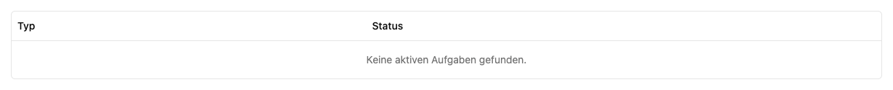

# Aufgabenstapel beobachten

Der **Aufgabenstapel** zeigt Hintergrundarbeit der Instanz. Er ist eine technische Statusansicht für Administrator:innen und unterscheidet sich vom persönlichen [Verlauf](../activity/index.md).

Öffne **Cluster → Aufgabenstapel** in der Verwaltungsnavigation. Die Tabelle aktualisiert sich über die laufende Verbindung. Wenn keine Aufgaben vorliegen, erscheint **Keine aktiven Aufgaben gefunden**.

Diese Ansicht ist nur lesbar. Starte Chat-Anfragen, Dateiverarbeitung oder Transkriptionen in den jeweiligen App-Bereichen.

## Typen einordnen

| Typ                                    | Bedeutung                                            |
| -------------------------------------- | ---------------------------------------------------- |
| `chat`                                 | Bearbeitung eines Gesprächsschritts                  |
| `agent-select-role`                    | Auswahl einer passenden Agentenrolle                 |
| `model-do-generate`, `model-do-stream` | Modellausgabe, gegebenenfalls fortlaufend übertragen |
| `model-do-embed`                       | Berechnung für semantische Verarbeitung              |
| `process-file`                         | Verarbeitung einer Datei zu lesbarem Inhalt          |
| `transcribe`                           | Verschriftlichung von Audio oder Video               |

## Zustände einordnen

| Status     | Bedeutung                                          |
| ---------- | -------------------------------------------------- |
| `pending`  | Wartet auf Übernahme                               |
| `claimed`  | Wurde von einer Verarbeitungskomponente übernommen |
| `finished` | Abgeschlossen                                      |
| `aborting` | Abbruch wurde angefordert                          |
| `aborted`  | Abgebrochen                                        |
| `error`    | Fehler bei der Verarbeitung                        |

Aufgaben lassen sich hier nicht löschen, neu starten oder priorisieren. Einen Chat brichst du im Gespräch ab; eine Datei startest du über ihr Aktionsmenü mit **Erneut verarbeiten** neu.

Bleibt eine Aufgabe auf `pending`, prüfe die benötigten Dienste: Realtime und Modellserver für Chats, Tika für Dokumentextraktion, Mac-Transcriber und Whisper-Modell für Audio/Video. Bei `error` öffne den betroffenen Chat oder die Datei und lies die Fehlermeldung. Notiere Typ, Status, Zeitpunkt und Ressourcenadresse und suche damit in den [Box-Admin-Protokollen](../box-admin/index.md).

## Nach einem Worker-Absturz

Eine übernommene Aufgabe muss regelmäßig ein Lebenszeichen melden. Bleibt es
90 Sekunden aus, wird die Aufgabe beim nächsten Wiederherstellungslauf als
`error` markiert. Diese Prüfung läuft bei verbundenem Aufgabenstapel alle
10 Sekunden und nach dessen Laden. Dafür müssen Realtime-Server und Datenbank
erreichbar sein; ein Ausfall kann die Wiederherstellung verzögern.

Ein betroffener Chat wird wieder freigegeben, noch wartende Texte seines
Nachrichtenstapels werden pausiert. Die unterbrochene Aufgabe startet nicht
automatisch erneut. Prüfe den bisherigen Gesprächsverlauf und bereits ausgeführte
Werkzeugaktionen, bevor du eine Anfrage erneut sendest oder eine Datei erneut
verarbeiten lässt. Externe Aktionen werden durch den Absturz nicht rückgängig
gemacht.

## Aufbewahrung

Der Aufgabenstapel ist kein dauerhaftes Archiv. Abgeschlossene, abgebrochene und
fehlgeschlagene Aufgaben werden regelmäßig bereinigt: Einträge ab 24 Stunden
werden entfernt, darüber hinaus bleiben die neuesten 1.000 erhalten. Ergebnisse
und Abbruchbestätigungen sind während der ersten fünf Minuten geschützt; dadurch
kann die Anzahl vorübergehend höher sein. Laufende und wartende Aufgaben bleiben
erhalten. Erfolgreiche Aufgaben können schon früher verschwinden, sobald ihr
aufrufender Dienst das Ergebnis abgeholt hat.

Die Bereinigung läuft bei geladenem Aufgabenstapel etwa einmal pro Minute.
Gesprächsverläufe und Dateien bleiben davon unberührt. Bleibt ein empfangender
Dienst länger getrennt, kann sein Ergebnis inzwischen abgelaufen sein; er meldet
dann einen Fehler, statt unbegrenzt darauf zu warten.
